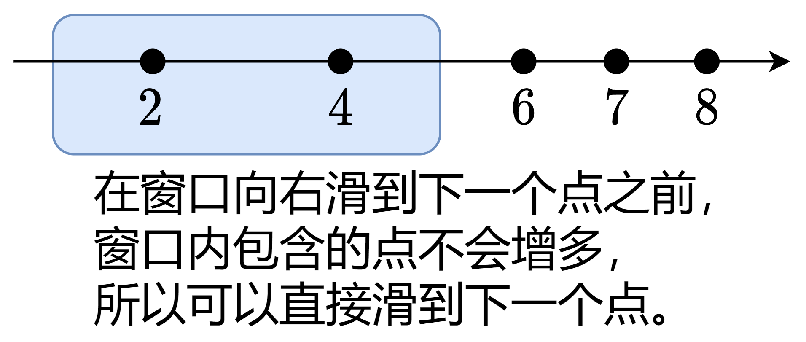

# 正难则反 + 滑动窗口（Python/Java/C++/C/Go/JS/Rust）

> **[2009. 使数组连续的最少操作数](https://leetcode.cn/problems/minimum-number-of-operations-to-make-array-continuous/solutions/1005398/on-zuo-fa-by-endlesscheng-l7yi/) · Hard · 难度分 2084**

> **所属题单**
> - [滑动窗口与双指针 · 二、不定长滑动窗口](../../../刷题路径/灵神原版题单/滑动窗口与双指针/二、不定长滑动窗口.md) · §2.1 越短越合法/求最长/最大 · §2.1.2 进阶（选做）

> **题目描述**
> 给你一个整数数组 `nums` 。每一次操作中，你可以将 `nums` 中 **任意** 一个元素替换成 **任意** 整数。
>
> 如果 `nums` 满足以下条件，那么它是 **连续的** ：
>
> - `nums` 中所有元素都是 **互不相同** 的。
>
> - `nums` 中 **最大** 元素与 **最小** 元素的差等于 `nums.length - 1` 。
>
> 比方说，`nums = [4, 2, 5, 3]` 是 **连续的** ，但是 `nums = [1, 2, 3, 5, 6]` **不是连续的** 。
>
> 请你返回使 `nums` **连续** 的 **最少** 操作次数。
>
> **示例 1：**
>
> ```
> 输入：nums = [4,2,5,3]
> 输出：0
> 解释：nums 已经是连续的了。
> ```
>
> **示例 2：**
>
> ```
> 输入：nums = [1,2,3,5,6]
> 输出：1
> 解释：一个可能的解是将最后一个元素变为 4 。
> 结果数组为 [1,2,3,5,4] ，是连续数组。
> ```
>
> **示例 3：**
>
> ```
> 输入：nums = [1,10,100,1000]
> 输出：3
> 解释：一个可能的解是：
> - 将第二个元素变为 2 。
> - 将第三个元素变为 3 。
> - 将第四个元素变为 4 。
> 结果数组为 [1,2,3,4] ，是连续数组。
> ```
>
> **提示：**
>
> - `1 <= nums.length <= 10⁵`
>
> - `1 <= nums[i] <= 10⁹`

> **题解**
> 正难则反，考虑最多**保留**多少个元素不变。
>
> 根据题意，$[1,2,3]$ 和 $[2,3,1]$ 都被认为是连续的，所以元素位置不影响答案，我们可以先把 $\textit{nums}$ 从小到大排序，方便思考。
>
> 题目要求所有元素互不相同，对于 $\textit{nums}$ 中的相同元素，至多保留其中一个。
>
> 设 $a$ 为 $\textit{nums}$ 排序去重后的数组。把 $a[i]$ 画在数轴上，由于最终形成的连续数组的长度为 $n$，所以相当于有一个长度为 $n$ 的滑动窗口，**窗口内的点保留不变，窗口外的点需要改变，填在窗口内的空位上**。
>
> 考虑最多保留多少个元素不变，问题为：
>
> - 计算长度固定为 $n$ 的窗口内最多可以包含多少个点。
>
> 然而，任意整数都可以是窗口的右端点，我们该如何枚举？
>
> 
>
> **定理**：只需要枚举 $a[i]$ 作为窗口的右端点。
>
> **证明**：在窗口从左向右滑动的过程中，如果窗口右端点处没有点，那么继续滑动，在滑到下一个点之前，窗口内包含的点的个数是不会增多的。
>
> 为了算出窗口内有多少个点，我们需要知道窗口包含的最左边的点在哪，设这个点的位置是 $\textit{a}[\textit{left}]$，则它必须大于等于窗口的左边界，即
>
> $$
> a[\textit{left}]\ge a[\textit{i}]-n+1
> $$
>
> 此时窗口内有 $\textit{i}-\textit{left}+1$ 个点，取其最大值，就得到了最多保留不变的元素个数。最后用 $n$ 减去保留不变的元素个数，就得到了答案。
>
> 关于滑动窗口算法，请看视频[【基础算法精讲 03】](https://www.bilibili.com/video/BV1hd4y1r7Gq/)。
>
> 关于原地去重算法，请参考 [26. 删除有序数组中的重复项](https://leetcode.cn/problems/remove-duplicates-from-sorted-array/)。
>
> ```python
> class Solution:
>     def minOperations(self, nums: List[int]) -> int:
>         n = len(nums)
>         nums = sorted(set(nums))  # 去重排序
>
>         ans = left = 0
>         for i, x in enumerate(nums):
>             while nums[left] < x - n + 1:  # nums[left] 不在窗口中
>                 left += 1
>             ans = max(ans, i - left + 1)
>         return n - ans
> ```
>
>
> #### 复杂度分析
>
> - 时间复杂度：$\mathcal{O}(n\log n)$，其中 $n$ 为 $\textit{nums}$ 的长度。瓶颈在排序上。
> - 空间复杂度：使用哈希表去重为 $\mathcal{O}(n)$，原地去重为 $\mathcal{O}(1)$（忽略排序时的栈开销）。
>
> ## 相似题目
>
> - [1040. 移动石子直到连续 II](https://leetcode.cn/problems/moving-stones-until-consecutive-ii/)，[我的图解](../../1000-1099/1040%20移动石子直到连续%20II/灵茶山艾府.md)
>
> ## 分类题单
>
> [如何科学刷题？](https://leetcode.cn/circle/discuss/RvFUtj/)
>
> 1. [滑动窗口与双指针（定长/不定长/单序列/双序列/三指针/分组循环）](https://leetcode.cn/circle/discuss/0viNMK/)
> 2. [二分算法（二分答案/最小化最大值/最大化最小值/第K小）](https://leetcode.cn/circle/discuss/SqopEo/)
> 3. [单调栈（基础/矩形面积/贡献法/最小字典序）](https://leetcode.cn/circle/discuss/9oZFK9/)
> 4. [网格图（DFS/BFS/综合应用）](https://leetcode.cn/circle/discuss/YiXPXW/)
> 5. [位运算（基础/性质/拆位/试填/恒等式/思维）](https://leetcode.cn/circle/discuss/dHn9Vk/)
> 6. [图论算法（DFS/BFS/拓扑排序/基环树/最短路/最小生成树/网络流）](https://leetcode.cn/circle/discuss/01LUak/)
> 7. [动态规划（入门/背包/划分/状态机/区间/状压/数位/数据结构优化/树形/博弈/概率期望）](https://leetcode.cn/circle/discuss/tXLS3i/)
> 8. [常用数据结构（前缀和/差分/栈/队列/堆/字典树/并查集/树状数组/线段树）](https://leetcode.cn/circle/discuss/mOr1u6/)
> 9. [数学算法（数论/组合/概率期望/博弈/计算几何/随机算法）](https://leetcode.cn/circle/discuss/IYT3ss/)
> 10. [贪心与思维（基本贪心策略/反悔/区间/字典序/数学/思维/脑筋急转弯/构造）](https://leetcode.cn/circle/discuss/g6KTKL/)
> 11. [链表、树与回溯（前后指针/快慢指针/DFS/BFS/直径/LCA）](https://leetcode.cn/circle/discuss/K0n2gO/)
> 12. [字符串（KMP/Z函数/Manacher/字符串哈希/AC自动机/后缀数组/子序列自动机）](https://leetcode.cn/circle/discuss/SJFwQI/)
>
> [我的题解精选（已分类）](https://github.com/EndlessCheng/codeforces-go/blob/master/leetcode/SOLUTIONS.md)
>
> 欢迎关注 [B站@灵茶山艾府](https://space.bilibili.com/206214)
