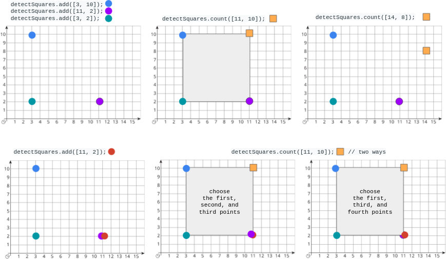

# 2013. 检测正方形

Medium · [力扣原题](https://leetcode.cn/problems/detect-squares/)

| 作者 | 题解 | 动画讲解 |
|---|---|---|
| 灵茶山艾府 | [📄 题解](灵茶山艾府.md) | [▶︎ 动画（GIF）](2013%20检测正方形%20·%20灵茶山艾府.gif) · [mp4 文件](2013%20检测正方形%20·%20灵茶山艾府.mp4) |
| yiduobo | [📄 题解](yiduobo.md) | [▶︎ 动画（GIF）](2013%20检测正方形%20·%20yiduobo.gif) · [mp4 文件](2013%20检测正方形%20·%20yiduobo.mp4) |

## 动画讲解

> 动图会循环播放；想暂停、拖进度条请下载上面表格里的 mp4 文件。

### 灵茶山艾府


### yiduobo


## 题目描述

给你一个在 X-Y 平面上的点构成的数据流。设计一个满足下述要求的算法：

- **添加** 一个在数据流中的新点到某个数据结构中**。**可以添加 **重复** 的点，并会视作不同的点进行处理。

- 给你一个查询点，请你从数据结构中选出三个点，使这三个点和查询点一同构成一个 **面积为正** 的 **轴对齐正方形** ，**统计** 满足该要求的方案数目**。**

**轴对齐正方形** 是一个正方形，除四条边长度相同外，还满足每条边都与 x-轴 或 y-轴 平行或垂直。

实现 `DetectSquares` 类：

- `DetectSquares()` 使用空数据结构初始化对象

- `void add(int[] point)` 向数据结构添加一个新的点 `point = [x, y]`

- `int count(int[] point)` 统计按上述方式与点 `point = [x, y]` 共同构造 **轴对齐正方形** 的方案数。

**示例：**



```

输入：
["DetectSquares", "add", "add", "add", "count", "count", "add", "count"]
[[], [[3, 10]], [[11, 2]], [[3, 2]], [[11, 10]], [[14, 8]], [[11, 2]], [[11, 10]]]
输出：
[null, null, null, null, 1, 0, null, 2]

解释：
DetectSquares detectSquares = new DetectSquares();
detectSquares.add([3, 10]);
detectSquares.add([11, 2]);
detectSquares.add([3, 2]);
detectSquares.count([11, 10]); // 返回 1 。你可以选择：
                               //   - 第一个，第二个，和第三个点
detectSquares.count([14, 8]);  // 返回 0 。查询点无法与数据结构中的这些点构成正方形。
detectSquares.add([11, 2]);    // 允许添加重复的点。
detectSquares.count([11, 10]); // 返回 2 。你可以选择：
                               //   - 第一个，第二个，和第三个点
                               //   - 第一个，第三个，和第四个点
```

**提示：**

- `point.length == 2`

- `0 <= x, y <= 1000`

- 调用 `add` 和 `count` 的 **总次数** 最多为 `5000`

---
[↑ 返回 2000-2099](../README.md) · [总索引](../../../索引.md) · [仓库首页](../../../README.md)
