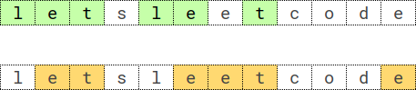

# 枚举排列 + 判断子序列（Python/Java/C++/Go）

> **[2014. 重复 K 次的最长子序列](https://leetcode.cn/problems/longest-subsequence-repeated-k-times/solutions/1006067/mei-ju-pai-lie-zi-xu-lie-pi-pei-by-endle-oi2h/) · Hard · 难度分 2558**

> **所属题单**
> - [链表、二叉树与回溯 · 四、回溯](../../../刷题路径/灵神原版题单/链表、二叉树与回溯/四、回溯.md) · §4.6 有重复元素的回溯
> - [字符串 · 九、子序列自动机](../../../刷题路径/灵神原版题单/字符串/九、子序列自动机.md)

> **题目描述**
> 给你一个长度为 `n` 的字符串 `s` ，和一个整数 `k` 。请你找出字符串 `s` 中 **重复** `k` 次的 **最长子序列** 。
>
> **子序列** 是由其他字符串删除某些（或不删除）字符派生而来的一个字符串。
>
> 如果 `seq * k` 是 `s` 的一个子序列，其中 `seq * k` 表示一个由 `seq` 串联 `k` 次构造的字符串，那么就称 `seq` 是字符串 `s` 中一个 **重复 `k` 次** 的子序列。
>
> - 举个例子，`"bba"` 是字符串 `"bababcba"` 中的一个重复 `2` 次的子序列，因为字符串 `"bbabba"` 是由 `"bba"` 串联 `2` 次构造的，而 `"bbabba"` 是字符串 `"bababcba"` 的一个子序列。
>
> 返回字符串 `s` 中 **重复 k 次的最长子序列**  。如果存在多个满足的子序列，则返回 **字典序最大** 的那个。如果不存在这样的子序列，返回一个 **空** 字符串。
>
> **示例 1：**
>
> 
>
> ```
>
> 输入：s = "letsleetcode", k = 2
> 输出："let"
> 解释：存在两个最长子序列重复 2 次：let" 和 "ete" 。
> "let" 是其中字典序最大的一个。
> ```
>
> **示例 2：**
>
> ```
>
> 输入：s = "bb", k = 2
> 输出："b"
> 解释：重复 2 次的最长子序列是 "b" 。
> ```
>
> **示例 3：**
>
> ```
>
> 输入：s = "ab", k = 2
> 输出：""
> 解释：不存在重复 2 次的最长子序列。返回空字符串。
> ```
>
> **提示：**
>
> - `n == s.length`
>
> - `2 <= k <= 2000`
>
> - `2 <= n < min(2001, k * 8)`
>
> - `s` 由小写英文字母组成

> **题解**
> ## 分析
>
> 如果 $\textit{seq} * k$ 是 $s$ 的子序列，必须满足：
>
> - $\textit{seq}$ 中的每个字母在 $s$ 中至少出现 $k$ 次。
>
> 示例 1 的 $s=\texttt{letsleetcode}$，$k=2$，其中 $\texttt{s},\texttt{c},\texttt{o},\texttt{d}$ 这些只出现一次的字母，一定不在 $\textit{seq}$ 中（因为 $\textit{seq}$ 要重复 $k=2$ 次，$1$ 个字母无法重复 $2$ 次）。只有 $\texttt{l},\texttt{e},\texttt{t}$ 这些至少出现 $k$ 次的字母，才可能在 $\textit{seq}$ 中。
>
> 分析到这里，题目的这个奇怪的数据范围 $n < 8k$ 就有用了。
>
> 设有 $x$ 个字母至少出现 $k$ 次，那么
>
> $$
> kx\le n
> $$
>
> 即
>
> $$
> x \le \dfrac{n}{k} < 8
> $$
>
> 所以至多有 $7$ 个字母至少出现 $k$ 次。
>
> ## 枚举排列
>
> 枚举从 $7$ 个字母中选出 $i=1,2,3,4,5,6,7$ 个字母的排列，枚举次数为
>
> $$
> A_7^1 + A_7^2 + A_7^3 + A_7^4 + A_7^5 + A_7^6 + A_7^7 = 13699
> $$
>
> 这不多，在时间范围内可以接受。
>
> 在示例 1 中，至少出现 $k=2$ 次的字母有 $\texttt{l},\texttt{e},\texttt{t}$。其中字母 $\texttt{e}$ 出现了 $4$ 次，这意味着 $\textit{seq}$ 中可以有 $\left\lfloor\dfrac{4}{k}\right\rfloor=2$ 个 $\texttt{e}$。所以我们枚举的是 $a=[\texttt{l},\texttt{e},\texttt{e},\texttt{t}]$ 的 [47. 全排列 II](https://leetcode.cn/problems/permutations-ii/)，[我的题解](../../0000-0099/0047%20全排列%20II/灵茶山艾府.md)。注意排列中有重复元素。
>
> ## 判断子序列
>
> 设当前枚举的排列为 $\textit{seq}$，我们需要判断 $\textit{seq} * k$ 是否为 $s$ 的子序列。
>
> 做法见 [392. 判断子序列](https://leetcode.cn/problems/is-subsequence/)，[我的题解](../../0300-0399/0392%20判断子序列/灵茶山艾府.md)。
>
> ## 优化前
>
> ```python
> class Solution:
>     # 392. 判断子序列
>     # 返回 seq 是否为 s 的子序列
>     def isSubsequence(self, seq: str, s: str) -> bool:
>         it = iter(s)
>         return all(c in it for c in seq)  # in 会消耗迭代器
>
>     def longestSubsequenceRepeatedK(self, s: str, k: int) -> str:
>         cnt = Counter(s)
>         a = [ch for ch, freq in cnt.items() for _ in range(freq // k)]
>         a.sort(reverse=True)  # 排序后，下面会按照字典序从大到小枚举排列
>
>         for i in range(len(a), 0, -1):  # 长的优先
>             for perm in permutations(a, i):  # 枚举 a 的长为 i 的排列
>                 seq = ''.join(perm)
>                 if self.isSubsequence(seq * k, s):  # seq*k 是 s 的子序列
>                     return seq
>         return ''
> ```
>
>
> ## 优化：子序列自动机
>
> 用 392 题的进阶做法（子序列自动机），原理见 [我的题解](../../0300-0399/0392%20判断子序列/灵茶山艾府.md)。
>
> ```python
> class Solution:
>     def longestSubsequenceRepeatedK(self, s: str, k: int) -> str:
>         s = [ord(c) - ord('a') for c in s]  # 转成 0 到 25，这样下面无需频繁调用 ord
>
>         # 392. 判断子序列（进阶做法）
>         n = len(s)
>         nxt = [[n] * 26 for _ in range(n + 1)]
>         for i in range(n - 1, -1, -1):
>             nxt[i][:] = nxt[i + 1]
>             nxt[i][s[i]] = i
>
>         def isSubsequence(seq: Tuple[int, ...]) -> bool:
>             i = -1
>             for _ in range(k):
>                 for c in seq:
>                     i = nxt[i + 1][c]
>                     if i == n:  # c 不在 s 中，说明 seq*k 不是 s 的子序列
>                         return False
>             return True  # seq*k 是 s 的子序列
>
>         cnt = Counter(s)
>         a = [ch for ch, freq in cnt.items() for _ in range(freq // k)]
>         a.sort(reverse=True)  # 排序后，下面会按照字典序从大到小枚举排列
>
>         for i in range(len(a), 0, -1):  # 长的优先
>             for seq in permutations(a, i):  # 枚举 a 的长为 i 的排列
>                 if isSubsequence(seq):  # seq*k 是 s 的子序列
>                     return ''.join(ascii_lowercase[c] for c in seq)
>         return ''
> ```
>
>
> #### 复杂度分析
>
> - 时间复杂度：$\mathcal{O}((n/k)!\cdot n)$，其中 $n$ 是 $s$ 的长度。注意 $\sum_{i=0}^m A_m^i$ 就是全排列搜索树的节点个数，我在 [排列型回溯【基础算法精讲 16】](https://www.bilibili.com/video/BV1mY411D7f6/)中精确地算出了全排列搜索树的节点个数为 $\left\lfloor e\cdot m!\right\rfloor$，其中 $e=2.718\cdots$ 为自然常数。比如 $m=7$ 时，$\sum_{i=0}^7 A_7^i = 13700 = \left\lfloor e\cdot 7!\right\rfloor$。当 $m=n/k$ 时，遍历这棵搜索树需要 $\mathcal{O}((n/k)!)$ 的时间，每个节点判断子序列需要 $\mathcal{O}(n)$ 的时间。
> - 空间复杂度：$\mathcal{O}(n|\Sigma|)$。其中 $|\Sigma|=26$ 是字符集合的大小。
>
> ## 相似题目
>
> 1. 回溯题单的「**§4.5 排列型回溯**」。
> 2. 双指针题单的「**§4.2 判断子序列**」。
> 3. 字符串题单的「**九、子序列自动机**」。
>
> ## 分类题单
>
> [如何科学刷题？](https://leetcode.cn/circle/discuss/RvFUtj/)
>
> 1. [滑动窗口与双指针（定长/不定长/单序列/双序列/三指针/分组循环）](https://leetcode.cn/circle/discuss/0viNMK/)
> 2. [二分算法（二分答案/最小化最大值/最大化最小值/第K小）](https://leetcode.cn/circle/discuss/SqopEo/)
> 3. [单调栈（基础/矩形面积/贡献法/最小字典序）](https://leetcode.cn/circle/discuss/9oZFK9/)
> 4. [网格图（DFS/BFS/综合应用）](https://leetcode.cn/circle/discuss/YiXPXW/)
> 5. [位运算（基础/性质/拆位/试填/恒等式/思维）](https://leetcode.cn/circle/discuss/dHn9Vk/)
> 6. [图论算法（DFS/BFS/拓扑排序/基环树/最短路/最小生成树/网络流）](https://leetcode.cn/circle/discuss/01LUak/)
> 7. [动态规划（入门/背包/划分/状态机/区间/状压/数位/数据结构优化/树形/博弈/概率期望）](https://leetcode.cn/circle/discuss/tXLS3i/)
> 8. [常用数据结构（前缀和/差分/栈/队列/堆/字典树/并查集/树状数组/线段树）](https://leetcode.cn/circle/discuss/mOr1u6/)
> 9. [数学算法（数论/组合/概率期望/博弈/计算几何/随机算法）](https://leetcode.cn/circle/discuss/IYT3ss/)
> 10. [贪心与思维（基本贪心策略/反悔/区间/字典序/数学/思维/脑筋急转弯/构造）](https://leetcode.cn/circle/discuss/g6KTKL/)
> 11. [链表、二叉树与回溯（前后指针/快慢指针/DFS/BFS/直径/LCA/一般树）](https://leetcode.cn/circle/discuss/K0n2gO/)
> 12. [字符串（KMP/Z函数/Manacher/字符串哈希/AC自动机/后缀数组/子序列自动机）](https://leetcode.cn/circle/discuss/SJFwQI/)
>
> [我的题解精选（已分类）](https://github.com/EndlessCheng/codeforces-go/blob/master/leetcode/SOLUTIONS.md)
>
> 欢迎关注 [B站@灵茶山艾府](https://space.bilibili.com/206214)
