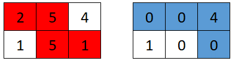
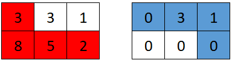
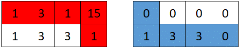

# 枚举第一个机器人的拐弯位置

> **[2017. 网格游戏](https://leetcode.cn/problems/grid-game/solutions/1018266/mei-ju-di-yi-ge-ji-qi-ren-de-guai-wan-we-prfy/) · Medium**

> **题目描述**
> 给你一个下标从 **0** 开始的二维数组 `grid` ，数组大小为 `2 x n` ，其中 `grid[r][c]` 表示矩阵中 `(r, c)` 位置上的点数。现在有两个机器人正在矩阵上参与一场游戏。
>
> 两个机器人初始位置都是 `(0, 0)` ，目标位置是 `(1, n-1)` 。每个机器人只会 **向右** (`(r, c)` 到 `(r, c + 1)`) 或 **向下** (`(r, c)` 到 `(r + 1, c)`) 。
>
> 游戏开始，**第一个** 机器人从 `(0, 0)` 移动到 `(1, n-1)` ，并收集路径上单元格的全部点数。对于路径上所有单元格 `(r, c)` ，途经后 `grid[r][c]` 会重置为 `0` 。然后，**第二个** 机器人从 `(0, 0)` 移动到 `(1, n-1)` ，同样收集路径上单元的全部点数。注意，它们的路径可能会存在相交的部分。
>
> **第一个** 机器人想要打击竞争对手，使 **第二个** 机器人收集到的点数 **最小化** 。与此相对，**第二个** 机器人想要 **最大化** 自己收集到的点数。两个机器人都发挥出自己的 **最佳水平** 的前提下，返回 **第二个** 机器人收集到的 **点数** <em>。</em>
>
> **示例 1：**
>
> 
>
> ```
>
> 输入：grid = [[2,5,4],[1,5,1]]
> 输出：4
> 解释：第一个机器人的最佳路径如红色所示，第二个机器人的最佳路径如蓝色所示。
> 第一个机器人访问过的单元格将会重置为 0 。
> 第二个机器人将会收集到 0 + 0 + 4 + 0 = 4 个点。
> ```
>
> **示例 2：**
>
> 
>
> ```
>
> 输入：grid = [[3,3,1],[8,5,2]]
> 输出：4
> 解释：第一个机器人的最佳路径如红色所示，第二个机器人的最佳路径如蓝色所示。
> 第一个机器人访问过的单元格将会重置为 0 。
> 第二个机器人将会收集到 0 + 3 + 1 + 0 = 4 个点。
> ```
>
> **示例 3：**
>
> 
>
> ```
>
> 输入：grid = [[1,3,1,15],[1,3,3,1]]
> 输出：7
> 解释：第一个机器人的最佳路径如红色所示，第二个机器人的最佳路径如蓝色所示。
> 第一个机器人访问过的单元格将会重置为 0 。
> 第二个机器人将会收集到 0 + 1 + 3 + 3 + 0 = 7 个点。
> ```
>
> **提示：**
>
> - `grid.length == 2`
>
> - `n == grid[r].length`
>
> - `1 <= n <= 5 * 10⁴`
>
> - `1 <= grid[r][c] <= 10⁵`

> **题解**
> 由于矩阵只有两行，我们可以枚举第一个机器人的拐弯位置，于是剩余的点数被划分成了两部分，即第一行的后缀和第二行的前缀，另一个机器人只能在这两部分中取最大值。为了最小化第二个机器人收集的点数，取所有最大值中的最小值，即为答案。
>
>
> - 时间复杂度：$O(n)$。
> - 空间复杂度：$O(1)$。
