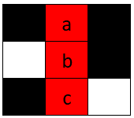
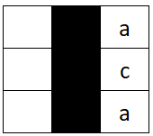
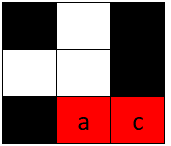

# 2018. 判断单词是否能放入填字游戏内

Medium · [力扣原题](https://leetcode.cn/problems/check-if-word-can-be-placed-in-crossword/)

| 作者 | 题解 | 动画讲解 |
|---|---|---|
| 灵茶山艾府 | [📄 题解](灵茶山艾府.md) | — |
| yiduobo | [📄 题解](yiduobo.md) | [▶︎ 2018 判断单词是否能放入填字游戏内 · yiduobo.mp4](2018%20判断单词是否能放入填字游戏内%20·%20yiduobo.mp4) |

## 题目描述

给你一个 `m x n` 的矩阵 `board` ，它代表一个填字游戏 **当前** 的状态。填字游戏格子中包含小写英文字母（已填入的单词），表示 **空** 格的 `' '` 和表示 **障碍** 格子的 `'#'` 。

如果满足以下条件，那么我们可以 **水平** （从左到右 **或者** 从右到左）或 **竖直** （从上到下 **或者** 从下到上）填入一个单词：

- 该单词不占据任何 `'#'` 对应的格子。

- 每个字母对应的格子要么是 `' '` （空格）要么与 `board` 中已有字母 **匹配** 。

- 如果单词是 **水平** 放置的，那么该单词左边和右边 **相邻** 格子不能为 `' '` 或小写英文字母。

- 如果单词是 **竖直** 放置的，那么该单词上边和下边 **相邻** 格子不能为 `' '` 或小写英文字母。

给你一个字符串 `word` ，如果 `word` 可以被放入 `board` 中，请你返回 `true` ，否则请返回 `false` 。

**示例 1：**



```

输入：board = [["#", " ", "#"], [" ", " ", "#"], ["#", "c", " "]], word = "abc"
输出：true
解释：单词 "abc" 可以如上图放置（从上往下）。
```

**示例 2：**



```

输入：board = [[" ", "#", "a"], [" ", "#", "c"], [" ", "#", "a"]], word = "ac"
输出：false
解释：无法放置单词，因为放置该单词后上方或者下方相邻格会有空格。
```

**示例 3：**



```

输入：board = [["#", " ", "#"], [" ", " ", "#"], ["#", " ", "c"]], word = "ca"
输出：true
解释：单词 "ca" 可以如上图放置（从右到左）。
```

**提示：**

- `m == board.length`

- `n == board[i].length`

- `1 <= m * n <= 2 * 10⁵`

- `board[i][j]` 可能为 `' '` ，`'#'` 或者一个小写英文字母。

- `1 <= word.length <= max(m, n)`

- `word` 只包含小写英文字母。

---
[↑ 返回 2000-2099](../README.md) · [总索引](../../../索引.md) · [仓库首页](../../../README.md)
