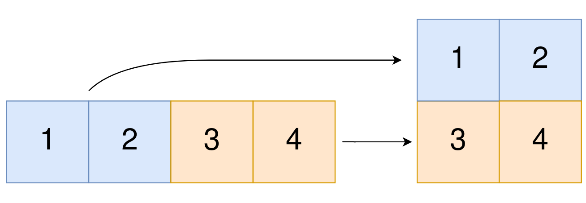

# Go 模拟

> **[2022. 将一维数组转变成二维数组](https://leetcode.cn/problems/convert-1d-array-into-2d-array/solutions/1028599/go-mo-ni-by-endlesscheng-t3a5/) · Easy**

> **题目描述**
> 给你一个下标从 **0** 开始的一维整数数组 `original` 和两个整数 `m` 和  `n` 。你需要使用 `original` 中 **所有** 元素创建一个 `m` 行 `n` 列的二维数组。
>
> `original` 中下标从 `0` 到 `n - 1` （都 **包含** ）的元素构成二维数组的第一行，下标从 `n` 到 `2 * n - 1` （都 **包含** ）的元素构成二维数组的第二行，依此类推。
>
> 请你根据上述过程返回一个 `m x n` 的二维数组。如果无法构成这样的二维数组，请你返回一个空的二维数组。
>
> **示例 1：**
>
> 
>
> ```
> 输入：original = [1,2,3,4], m = 2, n = 2
> 输出：[[1,2],[3,4]]
> 解释：
> 构造出的二维数组应该包含 2 行 2 列。
> original 中第一个 n=2 的部分为 [1,2] ，构成二维数组的第一行。
> original 中第二个 n=2 的部分为 [3,4] ，构成二维数组的第二行。
> ```
>
> **示例 2：**
>
> ```
> 输入：original = [1,2,3], m = 1, n = 3
> 输出：[[1,2,3]]
> 解释：
> 构造出的二维数组应该包含 1 行 3 列。
> 将 original 中所有三个元素放入第一行中，构成要求的二维数组。
> ```
>
> **示例 3：**
>
> ```
> 输入：original = [1,2], m = 1, n = 1
> 输出：[]
> 解释：
> original 中有 2 个元素。
> 无法将 2 个元素放入到一个 1x1 的二维数组中，所以返回一个空的二维数组。
> ```
>
> **示例 4：**
>
> ```
> 输入：original = [3], m = 1, n = 2
> 输出：[]
> 解释：
> original 中只有 1 个元素。
> 无法将 1 个元素放满一个 1x2 的二维数组，所以返回一个空的二维数组。
> ```
>
> **提示：**
>
> - `1 <= original.length <= 5 * 10⁴`
>
> - `1 <= original[i] <= 10⁵`
>
> - `1 <= m, n <= 4 * 10⁴`


