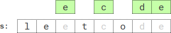

# Go 单调队列

> **[2030. 含特定字母的最小子序列](https://leetcode.cn/problems/smallest-k-length-subsequence-with-occurrences-of-a-letter/solutions/1029139/go-dan-diao-zhan-by-endlesscheng-4yqf/) · Hard · 难度分 2562**

> **所属题单**
> - [单调栈 · 四、最小字典序](../../../刷题路径/灵神原版题单/单调栈/四、最小字典序.md)

> **题目描述**
> 给你一个字符串 `s` ，一个整数 `k` ，一个字母 `letter` 以及另一个整数 `repetition` 。
>
> 返回 `s` 中长度为 `k` 且 **字典序最小** 的子序列，该子序列同时应满足字母 `letter` 出现 **至少** `repetition` 次。生成的测试用例满足 `letter` 在 `s` 中出现 **至少** `repetition` 次。
>
> **子序列** 是由原字符串删除一些（或不删除）字符且不改变剩余字符顺序得到的剩余字符串。
>
> 字符串 `a` 字典序比字符串 `b` 小的定义为：在 `a` 和 `b` 出现不同字符的第一个位置上，字符串 `a` 的字符在字母表中的顺序早于字符串 `b` 的字符。
>
> **示例 1：**
>
> ```
>
> 输入：s = "leet", k = 3, letter = "e", repetition = 1
> 输出："eet"
> 解释：存在 4 个长度为 3 ，且满足字母 'e' 出现至少 1 次的子序列：
> - "lee"（"leet"）
> - "let"（"leet"）
> - "let"（"leet"）
> - "eet"（"leet"）
> 其中字典序最小的子序列是 "eet" 。
> ```
>
> **示例 2：**
>
> 
>
> ```
>
> 输入：s = "leetcode", k = 4, letter = "e", repetition = 2
> 输出："ecde"
> 解释："ecde" 是长度为 4 且满足字母 "e" 出现至少 2 次的字典序最小的子序列。
> ```
>
> **示例 3：**
>
> ```
>
> 输入：s = "bb", k = 2, letter = "b", repetition = 2
> 输出："bb"
> 解释："bb" 是唯一一个长度为 2 且满足字母 "b" 出现至少 2 次的子序列。
> ```
>
> **提示：**
>
> - `1 <= repetition <= k <= s.length <= 5 * 10⁴`
>
> - `s` 由小写英文字母组成
>
> - `letter` 是一个小写英文字母，在 `s` 中至少出现 `repetition` 次

> **题解**
> 去掉 $\textit{repetition}$ 的限制就是一个经典问题，求长为 $k$ 的字典序最小子序列，可以使用单调队列求解。
>
> 对于本题需要注意的是，在弹出队尾元素时，需要判断后续能否构成 $\textit{repetition}$ 个 $\textit{letter}$，从而及时退出循环。以及在弹出队首元素时，需要判断是否还有空间来放置后续的 $\textit{letter}$。
