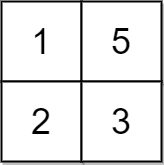
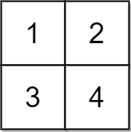

# 中位数贪心（Python/Java/C++/C/Go/JS/Rust）

> **[2033. 获取单值网格的最小操作数](https://leetcode.cn/problems/minimum-operations-to-make-a-uni-value-grid/solutions/1039445/zhong-wei-shu-by-endlesscheng-p0vj/) · Medium · 难度分 1672**

> **所属题单**
> - [贪心算法 · 四、数学贪心](../../../刷题路径/灵神原版题单/贪心算法/四、数学贪心.md) · §4.5 中位数贪心

> **题目描述**
> 给你一个大小为 `m x n` 的二维整数网格 `grid` 和一个整数 `x` 。每一次操作，你可以对 `grid` 中的任一元素 **加** `x` 或 **减** `x` 。
>
> **单值网格** 是全部元素都相等的网格。
>
> 返回使网格化为单值网格所需的 **最小** 操作数。如果不能，返回 `-1` 。
>
> **示例 1：**
>
> 
>
> ```
>
> 输入：grid = [[2,4],[6,8]], x = 2
> 输出：4
> 解释：可以执行下述操作使所有元素都等于 4 ：
> - 2 加 x 一次。
> - 6 减 x 一次。
> - 8 减 x 两次。
> 共计 4 次操作。
> ```
>
> **示例 2：**
>
> 
>
> ```
>
> 输入：grid = [[1,5],[2,3]], x = 1
> 输出：5
> 解释：可以使所有元素都等于 3 。
> ```
>
> **示例 3：**
>
> 
>
> ```
>
> 输入：grid = [[1,2],[3,4]], x = 2
> 输出：-1
> 解释：无法使所有元素相等。
> ```
>
> **提示：**
>
> - `m == grid.length`
>
> - `n == grid[i].length`
>
> - `1 <= m, n <= 10⁵`
>
> - `1 <= m * n <= 10⁵`
>
> - `1 <= x, grid[i][j] <= 10⁴`

> **题解**
> 先判断是否无解。
>
> 例如 $x=2$，我们可以把 $2,4,6,8$ 都变成同一个数，但能把 $2,5$ 变成同一个数吗？不能，在 $x=2$ 的情况下，偶数只能变成偶数，奇数只能变成奇数，无法把偶数和奇数变成同一个数。在 $x=2$ 的情况下，每个数的奇偶性（模 $2$ 的结果）必须都一样，才能变成同一个数。
>
> 一般地，对于整数 $k$，我们有 $(\textit{grid}[i][j] + kx)\bmod x = \textit{grid}[i][j]\bmod x$。所以操作后，$\textit{grid}[i][j] \bmod x$ 是不变的。每个数模 $x$ 的结果必须都一样，才能变成同一个数。否则无解，输出 $-1$。
>
> 想象操场上有一些人，把这些人聚在一起，怎么移动最迅速？
>
> 往「中间」移动是最迅速的。
>
> 根据 [中位数贪心及其证明](https://zhuanlan.zhihu.com/p/1922938031687595039)，把所有数变成 $\textit{grid}$ 的**中位数**是最优的。
>
> 设 $\textit{grid}$ 的中位数为 $\textit{median}$，总操作次数为
>
> $$
> \sum_{v\in \textit{grid}}\dfrac{|v - \textit{median}|}{x} = \dfrac{\sum\limits_{v\in \textit{grid}}|v - \textit{median}|}{x}
> $$
>
> ```python
> class Solution:
>     def minOperations(self, grid: List[List[int]], x: int) -> int:
>         a = []
>         target = grid[0][0] % x
>
>         # 1. 判断是否无解
>         for row in grid:
>             for v in row:
>                 if v % x != target:  # 每个数模 x 都必须相等
>                     return -1
>             a += row
>
>         # 2. 计算 grid 的中位数 median
>         a.sort()
>         median = a[len(a) // 2]
>
>         # 3. 计算操作次数
>         return sum(abs(v - median) for v in a) // x
> ```
>
>
> > 注：如果 $\textit{grid}$ 有负数，模 $x$ 的结果有正有负，不方便判断，此时可以把判断条件改成 `(grid[i][j] - grid[0][0]) % x != 0`。
>
> #### 复杂度分析
>
> - 时间复杂度：$\mathcal{O}(mn\log(mn))$ 或 $\mathcal{O}(mn)$，其中 $m$ 和 $n$ 分别是 $\textit{grid}$ 的行数和列数。瓶颈在排序上。用**快速选择算法**代替排序，可以做到 $\mathcal{O}(mn)$，见 C++ 或 Rust 代码。如果你想手写快速选择算法，可以看 [215. 数组中的第K个最大元素](https://leetcode.cn/problems/kth-largest-element-in-an-array/)，[我的题解](../../0200-0299/0215%20数组中的第K个最大元素/灵茶山艾府.md)。
> - 空间复杂度：$\mathcal{O}(mn)$。
>
> ## 专题训练
>
> 见下面贪心题单的「**§4.5 中位数贪心**」。
>
> ## 分类题单
>
> [如何科学刷题？](https://leetcode.cn/circle/discuss/RvFUtj/)
>
> 1. [滑动窗口与双指针（定长/不定长/单序列/双序列/三指针/分组循环）](https://leetcode.cn/circle/discuss/0viNMK/)
> 2. [二分算法（二分答案/最小化最大值/最大化最小值/第K小）](https://leetcode.cn/circle/discuss/SqopEo/)
> 3. [单调栈（基础/矩形面积/贡献法/最小字典序）](https://leetcode.cn/circle/discuss/9oZFK9/)
> 4. [网格图（DFS/BFS/综合应用）](https://leetcode.cn/circle/discuss/YiXPXW/)
> 5. [位运算（基础/性质/拆位/试填/恒等式/思维）](https://leetcode.cn/circle/discuss/dHn9Vk/)
> 6. [图论算法（DFS/BFS/拓扑排序/基环树/最短路/最小生成树/网络流）](https://leetcode.cn/circle/discuss/01LUak/)
> 7. [动态规划（入门/背包/划分/状态机/区间/状压/数位/数据结构优化/树形/博弈/概率期望）](https://leetcode.cn/circle/discuss/tXLS3i/)
> 8. [常用数据结构（前缀和/差分/栈/队列/堆/字典树/并查集/树状数组/线段树）](https://leetcode.cn/circle/discuss/mOr1u6/)
> 9. [数学算法（数论/组合/概率期望/博弈/计算几何/随机算法）](https://leetcode.cn/circle/discuss/IYT3ss/)
> 10. [贪心与思维（基本贪心策略/反悔/区间/字典序/数学/思维/脑筋急转弯/构造）](https://leetcode.cn/circle/discuss/g6KTKL/)
> 11. [链表、树与回溯（前后指针/快慢指针/DFS/BFS/直径/LCA）](https://leetcode.cn/circle/discuss/K0n2gO/)
> 12. [字符串（KMP/Z函数/Manacher/字符串哈希/AC自动机/后缀数组/子序列自动机）](https://leetcode.cn/circle/discuss/SJFwQI/)
>
> [我的题解精选（已分类）](https://github.com/EndlessCheng/codeforces-go/blob/master/leetcode/SOLUTIONS.md)
>
> 欢迎关注 [B站@灵茶山艾府](https://space.bilibili.com/206214)
