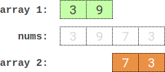

# 折半枚举+排序+二分

> **[2035. 将数组分成两个数组并最小化数组和的差](https://leetcode.cn/problems/partition-array-into-two-arrays-to-minimize-sum-difference/solutions/1039419/zhe-ban-mei-ju-pai-xu-er-fen-by-endlessc-04fn/) · Hard · 难度分 2490**

> **所属题单**
> - [链表、二叉树与回溯 · 四、回溯](../../../刷题路径/灵神原版题单/链表、二叉树与回溯/四、回溯.md) · §4.8 折半搜索

> **题目描述**
> 给你一个长度为 `2 * n` 的整数数组。你需要将 `nums` 分成 **两个** 长度为 `n` 的数组，分别求出两个数组的和，并 **最小化** 两个数组和之 **差的绝对值** 。`nums` 中每个元素都需要放入两个数组之一。
>
> 请你返回 **最小** 的数组和之差。
>
> **示例 1：**
>
> 
>
> ```
> 输入：nums = [3,9,7,3]
> 输出：2
> 解释：最优分组方案是分成 [3,9] 和 [7,3] 。
> 数组和之差的绝对值为 abs((3 + 9) - (7 + 3)) = 2 。
> ```
>
> **示例 2：**
>
> ```
> 输入：nums = [-36,36]
> 输出：72
> 解释：最优分组方案是分成 [-36] 和 [36] 。
> 数组和之差的绝对值为 abs((-36) - (36)) = 72 。
> ```
>
> **示例 3：**
>
> 
>
> ```
> 输入：nums = [2,-1,0,4,-2,-9]
> 输出：0
> 解释：最优分组方案是分成 [2,4,-9] 和 [-1,0,-2] 。
> 数组和之差的绝对值为 abs((2 + 4 + -9) - (-1 + 0 + -2)) = 0 。
> ```
>
> **提示：**
>
> - `1 <= n <= 15`
>
> - `nums.length == 2 * n`
>
> - `-10⁷ <= nums[i] <= 10⁷`

> **题解**
> 两个数组和之差可以视作从 $\textit{nums}$ 中选 $n$ 个数取正号，其余 $n$ 个数取负号，然后求元素和。
>
> 我们可以使用折半枚举的方法，枚举 $\textit{nums}$ 的前 $n$ 个元素取正或取负的所有情况，按取正的个数分组，并按照元素和排序。然后枚举 $\textit{nums}$ 的后 $n$ 个元素取正或取负的所有情况，然后去对应的组里二分找元素和最近的数，答案即为所有情况中最小的差值。
>
> 相似题目：
>
> - [1755. 最接近目标值的子序列和](https://leetcode.cn/problems/closest-subsequence-sum/)
