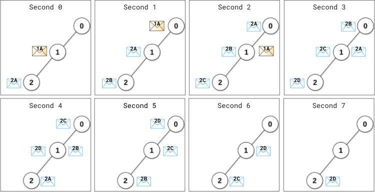
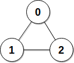

# BFS + 统计每个点变为空闲状态的最早秒数

> **[2039. 网络空闲的时刻](https://leetcode.cn/problems/the-time-when-the-network-becomes-idle/solutions/1050935/bfs-tong-ji-mei-ge-dian-bian-wei-kong-xi-mnm7/) · Medium · 难度分 1865**

> **所属题单**
> - [图论算法 · 一、图的遍历](../../../刷题路径/灵神原版题单/图论算法/一、图的遍历.md) · §1.2 广度优先搜索（BFS）

> **题目描述**
> 给你一个有 `n` 个服务器的计算机网络，服务器编号为 `0` 到 `n - 1` 。同时给你一个二维整数数组 `edges` ，其中 `edges[i] = [u_i, v_i]` 表示服务器 `u_i` 和 `v_i`<sub> </sub>之间有一条信息线路，在 **一秒** 内它们之间可以传输 **任意** 数目的信息。再给你一个长度为 `n` 且下标从 **0** 开始的整数数组 `patience` 。
>
> 题目保证所有服务器都是 **相通** 的，也就是说一个信息从任意服务器出发，都可以通过这些信息线路直接或间接地到达任何其他服务器。
>
> 编号为 `0` 的服务器是 **主** 服务器，其他服务器为 **数据** 服务器。每个数据服务器都要向主服务器发送信息，并等待回复。信息在服务器之间按 **最优** 线路传输，也就是说每个信息都会以 **最少时间** 到达主服务器。主服务器会处理 **所有** 新到达的信息并 **立即** 按照每条信息来时的路线 **反方向** 发送回复信息。
>
> 在 `0` 秒的开始，所有数据服务器都会发送各自需要处理的信息。从第 `1` 秒开始，**每** 一秒最 **开始** 时，每个数据服务器都会检查它是否收到了主服务器的回复信息（包括新发出信息的回复信息）：
>
> - 如果还没收到任何回复信息，那么该服务器会周期性 **重发** 信息。数据服务器 `i` 每 `patience[i]` 秒都会重发一条信息，也就是说，数据服务器 `i` 在上一次发送信息给主服务器后的 `patience[i]` 秒 **后** 会重发一条信息给主服务器。
>
> - 否则，该数据服务器 **不会重发** 信息。
>
> 当没有任何信息在线路上传输或者到达某服务器时，该计算机网络变为 **空闲** 状态。
>
> 请返回计算机网络变为 **空闲** 状态的 **最早秒数** 。
>
> **示例 1：**
>
> 
>
> ```
> 输入：edges = [[0,1],[1,2]], patience = [0,2,1]
> 输出：8
> 解释：
> 0 秒最开始时，
> - 数据服务器 1 给主服务器发出信息（用 1A 表示）。
> - 数据服务器 2 给主服务器发出信息（用 2A 表示）。
>
> 1 秒时，
> - 信息 1A 到达主服务器，主服务器立刻处理信息 1A 并发出 1A 的回复信息。
> - 数据服务器 1 还没收到任何回复。距离上次发出信息过去了 1 秒（1 < patience[1] = 2），所以不会重发信息。
> - 数据服务器 2 还没收到任何回复。距离上次发出信息过去了 1 秒（1 == patience[2] = 1），所以它重发一条信息（用 2B 表示）。
>
> 2 秒时，
> - 回复信息 1A 到达服务器 1 ，服务器 1 不会再重发信息。
> - 信息 2A 到达主服务器，主服务器立刻处理信息 2A 并发出 2A 的回复信息。
> - 服务器 2 重发一条信息（用 2C 表示）。
> ...
> 4 秒时，
> - 回复信息 2A 到达服务器 2 ，服务器 2 不会再重发信息。
> ...
> 7 秒时，回复信息 2D 到达服务器 2 。
>
> 从第 8 秒开始，不再有任何信息在服务器之间传输，也不再有信息到达服务器。
> 所以第 8 秒是网络变空闲的最早时刻。
> ```
>
> **示例 2：**
>
> 
>
> ```
> 输入：edges = [[0,1],[0,2],[1,2]], patience = [0,10,10]
> 输出：3
> 解释：数据服务器 1 和 2 第 2 秒初收到回复信息。
> 从第 3 秒开始，网络变空闲。
> ```
>
> **提示：**
>
> - `n == patience.length`
>
> - `2 <= n <= 10⁵`
>
> - `patience[0] == 0`
>
> - 对于 `1 <= i < n` ，满足 `1 <= patience[i] <= 10⁵`
>
> - `1 <= edges.length <= min(10⁵, n * (n - 1) / 2)`
>
> - `edges[i].length == 2`
>
> - `0 <= u_i, v_i < n`
>
> - `u_i != v_i`
>
> - 不会有重边。
>
> - 每个服务器都直接或间接与别的服务器相连。

> **题解**
> 题目可以抽象成一张图，我们可以用 BFS 求出 $0$ 号节点到其余节点的最短路长度，在 BFS 的同时求出每个节点变为空闲状态的最早秒数，其最大值就是整个计算机网络变为空闲状态的时间。
>
> 以其中某一节点 $v$ 为例，$v$ 变为空闲状态的最早秒数，就是其收到最后一条服务器给它的回复消息的时间的下一秒。记 $0$ 号节点到 $v$ 的最短路长度为 $d$，则从 $v$ 发出的第一条消息，到达 $0$ 后，回复消息又需要发给 $v$，这一共经过了 $2d$ 秒。此时我们需要知道 $v$ 发出的最后一条消息已经发出了多久（记作 $t$），这样就可以知道 $v$ 收到最后一条回复消息的时间。由于 $v$ 每 $p=\textit{patience}[v]$ 秒发出一条消息，我们按整除关系分类讨论：
>
> - 若 $p$ 能整除 $2d$，则根据题意，此时最后一条消息恰好发出了 $p$ 秒；
> - 若 $p$ 不能整除 $2d$，则最后一条消息发出了 $2d\bmod p$ 秒。例如 $2d=10,\ p=3$，则 $v$ 发出消息的时间为 $0,\ 3,\ 6,\ 9$，最后一条消息发出了 $10\bmod3=1$ 秒。
>
> 我们已经知道，从 $v$ 发出消息到收到回复要经过 $2d$ 秒，因此收到最后一条消息的时间为 $2d+(2d-t)=4d-t$ 秒，其下一秒为 $4d-t+1$ 秒，此时 $v$ 变为空闲状态。
>
> 所有节点变为空闲状态的时间的最大值即为整个计算机网络变为空闲状态的时间。
