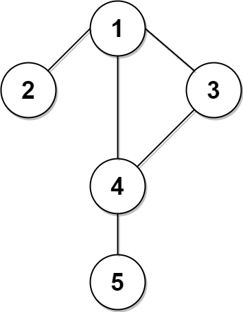
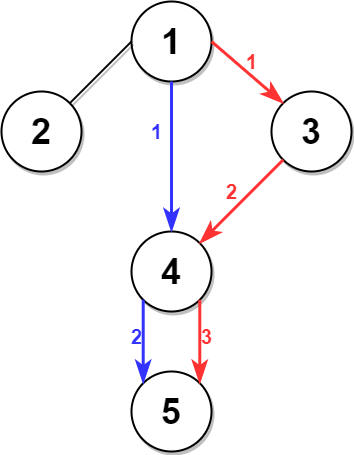

# BFS 求次短路，附详细注释

> **[2045. 到达目的地的第二短时间](https://leetcode.cn/problems/second-minimum-time-to-reach-destination/solutions/1051494/bfs-qiu-ci-duan-lu-fu-xiang-xi-zhu-shi-b-igf7/) · Hard · 难度分 2202**

> **所属题单**
> - [图论算法 · 三、最短路](../../../刷题路径/灵神原版题单/图论算法/三、最短路.md) · §3.1 单源最短路：Dijkstra 算法

> **题目描述**
> 城市用一个 **双向连通** 图表示，图中有 `n` 个节点，从 `1` 到 `n` 编号（包含 `1` 和 `n`）。图中的边用一个二维整数数组 `edges` 表示，其中每个 `edges[i] = [u_i, v_i]` 表示一条节点 `u_i` 和节点 `v_i` 之间的双向连通边。每组节点对由 **最多一条** 边连通，顶点不存在连接到自身的边。穿过任意一条边的时间是 `time` 分钟。
>
> 每个节点都有一个交通信号灯，每 `change` 分钟改变一次，从绿色变成红色，再由红色变成绿色，循环往复。所有信号灯都 **同时** 改变。你可以在 **任何时候** 进入某个节点，但是 **只能** 在节点 **信号灯是绿色时** 才能离开。如果信号灯是  **绿色** ，你 **不能** 在节点等待，必须离开。
>
> **第二小的值** 是 **严格大于** 最小值的所有值中最小的值。
>
> - 例如，`[2, 3, 4]` 中第二小的值是 `3` ，而 `[2, 2, 4]` 中第二小的值是 `4` 。
>
> 给你 `n`、`edges`、`time` 和 `change` ，返回从节点 `1` 到节点 `n` 需要的 **第二短时间** 。
>
> **注意：**
>
> - 你可以 **任意次** 穿过任意顶点，**包括** `1` 和 `n` 。
>
> - 你可以假设在 **启程时** ，所有信号灯刚刚变成 **绿色** 。
>
> **示例 1：**
>
> 
>
>         
>
> 
>
> ```
>
> 输入：n = 5, edges = [[1,2],[1,3],[1,4],[3,4],[4,5]], time = 3, change = 5
> 输出：13
> 解释：
> 上面的左图展现了给出的城市交通图。
> 右图中的蓝色路径是最短时间路径。
> 花费的时间是：
> - 从节点 1 开始，总花费时间=0
> - 1 -> 4：3 分钟，总花费时间=3
> - 4 -> 5：3 分钟，总花费时间=6
> 因此需要的最小时间是 6 分钟。
>
> 右图中的红色路径是第二短时间路径。
> - 从节点 1 开始，总花费时间=0
> - 1 -> 3：3 分钟，总花费时间=3
> - 3 -> 4：3 分钟，总花费时间=6
> - 在节点 4 等待 4 分钟，总花费时间=10
> - 4 -> 5：3 分钟，总花费时间=13
> 因此第二短时间是 13 分钟。
> ```
>
> **示例 2：**
>
> 
>
> ```
>
> 输入：n = 2, edges = [[1,2]], time = 3, change = 2
> 输出：11
> 解释：
> 最短时间路径是 1 -> 2 ，总花费时间 = 3 分钟
> 第二短时间路径是 1 -> 2 -> 1 -> 2 ，总花费时间 = 11 分钟
> ```
>
> **提示：**
>
> - `2 <= n <= 10⁴`
>
> - `n - 1 <= edges.length <= min(2 * 10⁴, n * (n - 1) / 2)`
>
> - `edges[i].length == 2`
>
> - `1 <= u_i, v_i <= n`
>
> - `u_i != v_i`
>
> - 不含重复边
>
> - 每个节点都可以从其他节点直接或者间接到达
>
> - `1 <= time, change <= 10³`

> **题解**
> 简单说一下为什么可以用 BFS。由于 $\textit{time}$ 和 $\textit{change}$ 是固定的，经过多少条边就知道花费了多少时间。因此这题本质上可以看成边权均为 $1$ 的图，我们要求的就是 $1$ 到 $n$ 的严格次短路的长度，知道长度就知道花费的时间。
>
> 下面的代码是直接用 BFS 求次短时间。
