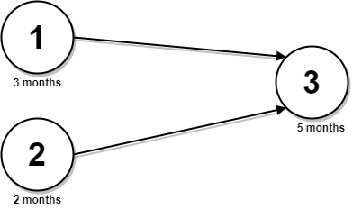
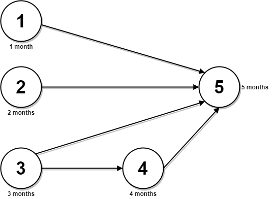

# 拓扑排序+动态规划（Python/Java/C++/Go/JS）

> **[2050. 并行课程 III](https://leetcode.cn/problems/parallel-courses-iii/solutions/1063928/tuo-bu-pai-xu-dong-tai-gui-hua-by-endles-dph6/) · Hard · 难度分 2084**

> **所属题单**
> - [动态规划 · 十三、图 DP](../../../刷题路径/灵神原版题单/动态规划/十三、图%20DP.md)
> - [图论算法 · 二、拓扑排序](../../../刷题路径/灵神原版题单/图论算法/二、拓扑排序.md) · §2.2 在拓扑序上 DP

> **题目描述**
> 给你一个整数 `n` ，表示有 `n` 节课，课程编号从 `1` 到 `n` 。同时给你一个二维整数数组 `relations` ，其中 `relations[j] = [prevCourse_j, nextCourse_j]` ，表示课程 `prevCourse_j` 必须在课程 `nextCourse_j` **之前** 完成（先修课的关系）。同时给你一个下标从 **0** 开始的整数数组 `time` ，其中 `time[i]` 表示完成第 `(i+1)` 门课程需要花费的 **月份** 数。
>
> 请你根据以下规则算出完成所有课程所需要的 **最少** 月份数：
>
> - 如果一门课的所有先修课都已经完成，你可以在 **任意** 时间开始这门课程。
>
> - 你可以 **同时** 上 **任意门课程** 。
>
> 请你返回完成所有课程所需要的 **最少** 月份数。
>
> **注意：**测试数据保证一定可以完成所有课程（也就是先修课的关系构成一个有向无环图）。
>
> **示例 1:**
>
> 
>
> ```
> 输入：n = 3, relations = [[1,3],[2,3]], time = [3,2,5]
> 输出：8
> 解释：上图展示了输入数据所表示的先修关系图，以及完成每门课程需要花费的时间。
> 你可以在月份 0 同时开始课程 1 和 2 。
> 课程 1 花费 3 个月，课程 2 花费 2 个月。
> 所以，最早开始课程 3 的时间是月份 3 ，完成所有课程所需时间为 3 + 5 = 8 个月。
> ```
>
> **示例 2：**
>
> 
>
> ```
> 输入：n = 5, relations = [[1,5],[2,5],[3,5],[3,4],[4,5]], time = [1,2,3,4,5]
> 输出：12
> 解释：上图展示了输入数据所表示的先修关系图，以及完成每门课程需要花费的时间。
> 你可以在月份 0 同时开始课程 1 ，2 和 3 。
> 在月份 1，2 和 3 分别完成这三门课程。
> 课程 4 需在课程 3 之后开始，也就是 3 个月后。课程 4 在 3 + 4 = 7 月完成。
> 课程 5 需在课程 1，2，3 和 4 之后开始，也就是在 max(1,2,3,7) = 7 月开始。
> 所以完成所有课程所需的最少时间为 7 + 5 = 12 个月。
> ```
>
> **提示：**
>
> - `1 <= n <= 5 * 10⁴`
>
> - `0 <= relations.length <= min(n * (n - 1) / 2, 5 * 10⁴)`
>
> - `relations[j].length == 2`
>
> - `1 <= prevCourse_j, nextCourse_j <= n`
>
> - `prevCourse_j != nextCourse_j`
>
> - 所有的先修课程对 `[prevCourse_j, nextCourse_j]` 都是 **互不相同** 的。
>
> - `time.length == n`
>
> - `1 <= time[i] <= 10⁴`
>
> - 先修课程图是一个有向无环图。

> **题解**
> 定义 $f[i]$ 表示完成第 $i$ 门课程需要花费的最少月份数。根据题意，只有当 $i$ 的所有先修课程都完成时，才可以开始学习第 $i$ 门课程，并且可以立即开始。
>
> 因此 
>
> $$
> f[i]=\textit{time}[i] + \max_{j} f[j]
> $$
>
> 其中 $j$ 是 $i$ 的先修课程。
>
> 由于题目保证图是一个有向无环图，所以一定存在拓扑序。我们可以在计算拓扑序的同时，计算状态转移。
>
> 具体来说，设当前节点为 $x$，我们可以在计算出 $f[x]$ 后，更新 $y$ 的所有先修课程耗时的最大值，这里 $x$ 是 $y$ 的先修课程。
>
> 答案就是所有 $f[i]$ 的最大值。
>
> ```python
> class Solution:
>     def minimumTime(self, n: int, relations: List[List[int]], time: List[int]) -> int:
>         g = [[] for _ in range(n)]
>         deg = [0] * n  # deg[i] 表示 i 的先修课的个数
>         for x, y in relations:
>             g[x - 1].append(y - 1)  # 建图
>             deg[y - 1] += 1
>
>         q = deque(i for i, d in enumerate(deg) if d == 0)  # 没有先修课
>         f = [0] * n
>         while q:
>             x = q.popleft()  # x 出队，意味着 x 的所有先修课都上完了
>             f[x] += time[x]  # 加上当前课程的时间，就得到了最终的 f[x]
>             for y in g[x]:  # 遍历 x 的邻居 y
>                 f[y] = max(f[y], f[x])  # 更新 f[y] 的所有先修课程耗时的最大值
>                 deg[y] -= 1
>                 if deg[y] == 0:  # y 的先修课已上完
>                     q.append(y)
>         return max(f)
> ```
>
>
> #### 复杂度分析
>
> - 时间复杂度：$\mathcal{O}(n+m)$，其中 $m$ 为 $\textit{relations}$ 的长度。
> - 空间复杂度：$\mathcal{O}(n+m)$。
>
> ## 相似题目
>
> - [1857. 有向图中最大颜色值](https://leetcode.cn/problems/largest-color-value-in-a-directed-graph/)
>
> ## 分类题单
>
> 1. [滑动窗口（定长/不定长/多指针）](https://leetcode.cn/circle/discuss/0viNMK/)
> 2. [二分算法（二分答案/最小化最大值/最大化最小值/第K小）](https://leetcode.cn/circle/discuss/SqopEo/)
> 3. [单调栈（矩形系列/字典序最小/贡献法）](https://leetcode.cn/circle/discuss/9oZFK9/)
> 4. [网格图（DFS/BFS/综合应用）](https://leetcode.cn/circle/discuss/YiXPXW/)
> 5. [位运算（基础/性质/拆位/试填/恒等式/贪心/脑筋急转弯）](https://leetcode.cn/circle/discuss/dHn9Vk/)
> 6. [图论算法（DFS/BFS/拓扑排序/最短路/最小生成树/二分图/基环树/欧拉路径）](https://leetcode.cn/circle/discuss/01LUak/)
> 7. [动态规划（入门/背包/状态机/划分/区间/状压/数位/数据结构优化/树形/博弈/概率期望）](https://leetcode.cn/circle/discuss/tXLS3i/)
> 8. [常用数据结构（前缀和/差分/栈/队列/堆/字典树/并查集/树状数组/线段树）](https://leetcode.cn/circle/discuss/mOr1u6/)
>
> 欢迎关注 [B站@灵茶山艾府](https://space.bilibili.com/206214)
>
> [我的题解精选（已分类）](https://github.com/EndlessCheng/codeforces-go/blob/master/leetcode/SOLUTIONS.md)
