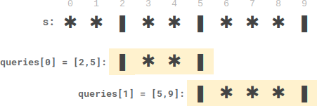
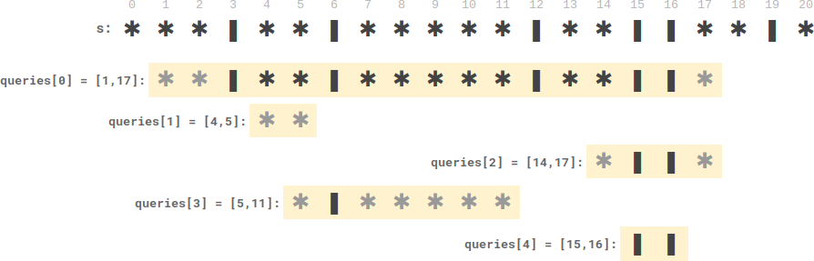

# 线性做法：前缀和+每个位置的最近蜡烛

> **[2055. 蜡烛之间的盘子](https://leetcode.cn/problems/plates-between-candles/solutions/1075392/xian-xing-zuo-fa-qian-zhui-he-mei-ge-wei-b2if/) · Medium · 难度分 1819**

> **所属题单**
> - [常用数据结构 · 一、前缀和](../../../刷题路径/灵神原版题单/常用数据结构/一、前缀和.md) · §1.5 进阶

> **题目描述**
> 给你一个长桌子，桌子上盘子和蜡烛排成一列。给你一个下标从 **0** 开始的字符串 `s` ，它只包含字符 `'*'` 和 `'|'` ，其中 `'*'` 表示一个 **盘子** ，`'|'` 表示一支 **蜡烛** 。
>
> 同时给你一个下标从 **0** 开始的二维整数数组 `queries` ，其中 `queries[i] = [left_i, right_i]` 表示 **子字符串** `s[left_i...right_i]` （**包含左右端点的字符**）。对于每个查询，你需要找到 **子字符串中** 在 **两支蜡烛之间** 的盘子的 **数目** 。如果一个盘子在 **子字符串中** 左边和右边 **都** 至少有一支蜡烛，那么这个盘子满足在 **两支蜡烛之间** 。
>
> - 比方说，`s = "||**||**|*"` ，查询 `[3, 8]` ，表示的是子字符串 `"*||**|"` 。子字符串中在两支蜡烛之间的盘子数目为 `2` ，子字符串中右边两个盘子在它们左边和右边 **都** 至少有一支蜡烛。
>
> 请你返回一个整数数组 `answer` ，其中 `answer[i]` 是第 `i` 个查询的答案。
>
> **示例 1:**
>
> 
>
> ```
> 输入：s = "**|**|***|", queries = [[2,5],[5,9]]
> 输出：[2,3]
> 解释：
> - queries[0] 有两个盘子在蜡烛之间。
> - queries[1] 有三个盘子在蜡烛之间。
> ```
>
> **示例 2:**
>
> 
>
> ```
> 输入：s = "***|**|*****|**||**|*", queries = [[1,17],[4,5],[14,17],[5,11],[15,16]]
> 输出：[9,0,0,0,0]
> 解释：
> - queries[0] 有 9 个盘子在蜡烛之间。
> - 另一个查询没有盘子在蜡烛之间。
> ```
>
> **提示：**
>
> - `3 <= s.length <= 10⁵`
>
> - `s` 只包含字符 `'*'` 和 `'|'` 。
>
> - `1 <= queries.length <= 10⁵`
>
> - `queries[i].length == 2`
>
> - `0 <= left_i <= right_i < s.length`


