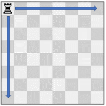
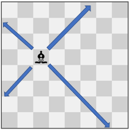
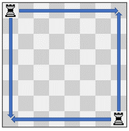
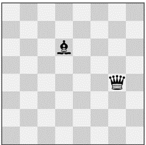

# 回溯（Python/Java/C++/Go）

> **[2056. 棋盘上有效移动组合的数目](https://leetcode.cn/problems/number-of-valid-move-combinations-on-chessboard/solutions/1075478/go-mo-ni-by-endlesscheng-kjpt/) · Hard · 难度分 2611**

> **所属题单**
> - [常用数据结构 · 编程能力强化训练](../../../刷题路径/灵神原版题单/常用数据结构/编程能力强化训练.md) · Part C
> - [链表、二叉树与回溯 · 四、回溯](../../../刷题路径/灵神原版题单/链表、二叉树与回溯/四、回溯.md) · §4.7 搜索

> **题目描述**
> 有一个 `8 x 8` 的棋盘，它包含 `n` 个棋子（棋子包括车，后和象三种）。给你一个长度为 `n` 的字符串数组 `pieces` ，其中 `pieces[i]` 表示第 `i` 个棋子的类型（车，后或象）。除此以外，还给你一个长度为 `n` 的二维整数数组 `positions` ，其中 `positions[i] = [r_i, c_i]` 表示第 `i` 个棋子现在在棋盘上的位置为 `(r_i, c_i)` ，棋盘下标从 **1** 开始。
>
> 每个棋子的移动中，首先选择移动的 **方向** ，然后选择 **移动的步数** ，同时你要确保移动过程中棋子不能移到棋盘以外的地方。棋子需按照以下规则移动：
>
> - 车可以 **水平或者竖直** 从 `(r, c)` 沿着方向 `(r+1, c)`，`(r-1, c)`，`(r, c+1)` 或者 `(r, c-1)` 移动。
>
> - 后可以 **水平竖直或者斜对角** 从 `(r, c)` 沿着方向 `(r+1, c)`，`(r-1, c)`，`(r, c+1)`，`(r, c-1)`，`(r+1, c+1)`，`(r+1, c-1)`，`(r-1, c+1)`，`(r-1, c-1)` 移动。
>
> - 象可以 **斜对角** 从 `(r, c)` 沿着方向 `(r+1, c+1)`，`(r+1, c-1)`，`(r-1, c+1)`，`(r-1, c-1)` 移动。
>
> 你必须同时 **移动** 棋盘上的每一个棋子。**移动组合** 包含所有棋子的 **移动** 。每一秒，每个棋子都沿着它们选择的方向往前移动 **一步** ，直到它们到达目标位置。所有棋子从时刻 `0` 开始移动。如果在某个时刻，两个或者更多棋子占据了同一个格子，那么这个移动组合 **不有效** 。
>
> 请你返回 **有效** 移动组合的数目。
>
> **注意：**
>
> - 初始时，**不会有两个棋子** 在 **同一个位置 。**
>
> - 有可能在一个移动组合中，有棋子不移动。
>
> - 如果两个棋子 **直接相邻** 且两个棋子下一秒要互相占据对方的位置，可以将它们在同一秒内 **交换位置** 。
>
> **示例 1:**
>
> 
>
> ```
>
> 输入：pieces = ["rook"], positions = [[1,1]]
> 输出：15
> 解释：上图展示了棋子所有可能的移动。
> ```
>
> **示例 2：**
>
> 
>
> ```
>
> 输入：pieces = ["queen"], positions = [[1,1]]
> 输出：22
> 解释：上图展示了棋子所有可能的移动。
> ```
>
> **示例 3:**
>
> 
>
> ```
>
> 输入：pieces = ["bishop"], positions = [[4,3]]
> 输出：12
> 解释：上图展示了棋子所有可能的移动。
> ```
>
> **示例 4:**
>
> 
>
> ```
>
> 输入：pieces = ["rook","rook"], positions = [[1,1],[8,8]]
> 输出：223
> 解释：每个车有 15 种移动，所以总共有 15 * 15 = 225 种移动组合。
> 但是，有两个是不有效的移动组合：
> - 将两个车都移动到 (8, 1) ，会导致它们在同一个格子相遇。
> - 将两个车都移动到 (1, 8) ，会导致它们在同一个格子相遇。
> 所以，总共有 225 - 2 = 223 种有效移动组合。
> 注意，有两种有效的移动组合，分别是一个车在 (1, 8) ，另一个车在 (8, 1) 。
> 即使棋盘状态是相同的，这两个移动组合被视为不同的，因为每个棋子移动操作是不相同的。
> ```
>
> **示例 5：**
>
> 
>
> ```
>
> 输入：pieces = ["queen","bishop"], positions = [[5,7],[3,4]]
> 输出：281
> 解释：总共有 12 * 24 = 288 种移动组合。
> 但是，有一些不有效的移动组合：
> - 如果后停在 (6, 7) ，它会阻挡象到达 (6, 7) 或者 (7, 8) 。
> - 如果后停在 (5, 6) ，它会阻挡象到达 (5, 6) ，(6, 7) 或者 (7, 8) 。
> - 如果象停在 (5, 2) ，它会阻挡后到达 (5, 2) 或者 (5, 1) 。
> 在 288 个移动组合当中，281 个是有效的。
> ```
>
> **提示：**
>
> - `n == pieces.length `
>
> - `n == positions.length`
>
> - `1 <= n <= 4`
>
> - `pieces` 只包含字符串 `"rook"` ，`"queen"` 和 `"bishop"` 。
>
> - 棋盘上最多只有一个后。
>
> - `1 <= r_i, c_i <= 8`
>
> - 每一个 `positions[i]` 互不相同。

> **题解**
> ## 核心思路
>
> 1. 预处理每个棋子的所有合法移动。
> 2. 写一个回溯，暴力枚举每个棋子的每个合法移动，如果这些棋子没有重叠在一起，则答案加一。
>
> ## 细节
>
> 具体来说，合法移动包含：
>
> - 棋子的初始位置 $(x_0,y_0)$。
> - 棋子的移动方向 $(d_x,d_y)$。
> - 棋子的移动次数 $\textit{step}$。
>
> 在回溯时，可以剪枝：如果当前棋子的当前这个合法移动，与前面的棋子冲突，即同一时刻两个棋子重叠，那么不往下递归，枚举当前棋子的下一个合法移动。
>
> ```python
> class Solution:
>     # 计算位于 (x0,y0) 的棋子在 dirs 这些方向上的所有合法移动
>     def generate_moves(self, x0: int, y0: int, dirs: List[Tuple[int, int]]) -> List[Tuple[int, int, int, int, int]]:
>         SIZE = 8
>         moves = [(x0, y0, 0, 0, 0)]  # 原地不动
>         for dx, dy in dirs:
>             # 往 (dx,dy) 方向走 1,2,3,... 步
>             x, y = x0 + dx, y0 + dy
>             step = 1
>             while 0 < x <= SIZE and 0 < y <= SIZE:
>                 moves.append((x0, y0, dx, dy, step))
>                 x += dx
>                 y += dy
>                 step += 1
>         return moves
>
>     # 判断两个移动是否合法，即不存在同一时刻两个棋子重叠的情况
>     def is_valid(self, move1: Tuple[int, int, int, int, int], move2: Tuple[int, int, int, int, int]) -> bool:
>         x1, y1, dx1, dy1, step1 = move1
>         x2, y2, dx2, dy2, step2 = move2
>         for i in range(max(step1, step2)):
>             # 每一秒走一步
>             if i < step1:
>                 x1 += dx1
>                 y1 += dy1
>             if i < step2:
>                 x2 += dx2
>                 y2 += dy2
>             if x1 == x2 and y1 == y2:  # 重叠
>                 return False
>         return True
>
>     def countCombinations(self, pieces: List[str], positions: List[List[int]]) -> int:
>         rook_dirs = (-1, 0), (1, 0), (0, -1), (0, 1)  # 上下左右
>         bishop_dirs = (1, 1), (-1, 1), (-1, -1), (1, -1)  # 斜向
>         piece_dirs = {'r': rook_dirs, 'b': bishop_dirs, 'q': rook_dirs + bishop_dirs}
>         # 预处理所有合法移动
>         all_moves = [self.generate_moves(x, y, piece_dirs[piece[0]])
>                      for piece, (x, y) in zip(pieces, positions)]
>
>         n = len(pieces)
>         path = [None] * n  # 注意 path 的长度是固定的
>         ans = 0
>         def dfs(i: int) -> None:
>             if i == n:
>                 nonlocal ans
>                 ans += 1
>                 return
>             # 枚举当前棋子的所有合法移动
>             for move1 in all_moves[i]:
>                 # 判断合法移动 move1 是否有效
>                 if all(self.is_valid(move1, move2) for move2 in path[:i]):
>                     path[i] = move1  # 直接覆盖，无需恢复现场
>                     dfs(i + 1)  # 枚举后续棋子的所有合法移动组合
>         dfs(0)
>         return ans
> ```
>
>
> #### 复杂度分析
>
> - 时间复杂度：$\mathcal{O}(nLM^n)$，其中 $n$ 是 $\textit{pieces}$ 的长度，$L=8$，$M=\mathcal{O}(L)$ 是单个棋子的合法移动个数。搜索树是一棵 $M$ 叉树，深度为 $\mathcal{O}(n)$，一共有 $\mathcal{O}(M^n)$ 个节点。每个节点需要用 $\mathcal{O}(nL)$ 的时间，判断第 $i$ 个棋子的其中一个合法移动是否有效。
> - 空间复杂度：$\mathcal{O}(nM)$。
>
> ## 分类题单
>
> [如何科学刷题？](https://leetcode.cn/circle/discuss/RvFUtj/)
>
> 1. [滑动窗口与双指针（定长/不定长/单序列/双序列/三指针）](https://leetcode.cn/circle/discuss/0viNMK/)
> 2. [二分算法（二分答案/最小化最大值/最大化最小值/第K小）](https://leetcode.cn/circle/discuss/SqopEo/)
> 3. [单调栈（基础/矩形面积/贡献法/最小字典序）](https://leetcode.cn/circle/discuss/9oZFK9/)
> 4. [网格图（DFS/BFS/综合应用）](https://leetcode.cn/circle/discuss/YiXPXW/)
> 5. [位运算（基础/性质/拆位/试填/恒等式/思维）](https://leetcode.cn/circle/discuss/dHn9Vk/)
> 6. [图论算法（DFS/BFS/拓扑排序/最短路/最小生成树/二分图/基环树/欧拉路径）](https://leetcode.cn/circle/discuss/01LUak/)
> 7. [动态规划（入门/背包/状态机/划分/区间/状压/数位/数据结构优化/树形/博弈/概率期望）](https://leetcode.cn/circle/discuss/tXLS3i/)
> 8. [常用数据结构（前缀和/差分/栈/队列/堆/字典树/并查集/树状数组/线段树）](https://leetcode.cn/circle/discuss/mOr1u6/)
> 9. [数学算法（数论/组合/概率期望/博弈/计算几何/随机算法）](https://leetcode.cn/circle/discuss/IYT3ss/)
> 10. [贪心与思维（基本贪心策略/反悔/区间/字典序/数学/思维/脑筋急转弯/构造）](https://leetcode.cn/circle/discuss/g6KTKL/)
> 11. [链表、二叉树与一般树（前后指针/快慢指针/DFS/BFS/直径/LCA）](https://leetcode.cn/circle/discuss/K0n2gO/)
> 12. [字符串（KMP/Z函数/Manacher/字符串哈希/AC自动机/后缀数组/子序列自动机）](https://leetcode.cn/circle/discuss/SJFwQI/)
>
> [我的题解精选（已分类）](https://github.com/EndlessCheng/codeforces-go/blob/master/leetcode/SOLUTIONS.md)
>
> 欢迎关注 [B站@灵茶山艾府](https://space.bilibili.com/206214)
