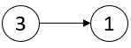
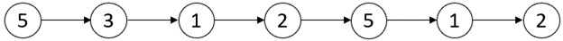
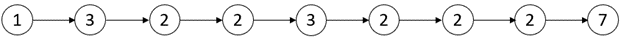
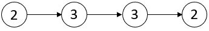

# 2058. 找出临界点之间的最小和最大距离

Medium · [力扣原题](https://leetcode.cn/problems/find-the-minimum-and-maximum-number-of-nodes-between-critical-points/)

所在刷题路径：灵神题单·链表树与回溯

| 作者 | 题解 | 动画讲解 |
|---|---|---|
| 灵茶山艾府 | [📄 题解](灵茶山艾府.md) | [▶︎ 2058 找出临界点之间的最小和最大距离 · 灵茶山艾府.mp4](2058%20找出临界点之间的最小和最大距离%20·%20灵茶山艾府.mp4) |
| yiduobo | [📄 题解](yiduobo.md) | [▶︎ 2058 找出临界点之间的最小和最大距离 · yiduobo.mp4](2058%20找出临界点之间的最小和最大距离%20·%20yiduobo.mp4) |

## 题目描述

链表中的 **临界点** 定义为一个 **局部极大值点** **或** **局部极小值点 。**

如果当前节点的值 **严格大于** 前一个节点和后一个节点，那么这个节点就是一个  **局部极大值点** 。

如果当前节点的值 **严格小于** 前一个节点和后一个节点，那么这个节点就是一个  **局部极小值点** 。

注意：节点只有在同时存在前一个节点和后一个节点的情况下，才能成为一个 **局部极大值点 / 极小值点** 。

给你一个链表 `head` ，返回一个长度为 2 的数组 `[minDistance, maxDistance]` ，其中 `minDistance` 是任意两个不同临界点之间的最小距离，`maxDistance` 是任意两个不同临界点之间的最大距离。如果临界点少于两个，则返回 `[-1，-1]` 。

**示例 1：**



```

输入：head = [3,1]
输出：[-1,-1]
解释：链表 [3,1] 中不存在临界点。
```

**示例 2：**



```

输入：head = [5,3,1,2,5,1,2]
输出：[1,3]
解释：存在三个临界点：
- [5,3,1,2,5,1,2]：第三个节点是一个局部极小值点，因为 1 比 3 和 2 小。
- [5,3,1,2,5,1,2]：第五个节点是一个局部极大值点，因为 5 比 2 和 1 大。
- [5,3,1,2,5,1,2]：第六个节点是一个局部极小值点，因为 1 比 5 和 2 小。
第五个节点和第六个节点之间距离最小。minDistance = 6 - 5 = 1 。
第三个节点和第六个节点之间距离最大。maxDistance = 6 - 3 = 3 。
```

**示例 3：**



```

输入：head = [1,3,2,2,3,2,2,2,7]
输出：[3,3]
解释：存在两个临界点：
- [1,3,2,2,3,2,2,2,7]：第二个节点是一个局部极大值点，因为 3 比 1 和 2 大。
- [1,3,2,2,3,2,2,2,7]：第五个节点是一个局部极大值点，因为 3 比 2 和 2 大。
最小和最大距离都存在于第二个节点和第五个节点之间。
因此，minDistance 和 maxDistance 是 5 - 2 = 3 。
注意，最后一个节点不算一个局部极大值点，因为它之后就没有节点了。
```

**示例 4：**



```

输入：head = [2,3,3,2]
输出：[-1,-1]
解释：链表 [2,3,3,2] 中不存在临界点。
```

**提示：**

- 链表中节点的数量在范围 `[2, 10⁵]` 内

- `1 <= Node.val <= 10⁵`

---
[↑ 返回 2000-2099](../README.md) · [总索引](../../../索引.md) · [仓库首页](../../../README.md)
