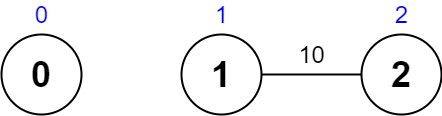

# 暴搜+最短路剪枝（Python/Java/C++/Go/JS/Rust）

> **[2065. 最大化一张图中的路径价值](https://leetcode.cn/problems/maximum-path-quality-of-a-graph/solutions/1088414/bao-sou-jian-zhi-by-endlesscheng-iv6z/) · Hard · 难度分 2178**

> **所属题单**
> - [图论算法 · 九、其他](../../../刷题路径/灵神原版题单/图论算法/九、其他.md)

> **题目描述**
> 给你一张 **无向** 图，图中有 `n` 个节点，节点编号从 `0` 到 `n - 1` （**都包括**）。同时给你一个下标从 **0** 开始的整数数组 `values` ，其中 `values[i]` 是第 `i` 个节点的 **价值** 。同时给你一个下标从 **0** 开始的二维整数数组 `edges` ，其中 `edges[j] = [u_j, v_j, time_j]` 表示节点 `u_j` 和 `v_j` 之间有一条需要 `time_j` 秒才能通过的无向边。最后，给你一个整数 `maxTime` 。
>
> **合法路径** 指的是图中任意一条从节点 `0` 开始，最终回到节点 `0` ，且花费的总时间 **不超过** `maxTime` 秒的一条路径。你可以访问一个节点任意次。一条合法路径的 **价值** 定义为路径中 **不同节点** 的价值 **之和** （每个节点的价值 **至多** 算入价值总和中一次）。
>
> 请你返回一条合法路径的 **最大** 价值。
>
> **注意：**每个节点 **至多** 有 **四条** 边与之相连。
>
> **示例 1：**
>
> 
>
> ```
>
> 输入：values = [0,32,10,43], edges = [[0,1,10],[1,2,15],[0,3,10]], maxTime = 49
> 输出：75
> 解释：
> 一条可能的路径为：0 -> 1 -> 0 -> 3 -> 0 。总花费时间为 10 + 10 + 10 + 10 = 40 <= 49 。
> 访问过的节点为 0 ，1 和 3 ，最大路径价值为 0 + 32 + 43 = 75 。
> ```
>
> **示例 2：**
>
> 
>
> ```
>
> 输入：values = [5,10,15,20], edges = [[0,1,10],[1,2,10],[0,3,10]], maxTime = 30
> 输出：25
> 解释：
> 一条可能的路径为：0 -> 3 -> 0 。总花费时间为 10 + 10 = 20 <= 30 。
> 访问过的节点为 0 和 3 ，最大路径价值为 5 + 20 = 25 。
> ```
>
> **示例 3：**
>
> 
>
> ```
>
> 输入：values = [1,2,3,4], edges = [[0,1,10],[1,2,11],[2,3,12],[1,3,13]], maxTime = 50
> 输出：7
> 解释：
> 一条可能的路径为：0 -> 1 -> 3 -> 1 -> 0 。总花费时间为 10 + 13 + 13 + 10 = 46 <= 50 。
> 访问过的节点为 0 ，1 和 3 ，最大路径价值为 1 + 2 + 4 = 7 。
> ```
>
> **示例 4：**
>
> 
>
> ```
>
> 输入：values = [0,1,2], edges = [[1,2,10]], maxTime = 10
> 输出：0
> 解释：
> 唯一一条路径为 0 。总花费时间为 0 。
> 唯一访问过的节点为 0 ，最大路径价值为 0 。
> ```
>
> **提示：**
>
> - `n == values.length`
>
> - `1 <= n <= 1000`
>
> - `0 <= values[i] <= 10⁸`
>
> - `0 <= edges.length <= 2000`
>
> - `edges[j].length == 3 `
>
> - `0 <= u_j < v_j <= n - 1`
>
> - `10 <= time_j, maxTime <= 100`
>
> - `[u_j, v_j]` 所有节点对 **互不相同** 。
>
> - 每个节点 **至多有四条** 边。
>
> - 图可能不连通。

> **题解**
> ## 方法一：暴搜
>
> 根据题目的数据范围，路径至多有 $\dfrac{\textit{maxTime}}{\min(\textit{time}_j)}\le \dfrac{100}{10} = 10$ 条边，这意味着搜索树至多有 $11$ 层；同时，题目保证每个节点至多有 $4$ 条边与之相连，因此搜索树的每个节点至多有 $4$ 个儿子。所以本题可以视作在一棵层数至多为 $11$ 的四叉树上递归，这可以在时限内跑完。
>
> 递归到下一个节点之前，如果发现消耗的时间超过了 $\textit{maxTime}$，则不递归。
>
> ```python
> class Solution:
>     def maximalPathQuality(self, values: List[int], edges: List[List[int]], max_time: int) -> int:
>         n = len(values)
>         g = [[] for _ in range(n)]
>         for x, y, t in edges:
>             g[x].append((y, t))
>             g[y].append((x, t))
>
>         def dfs(x: int, sum_time: int, sum_value: int) -> None:
>             if x == 0:
>                 nonlocal ans
>                 ans = max(ans, sum_value)
>                 # 注意这里没有 return，还可以继续走
>             for y, t in g[x]:
>                 if sum_time + t > max_time:
>                     continue
>                 if vis[y]:
>                     dfs(y, sum_time + t, sum_value)
>                 else:
>                     vis[y] = True
>                     # 每个节点的价值至多算入价值总和中一次
>                     dfs(y, sum_time + t, sum_value + values[y])
>                     vis[y] = False  # 恢复现场
>
>         ans = 0
>         vis = [False] * n
>         vis[0] = True
>         dfs(0, 0, values[0])
>         return ans
> ```
>
>
> #### 复杂度分析
>
> - 时间复杂度：$\mathcal{O}(n+m+4^k)$，其中 $n$ 是 $\textit{values}$ 的长度，$m$ 是 $\textit{edges}$ 的长度，$k=\dfrac{\textit{maxTime}}{\min(\textit{time}_j)}$。
> - 空间复杂度：$\mathcal{O}(n+m+k)$。注意递归会消耗 $\mathcal{O}(k)$ 的栈空间。
>
> ## 方法二：暴搜+最短路剪枝
>
> **前置知识**：[Dijkstra 算法介绍](../../0700-0799/0743%20网络延迟时间/灵茶山艾府.md)
>
> 用 Dijkstra 算法预处理起点 $0$ 到每个节点的最短路，这也是每个节点到 $0$ 的最短路。
>
> > 由于本题是稀疏图，使用堆优化的 Dijkstra 算法。
>
> 在递归到下一个节点之前，判断下一个节点在走最短路的前提下，能否在 $\textit{maxTime}$ 时间内回到起点 $0$，若不能则不递归。
>
> ```python
> class Solution:
>     def maximalPathQuality(self, values: List[int], edges: List[List[int]], max_time: int) -> int:
>         n = len(values)
>         g = [[] for _ in range(n)]
>         for x, y, t in edges:
>             g[x].append((y, t))
>             g[y].append((x, t))
>
>         # Dijkstra 算法
>         dis = [inf] * n
>         dis[0] = 0
>         h = [(0, 0)]
>         while h:
>             dx, x = heappop(h)
>             if dx > dis[x]:  # x 之前出堆过
>                 continue
>             for y, d in g[x]:
>                 new_dis = dx + d
>                 if new_dis < dis[y]:
>                     dis[y] = new_dis  # 更新 x 的邻居的最短路
>                     heappush(h, (new_dis, y))
>
>         def dfs(x: int, sum_time: int, sum_value: int) -> None:
>             if x == 0:
>                 nonlocal ans
>                 ans = max(ans, sum_value)
>                 # 注意这里没有 return，还可以继续走
>             for y, t in g[x]:
>                 # 相比方法一，这里多了 dis[y]
>                 if sum_time + t + dis[y] > max_time:
>                     continue
>                 if vis[y]:
>                     dfs(y, sum_time + t, sum_value)
>                 else:
>                     vis[y] = True
>                     # 每个节点的价值至多算入价值总和中一次
>                     dfs(y, sum_time + t, sum_value + values[y])
>                     vis[y] = False  # 恢复现场
>
>         ans = 0
>         vis = [False] * n
>         vis[0] = True
>         dfs(0, 0, values[0])
>         return ans
> ```
>
>
> #### 复杂度分析
>
> - 时间复杂度：$\mathcal{O}(n+m\log m+4^k)$，其中 $n$ 是 $\textit{values}$ 的长度，$m$ 是 $\textit{edges}$ 的长度，$k=\dfrac{\textit{maxTime}}{\min(\textit{time}_j)}$。Dijkstra 算法的时间复杂度为 $\mathcal{O}(n + m\log m)$。
> - 空间复杂度：$\mathcal{O}(n+m+k)$。注意递归会消耗 $\mathcal{O}(k)$ 的栈空间。
>
> ## 分类题单
>
> [如何科学刷题？](https://leetcode.cn/circle/discuss/RvFUtj/)
>
> 1. [滑动窗口与双指针（定长/不定长/单序列/双序列/三指针/分组循环）](https://leetcode.cn/circle/discuss/0viNMK/)
> 2. [二分算法（二分答案/最小化最大值/最大化最小值/第K小）](https://leetcode.cn/circle/discuss/SqopEo/)
> 3. [单调栈（基础/矩形面积/贡献法/最小字典序）](https://leetcode.cn/circle/discuss/9oZFK9/)
> 4. [网格图（DFS/BFS/综合应用）](https://leetcode.cn/circle/discuss/YiXPXW/)
> 5. [位运算（基础/性质/拆位/试填/恒等式/思维）](https://leetcode.cn/circle/discuss/dHn9Vk/)
> 6. [图论算法（DFS/BFS/拓扑排序/基环树/最短路/最小生成树/网络流）](https://leetcode.cn/circle/discuss/01LUak/)
> 7. [动态规划（入门/背包/划分/状态机/区间/状压/数位/数据结构优化/树形/博弈/概率期望）](https://leetcode.cn/circle/discuss/tXLS3i/)
> 8. [常用数据结构（前缀和/差分/栈/队列/堆/字典树/并查集/树状数组/线段树）](https://leetcode.cn/circle/discuss/mOr1u6/)
> 9. [数学算法（数论/组合/概率期望/博弈/计算几何/随机算法）](https://leetcode.cn/circle/discuss/IYT3ss/)
> 10. [贪心与思维（基本贪心策略/反悔/区间/字典序/数学/思维/脑筋急转弯/构造）](https://leetcode.cn/circle/discuss/g6KTKL/)
> 11. [链表、二叉树与回溯（前后指针/快慢指针/DFS/BFS/直径/LCA/一般树）](https://leetcode.cn/circle/discuss/K0n2gO/)
> 12. [字符串（KMP/Z函数/Manacher/字符串哈希/AC自动机/后缀数组/子序列自动机）](https://leetcode.cn/circle/discuss/SJFwQI/)
>
> [我的题解精选（已分类）](https://github.com/EndlessCheng/codeforces-go/blob/master/leetcode/SOLUTIONS.md)
>
> 欢迎关注 [B站@灵茶山艾府](https://space.bilibili.com/206214)
