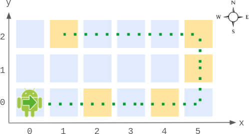

# 分类讨论，O(1) 时间复杂度（Python/Java/C++/C/Go/JS/Rust）

> **[2069. 模拟行走机器人 II](https://leetcode.cn/problems/walking-robot-simulation-ii/solutions/1100443/go-mo-ni-by-endlesscheng-exyr/) · Medium**

> **题目描述**
> 给你一个在 XY 平面上的 `width x height` 的网格图，**左下角** 的格子为 `(0, 0)` ，**右上角** 的格子为 `(width - 1, height - 1)` 。网格图中相邻格子为四个基本方向之一（`"North"`，`"East"`，`"South"` 和 `"West"`）。一个机器人 **初始** 在格子 `(0, 0)` ，方向为 `"East"` 。
>
> 机器人可以根据指令移动指定的 **步数** 。每一步，它可以执行以下操作。
>
> 1. 沿着当前方向尝试 **往前一步** 。
>
> 2. 如果机器人下一步将到达的格子 **超出了边界** ，机器人会 **逆时针** 转 90 度，然后再尝试往前一步。
>
> 如果机器人完成了指令要求的移动步数，它将停止移动并等待下一个指令。
>
> 请你实现 `Robot` 类：
>
> - `Robot(int width, int height)` 初始化一个 `width x height` 的网格图，机器人初始在 `(0, 0)` ，方向朝 `"East"` 。
>
> - `void step(int num)` 给机器人下达前进 `num` 步的指令。
>
> - `int[] getPos()` 返回机器人当前所处的格子位置，用一个长度为 2 的数组 `[x, y]` 表示。
>
> - `String getDir()` 返回当前机器人的朝向，为 `"North"` ，`"East"` ，`"South"` 或者 `"West"` 。
>
> **示例 1：**
>
> 
>
> ```
>
> 输入：
> ["Robot", "step", "step", "getPos", "getDir", "step", "step", "step", "getPos", "getDir"]
> [[6, 3], [2], [2], [], [], [2], [1], [4], [], []]
> 输出：
> [null, null, null, [4, 0], "East", null, null, null, [1, 2], "West"]
>
> 解释：
> Robot robot = new Robot(6, 3); // 初始化网格图，机器人在 (0, 0) ，朝东。
> robot.step(2);  // 机器人朝东移动 2 步，到达 (2, 0) ，并朝东。
> robot.step(2);  // 机器人朝东移动 2 步，到达 (4, 0) ，并朝东。
> robot.getPos(); // 返回 [4, 0]
> robot.getDir(); // 返回 "East"
> robot.step(2);  // 朝东移动 1 步到达 (5, 0) ，并朝东。
>                 // 下一步继续往东移动将出界，所以逆时针转变方向朝北。
>                 // 然后，往北移动 1 步到达 (5, 1) ，并朝北。
> robot.step(1);  // 朝北移动 1 步到达 (5, 2) ，并朝 北 （不是朝西）。
> robot.step(4);  // 下一步继续往北移动将出界，所以逆时针转变方向朝西。
>                 // 然后，移动 4 步到 (1, 2) ，并朝西。
> robot.getPos(); // 返回 [1, 2]
> robot.getDir(); // 返回 "West"
> ```
>
> **提示：**
>
> - `2 <= width, height <= 100`
>
> - `1 <= num <= 10⁵`
>
> - `step` ，`getPos` 和 `getDir` **总共** 调用次数不超过 `10⁴` 次。

> **题解**
> 本文把 $\textit{width}$ 简称为 $w$，把 $\textit{height}$ 简称为 $h$。
>
> 根据题意，机器人只能在网格图的**最外圈**中移动，移动一整圈需要 $2(w+h-2)$ 步。
>
> 
>
> 设当前移动的总步数模 $2(w+h-2)$ 的结果为 $s$。分类讨论：
>
> - 如果 $s < w$，机器人往右走了 $s$ 步，位于 $(s,0)$，面朝东。
> - 如果 $w\le s < w+h-1$，机器人先往右走 $w-1$ 步，再往北走 $s-(w-1)$ 步，位于 $(w-1,s-w+1)$，面朝北。
> - 如果 $w+h-1\le s < 2w+h-2$，机器人先往右走 $w-1$ 步，再往北走 $h-1$ 步，到达右上角 $(w-1,h-1)$，再往西走 $s-(w-1)-(h-1)$ 步，位于 $(w-1-(s-(w-1)-(h-1)),h-1) = (2w + h - s - 3,h-1)$，面朝西。
> - 否则，机器人先往右走 $w-1$ 步，再往北走 $h-1$ 步，再往西走 $w-1$ 步，到达左上角 $(0,h-1)$，再往南走 $s-2(w-1)-(h-1)$ 步，位于 $(0,h-1-(s-2(w-1)-(h-1))) = (0, 2(w+h)-s-4)$，面朝南。
>
> ⚠**注意**：总步数为 $0$ 时，机器人面朝东，但总步数为 $2(w+h-2)$ 的正整数倍时，机器人面朝南。需要特判总步数为 $0$ 的特殊情况吗？不需要，当总步数大于 $0$ 时，我们可以把取模后的范围从 $[0, 2(w+h-2)-1]$ 调整到 $[1, 2(w+h-2)]$，从而使原先模为 $0$ 的总步数变成 $2(w+h-2)$，落入面朝南的分支中，这样就可以避免特判了。
>
> ```python
> class Robot:
>     def __init__(self, width: int, height: int) -> None:
>         self.w = width
>         self.h = height
>         self.s = 0
>
>     def step(self, num: int) -> None:
>         # 由于机器人只能走外圈，那么走 (w+h-2)*2 步后会回到起点
>         # 把 s 取模调整到 [1, (w+h-2)*2]，这样不需要特判 s == 0 时的方向
>         self.s = (self.s + num - 1) % ((self.w + self.h - 2) * 2) + 1
>
>     def _getState(self) -> Tuple[int, int, str]:
>         w, h, s = self.w, self.h, self.s
>         if s < w:
>             return s, 0, "East"
>         if s < w + h - 1:
>             return w - 1, s - w + 1, "North"
>         if s < w * 2 + h - 2:
>             return w * 2 + h - s - 3, h - 1, "West"
>         return 0, (w + h) * 2 - s - 4, "South"
>
>     def getPos(self) -> List[int]:
>         x, y, _ = self._getState()
>         return [x, y]
>
>     def getDir(self) -> str:
>         return self._getState()[2]
> ```
>
>
> #### 复杂度分析
>
> - 时间复杂度：均为 $\mathcal{O}(1)$。
> - 空间复杂度：$\mathcal{O}(1)$。
>
> ## 分类题单
>
> [如何科学刷题？](https://leetcode.cn/circle/discuss/RvFUtj/)
>
> 1. [滑动窗口与双指针（定长/不定长/单序列/双序列/三指针/分组循环）](https://leetcode.cn/circle/discuss/0viNMK/)
> 2. [二分算法（二分答案/最小化最大值/最大化最小值/第K小）](https://leetcode.cn/circle/discuss/SqopEo/)
> 3. [单调栈（基础/矩形面积/贡献法/最小字典序）](https://leetcode.cn/circle/discuss/9oZFK9/)
> 4. [网格图（DFS/BFS/综合应用）](https://leetcode.cn/circle/discuss/YiXPXW/)
> 5. [位运算（基础/性质/拆位/试填/恒等式/思维）](https://leetcode.cn/circle/discuss/dHn9Vk/)
> 6. [图论算法（DFS/BFS/拓扑排序/基环树/最短路/最小生成树/网络流）](https://leetcode.cn/circle/discuss/01LUak/)
> 7. [动态规划（入门/背包/划分/状态机/区间/状压/数位/数据结构优化/树形/博弈/概率期望）](https://leetcode.cn/circle/discuss/tXLS3i/)
> 8. [常用数据结构（前缀和/差分/栈/队列/堆/字典树/并查集/树状数组/线段树）](https://leetcode.cn/circle/discuss/mOr1u6/)
> 9. [数学算法（数论/组合/概率期望/博弈/计算几何/随机算法）](https://leetcode.cn/circle/discuss/IYT3ss/)
> 10. [贪心与思维（基本贪心策略/反悔/区间/字典序/数学/思维/脑筋急转弯/构造）](https://leetcode.cn/circle/discuss/g6KTKL/)
> 11. [链表、树与回溯（前后指针/快慢指针/DFS/BFS/直径/LCA）](https://leetcode.cn/circle/discuss/K0n2gO/)
> 12. [字符串（KMP/Z函数/Manacher/字符串哈希/AC自动机/后缀数组/子序列自动机）](https://leetcode.cn/circle/discuss/SJFwQI/)
>
> [我的题解精选（已分类）](https://github.com/EndlessCheng/codeforces-go/blob/master/leetcode/SOLUTIONS.md)
>
> 欢迎关注 [B站@灵茶山艾府](https://space.bilibili.com/206214)
