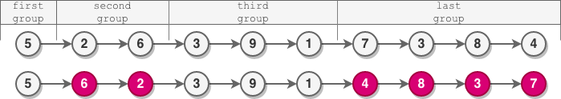
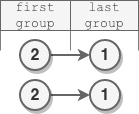

# 交换元素值的写法

> **[2074. 反转偶数长度组的节点](https://leetcode.cn/problems/reverse-nodes-in-even-length-groups/solutions/1100918/zhi-jie-jiao-huan-yuan-su-zhi-by-endless-hsfq/) · Medium**

> **所属题单**
> - [链表、二叉树与回溯 · 一、链表](../../../刷题路径/灵神原版题单/链表、二叉树与回溯/一、链表.md) · §1.4 反转链表

> **题目描述**
> 给你一个链表的头节点 `head` 。
>
> 链表中的节点 **按顺序** 划分成若干 **非空** 组，这些非空组的长度构成一个自然数序列（`1, 2, 3, 4, ...`）。一个组的 **长度** 就是组中分配到的节点数目。换句话说：
>
> - 节点 `1` 分配给第一组
>
> - 节点 `2` 和 `3` 分配给第二组
>
> - 节点 `4`、`5` 和 `6` 分配给第三组，以此类推
>
> 注意，最后一组的长度可能小于或者等于 `1 + 倒数第二组的长度` 。
>
> **反转** 每个 **偶数** 长度组中的节点，并返回修改后链表的头节点 `head` 。
>
> **示例 1：**
>
> 
>
> ```
>
> 输入：head = [5,2,6,3,9,1,7,3,8,4]
> 输出：[5,6,2,3,9,1,4,8,3,7]
> 解释：
> - 第一组长度为 1 ，奇数，没有发生反转。
> - 第二组长度为 2 ，偶数，节点反转。
> - 第三组长度为 3 ，奇数，没有发生反转。
> - 最后一组长度为 4 ，偶数，节点反转。
> ```
>
> **示例 2：**
>
> 
>
> ```
>
> 输入：head = [1,1,0,6]
> 输出：[1,0,1,6]
> 解释：
> - 第一组长度为 1 ，没有发生反转。
> - 第二组长度为 2 ，节点反转。
> - 最后一组长度为 1 ，没有发生反转。
> ```
>
> **示例 3：**
>
> 
>
> ```
>
> 输入：head = [2,1]
> 输出：[2,1]
> 解释：
> - 第一组长度为 1 ，没有发生反转。
> - 最后一组长度为 1 ，没有发生反转。
> ```
>
> **提示：**
>
> - 链表中节点数目范围是 `[1, 10⁵]`
>
> - `0 <= Node.val <= 10⁵`


