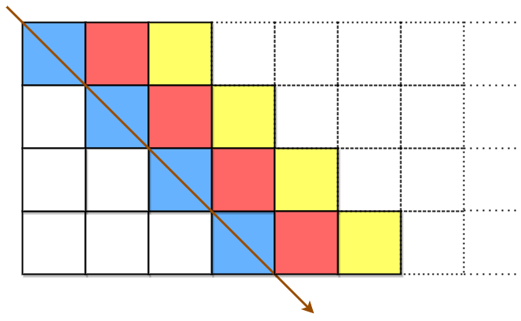
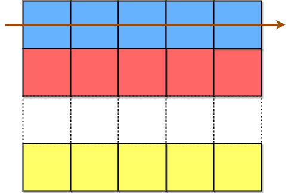
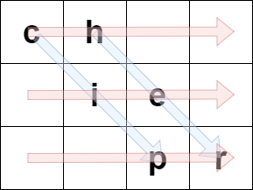
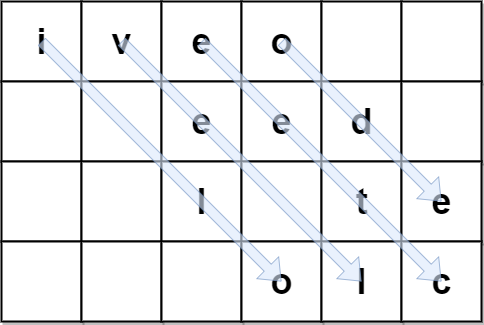
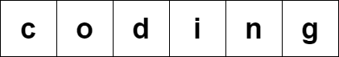
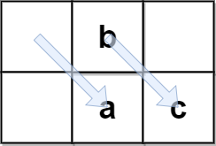

# 2075. 解码斜向换位密码

Medium · [力扣原题](https://leetcode.cn/problems/decode-the-slanted-ciphertext/)

| 作者 | 题解 | 动画讲解 |
|---|---|---|
| 灵茶山艾府 | [📄 题解](灵茶山艾府.md) | — |
| yiduobo | [📄 题解](yiduobo.md) | [▶︎ 2075 解码斜向换位密码 · yiduobo.mp4](2075%20解码斜向换位密码%20·%20yiduobo.mp4) |

## 题目描述

字符串 `originalText` 使用 **斜向换位密码** ，经由 **行数固定** 为 `rows` 的矩阵辅助，加密得到一个字符串 `encodedText` 。

`originalText` 先按从左上到右下的方式放置到矩阵中。



先填充蓝色单元格，接着是红色单元格，然后是黄色单元格，以此类推，直到到达 `originalText` 末尾。箭头指示顺序即为单元格填充顺序。所有空单元格用 `' '` 进行填充。矩阵的列数需满足：用 `originalText` 填充之后，最右侧列 **不为空** 。

接着按行将字符附加到矩阵中，构造 `encodedText` 。



先把蓝色单元格中的字符附加到 `encodedText` 中，接着是红色单元格，最后是黄色单元格。箭头指示单元格访问顺序。

例如，如果 `originalText = "cipher"` 且 `rows = 3` ，那么我们可以按下述方法将其编码：



蓝色箭头标识 `originalText` 是如何放入矩阵中的，红色箭头标识形成 `encodedText` 的顺序。在上述例子中，`encodedText = "ch ie pr"` 。

给你编码后的字符串 `encodedText` 和矩阵的行数 `rows` ，返回源字符串 `originalText` 。

**注意：**`originalText` **不** 含任何尾随空格 `' '` 。生成的测试用例满足 **仅存在一个** 可能的 `originalText` 。

**示例 1：**

```

输入：encodedText = "ch   ie   pr", rows = 3
输出："cipher"
解释：此示例与问题描述中的例子相同。
```

**示例 2：**



```

输入：encodedText = "iveo    eed   l te   olc", rows = 4
输出："i love leetcode"
解释：上图标识用于编码 originalText 的矩阵。
蓝色箭头展示如何从 encodedText 找到 originalText 。
```

**示例 3：**



```

输入：encodedText = "coding", rows = 1
输出："coding"
解释：由于只有 1 行，所以 originalText 和 encodedText 是相同的。
```

**示例 4：**



```

输入：encodedText = " b  ac", rows = 2
输出：" abc"
解释：originalText 不能含尾随空格，但它可能会有一个或者多个前置空格。
```

**提示：**

- `0 <= encodedText.length <= 10⁶`

- `encodedText` 仅由小写英文字母和 `' '` 组成

- `encodedText` 是对某个 **不含** 尾随空格的 `originalText` 的一个有效编码

- `1 <= rows <= 1000`

- 生成的测试用例满足 **仅存在一个** 可能的 `originalText`

---
[↑ 返回 2000-2099](../README.md) · [总索引](../../../索引.md) · [仓库首页](../../../README.md)
