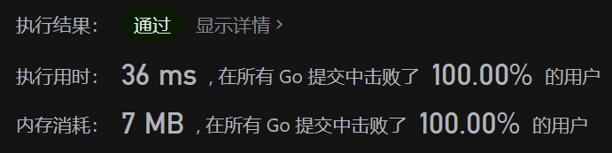

# O(nlogn) 做法：用并查集维护朋友关系，同时用哈希表维护代表元之间能否成为朋友

> **[2076. 处理含限制条件的好友请求](https://leetcode.cn/problems/process-restricted-friend-requests/solutions/1100831/bing-cha-ji-by-endlesscheng-8ipg/) · Hard · 难度分 2131**

> **所属题单**
> - [常用数据结构 · 七、并查集](../../../刷题路径/灵神原版题单/常用数据结构/七、并查集.md) · §7.2 进阶

> **题目描述**
> 给你一个整数 `n` ，表示网络上的用户数目。每个用户按从 `0` 到 `n - 1` 进行编号。
>
> 给你一个下标从 **0** 开始的二维整数数组 `restrictions` ，其中 `restrictions[i] = [x_i, y_i]` 意味着用户 `x_i` 和用户 `y_i` **不能** 成为 **朋友** ，不管是 **直接** 还是通过其他用户 **间接** 。
>
> 最初，用户里没有人是其他用户的朋友。给你一个下标从 **0** 开始的二维整数数组 `requests` 表示好友请求的列表，其中 `requests[j] = [u_j, v_j]` 是用户 `u_j` 和用户 `v_j` 之间的一条好友请求。
>
> 如果 `u_j` 和 `v_j` 可以成为 **朋友** ，那么好友请求将会 **成功** 。每个好友请求都会按列表中给出的顺序进行处理（即，`requests[j]` 会在 `requests[j + 1]` 前）。一旦请求成功，那么对所有未来的好友请求而言， `u_j` 和 `v_j` 将会 **成为直接朋友 。**
>
> 返回一个 **布尔数组** `result` ，其中元素遵循此规则：如果第 `j` 个好友请求 **成功** ，那么 `result[j]` 就是 `true` ；否则，为 `false` 。
>
> **注意：**如果 `u_j` 和 `v_j` 已经是直接朋友，那么他们之间的请求将仍然 **成功** 。
>
> **示例 1：**
>
> ```
>
> 输入：n = 3, restrictions = [[0,1]], requests = [[0,2],[2,1]]
> 输出：[true,false]
> 解释：
> 请求 0 ：用户 0 和 用户 2 可以成为朋友，所以他们成为直接朋友。
> 请求 1 ：用户 2 和 用户 1 不能成为朋友，因为这会使 用户 0 和 用户 1 成为间接朋友 (1--2--0) 。
> ```
>
> **示例 2：**
>
> ```
>
> 输入：n = 3, restrictions = [[0,1]], requests = [[1,2],[0,2]]
> 输出：[true,false]
> 解释：
> 请求 0 ：用户 1 和 用户 2 可以成为朋友，所以他们成为直接朋友。
> 请求 1 ：用户 0 和 用户 2 不能成为朋友，因为这会使 用户 0 和 用户 1 成为间接朋友 (0--2--1) 。
> ```
>
> **示例 3：**
>
> ```
>
> 输入：n = 5, restrictions = [[0,1],[1,2],[2,3]], requests = [[0,4],[1,2],[3,1],[3,4]]
> 输出：[true,false,true,false]
> 解释：
> 请求 0 ：用户 0 和 用户 4 可以成为朋友，所以他们成为直接朋友。
> 请求 1 ：用户 1 和 用户 2 不能成为朋友，因为他们之间存在限制。
> 请求 2 ：用户 3 和 用户 1 可以成为朋友，所以他们成为直接朋友。
> 请求 3 ：用户 3 和 用户 4 不能成为朋友，因为这会使 用户 0 和 用户 1 成为间接朋友 (0--4--3--1) 。
> ```
>
> **提示：**
>
> - `2 <= n <= 1000`
>
> - `0 <= restrictions.length <= 1000`
>
> - `restrictions[i].length == 2`
>
> - `0 <= x_i, y_i <= n - 1`
>
> - `x_i != y_i`
>
> - `1 <= requests.length <= 1000`
>
> - `requests[j].length == 2`
>
> - `0 <= u_j, v_j <= n - 1`
>
> - `u_j != v_j`

> **题解**
> 用并查集维护朋友关系。同时我们还要处理哪些用户不能成为朋友，这可以用哈希表来维护。更具体地，我们可以在并查集的代表元（即 `find` 的终点）上记录当前集合与哪些用户不能成为朋友。
>  
> 如果两个用户不在同一集合且可以成为朋友，那么就要用并查集合并这两个集合，同时把与其中一个集合的不能成为朋友的用户添加到另一个集合上。这里的一个优化点是，合并集合时，总是从小的集合合并到大的集合上。
>
> 时间复杂度：由于在合并集合时，总是从小的合并到大的上，因此时间复杂度与启发式合并相同，为 $O(n\log n)$（这里将输入大小均视作 $O(n)$）。证明[见此](https://oi-wiki.org/graph/dsu-on-tree/#_3)。
>
> 
