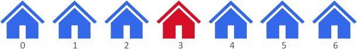
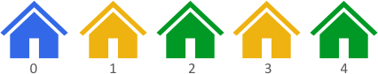

# O(n) 做法，脑筋急转弯（Python/Java/C++/C/Go/JS/Rust）

> **[2078. 两栋颜色不同且距离最远的房子](https://leetcode.cn/problems/two-furthest-houses-with-different-colors/solutions/1113521/on-zuo-fa-by-endlesscheng-an8b/) · Easy**

> **所属题单**
> - [常用数据结构 · 零、常用枚举技巧](../../../刷题路径/灵神原版题单/常用数据结构/零、常用枚举技巧.md) · §0.1 枚举右，维护左 · §0.1.2 进阶
> - [贪心算法 · 五、思维题](../../../刷题路径/灵神原版题单/贪心算法/五、思维题.md) · §5.2 脑筋急转弯

> **题目描述**
> 街上有 `n` 栋房子整齐地排成一列，每栋房子都粉刷上了漂亮的颜色。给你一个下标从 **0** 开始且长度为 `n` 的整数数组 `colors` ，其中 `colors[i]` 表示第  `i` 栋房子的颜色。
>
> 返回 **两栋** 颜色 **不同** 房子之间的 **最大** 距离。
>
> 第 `i` 栋房子和第 `j` 栋房子之间的距离是 `abs(i - j)` ，其中 `abs(x)` 是 `x` 的绝对值。
>
> **示例 1：**
>
> 
>
> ```
>
> 输入：colors = [1,1,1,6,1,1,1]
> 输出：3
> 解释：上图中，颜色 1 标识成蓝色，颜色 6 标识成红色。
> 两栋颜色不同且距离最远的房子是房子 0 和房子 3 。
> 房子 0 的颜色是颜色 1 ，房子 3 的颜色是颜色 6 。两栋房子之间的距离是 abs(0 - 3) = 3 。
> 注意，房子 3 和房子 6 也可以产生最佳答案。
> ```
>
> **示例 2：**
>
> 
>
> ```
>
> 输入：colors = [1,8,3,8,3]
> 输出：4
> 解释：上图中，颜色 1 标识成蓝色，颜色 8 标识成黄色，颜色 3 标识成绿色。
> 两栋颜色不同且距离最远的房子是房子 0 和房子 4 。
> 房子 0 的颜色是颜色 1 ，房子 4 的颜色是颜色 3 。两栋房子之间的距离是 abs(0 - 4) = 4 。
> ```
>
> **示例 3：**
>
> ```
>
> 输入：colors = [0,1]
> 输出：1
> 解释：两栋颜色不同且距离最远的房子是房子 0 和房子 1 。
> 房子 0 的颜色是颜色 0 ，房子 1 的颜色是颜色 1 。两栋房子之间的距离是 abs(0 - 1) = 1 。
> ```
>
> **提示：**
>
> - `n == colors.length`
>
> - `2 <= n <= 100`
>
> - `0 <= colors[i] <= 100`
>
> - 生成的测试数据满足 **至少** 存在 2 栋颜色不同的房子

> **题解**
> 如果 $\textit{colors}[0] \ne \textit{colors}[n-1]$，那么答案是 $n-1$。
>
> 否则设 $c = \textit{colors}[0] = \textit{colors}[n-1]$。
>
> 设最大距离来自房子 $i$ 和房子 $j$。由于题目要求 $\textit{colors}[i]\ne \textit{colors}[j]$，所以这两个颜色不可能都等于 $c$。如果 $\textit{colors}[i]\ne c$，那么 $j$ 必然是离 $i$ 最远的 $0$ 或者 $n-1$（这两栋房子的颜色与房子 $i$ 不同）。这意味着，$0$ 或者 $n-1$ **必然参与最大距离的计算**。
>
> - 对于房子 $0$ 来说，另一栋房子越远（越靠右）越好。从右往左找到颜色不等于 $c$ 的房子 $\textit{colors}[r]$，距离为 $r-0 = r$。
> - 对于房子 $n-1$ 来说，另一栋房子越远（越靠左）越好。从左往右找到颜色不等于 $c$ 的房子 $\textit{colors}[\ell]$，距离为 $n-1-\ell$。
>
> 答案为二者的最大值
>
> $$
> \max(r, n-1-\ell)
> $$
>
> > 注意题目保证至少有两栋颜色不同的房子。
>
> ```python
> class Solution:
>     def maxDistance(self, colors: List[int]) -> int:
>         n = len(colors)
>         c = colors[0]
>         if c != colors[-1]:
>             return n - 1
>
>         # 找最右边的颜色不等于 c 的房子
>         # 题目保证至少有两栋颜色不同的房子
>         r = n - 2
>         while colors[r] == c:
>             r -= 1
>
>         # 找最左边的颜色不等于 c 的房子
>         l = 1
>         while colors[l] == c:
>             l += 1
>
>         return max(r, n - 1 - l)
> ```
>
>
> #### 复杂度分析
>
> - 时间复杂度：$\mathcal{O}(n)$，其中 $n$ 是 $\textit{colors}$ 的长度。
> - 空间复杂度：$\mathcal{O}(1)$。
>
> ## 专题训练
>
> 见下面贪心与思维题单的「**§5.2 脑筋急转弯**」。
>
> ## 分类题单
>
> [如何科学刷题？](https://leetcode.cn/circle/discuss/RvFUtj/)
>
> 1. [滑动窗口与双指针（定长/不定长/单序列/双序列/三指针/分组循环）](https://leetcode.cn/circle/discuss/0viNMK/)
> 2. [二分算法（二分答案/最小化最大值/最大化最小值/第K小）](https://leetcode.cn/circle/discuss/SqopEo/)
> 3. [单调栈（基础/矩形面积/贡献法/最小字典序）](https://leetcode.cn/circle/discuss/9oZFK9/)
> 4. [网格图（DFS/BFS/综合应用）](https://leetcode.cn/circle/discuss/YiXPXW/)
> 5. [位运算（基础/性质/拆位/试填/恒等式/思维）](https://leetcode.cn/circle/discuss/dHn9Vk/)
> 6. [图论算法（DFS/BFS/拓扑排序/基环树/最短路/最小生成树/网络流）](https://leetcode.cn/circle/discuss/01LUak/)
> 7. [动态规划（入门/背包/划分/状态机/区间/状压/数位/数据结构优化/树形/博弈/概率期望）](https://leetcode.cn/circle/discuss/tXLS3i/)
> 8. [常用数据结构（前缀和/差分/栈/队列/堆/字典树/并查集/树状数组/线段树）](https://leetcode.cn/circle/discuss/mOr1u6/)
> 9. [数学算法（数论/组合/概率期望/博弈/计算几何/随机算法）](https://leetcode.cn/circle/discuss/IYT3ss/)
> 10. [贪心与思维（基本贪心策略/反悔/区间/字典序/数学/思维/脑筋急转弯/构造）](https://leetcode.cn/circle/discuss/g6KTKL/)
> 11. [链表、树与回溯（前后指针/快慢指针/DFS/BFS/直径/LCA）](https://leetcode.cn/circle/discuss/K0n2gO/)
> 12. [字符串（KMP/Z函数/Manacher/字符串哈希/AC自动机/后缀数组/子序列自动机）](https://leetcode.cn/circle/discuss/SJFwQI/)
>
> [我的题解精选（已分类）](https://github.com/EndlessCheng/codeforces-go/blob/master/leetcode/SOLUTIONS.md)
>
> 欢迎关注 [B站@灵茶山艾府](https://space.bilibili.com/206214)
