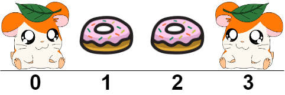
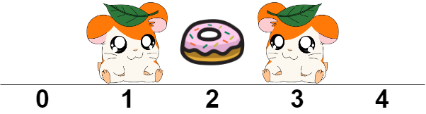

# 2086. 喂食仓鼠的最小食物桶数

Medium · 难度分 1623 · [力扣原题](https://leetcode.cn/problems/minimum-number-of-food-buckets-to-feed-the-hamsters/)

所在刷题路径：灵神题单·贪心与思维

| 作者 | 题解 | 动画讲解 |
|---|---|---|
| 灵茶山艾府 | [📄 题解](灵茶山艾府.md) | — |
| yiduobo | [📄 题解](yiduobo.md) | [▶︎ 2086 喂食仓鼠的最小食物桶数 · yiduobo.mp4](2086%20喂食仓鼠的最小食物桶数%20·%20yiduobo.mp4) |

## 题目描述

给你一个下标从 **0** 开始的字符串 `hamsters` ，其中 `hamsters[i]`  要么是：

- `'H'` 表示有一个仓鼠在下标 `i` ，或者

- `'.'` 表示下标 `i` 是空的。

你将要在空的位置上添加一定数量的食物桶来喂养仓鼠。如果仓鼠的左边或右边至少有一个食物桶，就可以喂食它。更正式地说，如果你在位置 `i - 1` **或者** `i + 1` 放置一个食物桶，就可以喂养位置为 `i` 处的仓鼠。

在 **空的位置** 放置食物桶以喂养所有仓鼠的前提下，请你返回需要的 **最少** 食物桶数。如果无解请返回 `-1` 。

**示例 1：**



```

输入：hamsters = "H..H"
输出：2
解释：
我们可以在下标为 1 和 2 处放食物桶。
可以发现如果我们只放置 1 个食物桶，其中一只仓鼠将得不到喂养。
```

**示例 2：**



```

输入：street = ".H.H."
输出：1
解释：
我们可以在下标为 2 处放置一个食物桶。
```

**示例 3：**

```

输入：street = ".HHH."
输出：-1
解释：
如果我们如图那样在每个空位放置食物桶，下标 2 处的仓鼠将吃不到食物。
```

**提示：**

- `1 <= hamsters.length <= 10⁵`

- `hamsters[i]` 要么是 `'H'` ，要么是 `'.'` 。

---
[↑ 返回 2000-2099](../README.md) · [总索引](../../../索引.md) · [仓库首页](../../../README.md)
