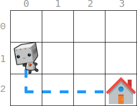

# 脑筋急转弯（Python/Java/C++/C/Go/JS/Rust）

> **[2087. 网格图中机器人回家的最小代价](https://leetcode.cn/problems/minimum-cost-homecoming-of-a-robot-in-a-grid/solutions/1125725/yue-du-li-jie-by-endlesscheng-xz4d/) · Medium · 难度分 1744**

> **所属题单**
> - [贪心算法 · 五、思维题](../../../刷题路径/灵神原版题单/贪心算法/五、思维题.md) · §5.2 脑筋急转弯

> **题目描述**
> 给你一个 `m x n` 的网格图，其中 `(0, 0)` 是最左上角的格子，`(m - 1, n - 1)` 是最右下角的格子。给你一个整数数组 `startPos` ，`startPos = [start_row, start_col]` 表示 **初始** 有一个 **机器人** 在格子 `(start_row, start_col)` 处。同时给你一个整数数组 `homePos` ，`homePos = [home_row, home_col]` 表示机器人的 **家** 在格子 `(home_row, home_col)` 处。
>
> 机器人需要回家。每一步它可以往四个方向移动：**上**，**下**，**左**，**右**，同时机器人不能移出边界。每一步移动都有一定代价。再给你两个下标从 **0** 开始的整数数组：长度为 `m` 的数组 `rowCosts`  和长度为 `n` 的数组 `colCosts` 。
>
> - 如果机器人往 **上** 或者往 **下** 移动到第 `r` **行** 的格子，那么代价为 `rowCosts[r]` 。
>
> - 如果机器人往 **左** 或者往 **右** 移动到第 `c` **列** 的格子，那么代价为 `colCosts[c]` 。
>
> 请你返回机器人回家需要的 **最小总代价** 。
>
> **示例 1：**
>
> 
>
> ```
>
> 输入：startPos = [1, 0], homePos = [2, 3], rowCosts = [5, 4, 3], colCosts = [8, 2, 6, 7]
> 输出：18
> 解释：一个最优路径为：
> 从 (1, 0) 开始
> -> 往下走到 (2, 0) 。代价为 rowCosts[2] = 3 。
> -> 往右走到 (2, 1) 。代价为 colCosts[1] = 2 。
> -> 往右走到 (2, 2) 。代价为 colCosts[2] = 6 。
> -> 往右走到 (2, 3) 。代价为 colCosts[3] = 7 。
> 总代价为 3 + 2 + 6 + 7 = 18
> ```
>
> **示例 2：**
>
> ```
>
> 输入：startPos = [0, 0], homePos = [0, 0], rowCosts = [5], colCosts = [26]
> 输出：0
> 解释：机器人已经在家了，所以不需要移动。总代价为 0 。
> ```
>
> **提示：**
>
> - `m == rowCosts.length`
>
> - `n == colCosts.length`
>
> - `1 <= m, n <= 10⁵`
>
> - `0 <= rowCosts[r], colCosts[c] <= 10⁴`
>
> - `startPos.length == 2`
>
> - `homePos.length == 2`
>
> - `0 <= start_row, home_row < m`
>
> - `0 <= start_col, home_col < n`

> **题解**
> 脑筋急转弯：由于题目保证代价均为非负数，所以**除了径直走以外，其它弯弯绕绕的策略都不可能更优**，那么直接统计径直走的代价即可。
>
> 设起点为 $(x_0,y_0)$，终点为 $(x_1,y_1)$。
>
> 分别计算上下移动的代价，左右移动的代价，二者之和就是总代价。
>
> - 上下移动的代价：如果 $x_0 < x_1$，那么从起点移动到终点，$x_0+1,x_0+2,\ldots,x_1$ 这些行都要访问到，移动代价为 $\textit{rowCosts}$ 的子数组 $[x_0+1,x_1]$ 的元素和。如果 $x_0 > x_1$，那么移动代价为 $\textit{rowCosts}$ 的子数组 $[x_1,x_0-1]$ 的元素和。
> - 左右移动的代价：如果 $y_0 < y_1$，那么从起点移动到终点，$y_0+1,y_0+2,\ldots,y_1$ 这些列都要访问到，移动代价为 $\textit{colCosts}$ 的子数组 $[y_0+1,y_1]$ 的元素和。如果 $y_0 > y_1$，那么移动代价为 $\textit{colCosts}$ 的子数组 $[y_1,y_0-1]$ 的元素和。
>
> 代码实现时，不需要根据 $x_0$ 和 $x_1$ 的大小关系分情况讨论，而是计算 $\textit{rowCosts}$ 的子数组 $[\min(x_0,x_1), \max(x_0,x_1)]$ 的元素和，再减去多算的起点代价 $\textit{rowCosts}[x_0]$。对于 $y_0$ 和 $y_1$ 同理。
>
> ```python
> class Solution:
>     def minCost(self, startPos: List[int], homePos: List[int], rowCosts: List[int], colCosts: List[int]) -> int:
>         x0, y0 = startPos
>         x1, y1 = homePos
>
>         # 起点的代价不计入，先减去
>         ans = -rowCosts[x0] - colCosts[y0]
>
>         # 累加代价（包含起点）
>         ans += sum(rowCosts[min(x0, x1): max(x0, x1) + 1])
>         ans += sum(colCosts[min(y0, y1): max(y0, y1) + 1])
>
>         return ans
> ```
>
>
> #### 复杂度分析
>
> - 时间复杂度：$\mathcal{O}(|\textit{start}_{\textit{row}} - \textit{home}_{\textit{row}}| + |\textit{start}_{\textit{col}} - \textit{home}_{\textit{col}}|)$。
> - 空间复杂度：$\mathcal{O}(1)$。Python 和 JS 把切片改成普通循环即可做到 $\mathcal{O}(1)$ 空间。
>
> ## 如果有负数代价呢？
>
> 本题是图论中的最短路问题。在有负数边权的情况下，可以用 Bellman-Ford 算法解决。需要注意的是，如果有负环，则最小代价为 $-\infty$。
>
> ## 专题训练
>
> 见下面贪心与思维题单的「**§5.2 脑筋急转弯**」。
>
> ## 分类题单
>
> [如何科学刷题？](https://leetcode.cn/circle/discuss/RvFUtj/)
>
> 1. [滑动窗口与双指针（定长/不定长/单序列/双序列/三指针/分组循环）](https://leetcode.cn/circle/discuss/0viNMK/)
> 2. [二分算法（二分答案/最小化最大值/最大化最小值/第K小）](https://leetcode.cn/circle/discuss/SqopEo/)
> 3. [单调栈（基础/矩形面积/贡献法/最小字典序）](https://leetcode.cn/circle/discuss/9oZFK9/)
> 4. [网格图（DFS/BFS/综合应用）](https://leetcode.cn/circle/discuss/YiXPXW/)
> 5. [位运算（基础/性质/拆位/试填/恒等式/思维）](https://leetcode.cn/circle/discuss/dHn9Vk/)
> 6. [图论算法（DFS/BFS/拓扑排序/基环树/最短路/最小生成树/网络流）](https://leetcode.cn/circle/discuss/01LUak/)
> 7. [动态规划（入门/背包/划分/状态机/区间/状压/数位/数据结构优化/树形/博弈/概率期望）](https://leetcode.cn/circle/discuss/tXLS3i/)
> 8. [常用数据结构（前缀和/差分/栈/队列/堆/字典树/并查集/树状数组/线段树）](https://leetcode.cn/circle/discuss/mOr1u6/)
> 9. [数学算法（数论/组合/概率期望/博弈/计算几何/随机算法）](https://leetcode.cn/circle/discuss/IYT3ss/)
> 10. [贪心与思维（基本贪心策略/反悔/区间/字典序/数学/思维/脑筋急转弯/构造）](https://leetcode.cn/circle/discuss/g6KTKL/)
> 11. [链表、树与回溯（前后指针/快慢指针/DFS/BFS/直径/LCA）](https://leetcode.cn/circle/discuss/K0n2gO/)
> 12. [字符串（KMP/Z函数/Manacher/字符串哈希/AC自动机/后缀数组/子序列自动机）](https://leetcode.cn/circle/discuss/SJFwQI/)
>
> [我的题解精选（已分类）](https://github.com/EndlessCheng/codeforces-go/blob/master/leetcode/SOLUTIONS.md)
>
> 欢迎关注 [B站@灵茶山艾府](https://space.bilibili.com/206214)
