# O(mn) 动态规划

> **[2088. 统计农场中肥沃金字塔的数目](https://leetcode.cn/problems/count-fertile-pyramids-in-a-land/solutions/1125747/dong-tai-gui-hua-by-endlesscheng-depp/) · Hard · 难度分 2105**

> **所属题单**
> - [动态规划 · 七、其他线性 DP](../../../刷题路径/灵神原版题单/动态规划/七、其他线性%20DP.md) · §7.5 子矩形 DP

> **题目描述**
> 有一个 **矩形网格** 状的农场，划分为 `m` 行 `n` 列的单元格。每个格子要么是 **肥沃的** （用 `1` 表示），要么是 **贫瘠** 的（用 `0` 表示）。网格图以外的所有与格子都视为贫瘠的。
>
> 农场中的 **金字塔** 区域定义如下：
>
> 1. 区域内格子数目 **大于** `1` 且所有格子都是 **肥沃的** 。
>
> 2. 金字塔 **顶端** 是这个金字塔 **最上方** 的格子。金字塔的高度是它所覆盖的行数。令 `(r, c)` 为金字塔的顶端且高度为 `h` ，那么金字塔区域内包含的任一格子 `(i, j)` 需满足 `r <= i <= r + h - 1` **且** `c - (i - r) <= j <= c + (i - r)` 。
>
> 一个 **倒金字塔** 类似定义如下：
>
> 1. 区域内格子数目 **大于** `1` 且所有格子都是 **肥沃的** 。
>
> 2. 倒金字塔的 **顶端** 是这个倒金字塔 **最下方** 的格子。倒金字塔的高度是它所覆盖的行数。令 `(r, c)` 为金字塔的顶端且高度为 `h` ，那么金字塔区域内包含的任一格子 `(i, j)` 需满足 `r - h + 1 <= i <= r` **且** `c - (r - i) <= j <= c + (r - i)` 。
>
> 下图展示了部分符合定义和不符合定义的金字塔区域。黑色区域表示肥沃的格子。
>
> 
>
> 给你一个下标从 **0** 开始且大小为 `m x n` 的二进制矩阵 `grid` ，它表示农场，请你返回 `grid` 中金字塔和倒金字塔的 **总数目** 。
>
> **示例 1：**
>
> 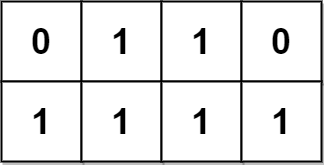
>
> 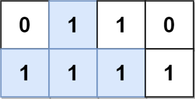
>
> 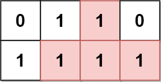
>
> ```
> 输入：grid = [[0,1,1,0],[1,1,1,1]]
> 输出：2
> 解释：
> 2 个可能的金字塔区域分别如上图蓝色和红色区域所示。
> 这个网格图中没有倒金字塔区域。
> 所以金字塔区域总数为 2 + 0 = 2 。
> ```
>
> **示例 2：**
>
> 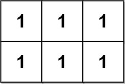
>
> 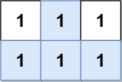
>
> 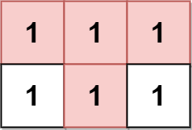
>
> ```
> 输入：grid = [[1,1,1],[1,1,1]]
> 输出：2
> 解释：
> 金字塔区域如上图蓝色区域所示，倒金字塔如上图红色区域所示。
> 所以金字塔区域总数目为 1 + 1 = 2 。
> ```
>
> **示例 3：**
>
> 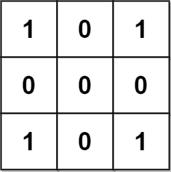
>
> ```
> 输入：grid = [[1,0,1],[0,0,0],[1,0,1]]
> 输出：0
> 解释：
> 网格图中没有任何金字塔或倒金字塔区域。
> ```
>
> **示例 4：**
>
> 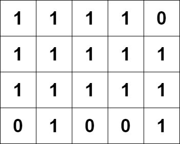
>
> 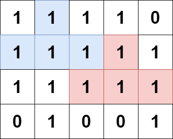
>
> 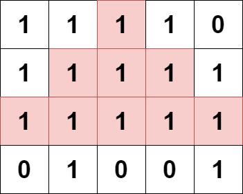
>
> 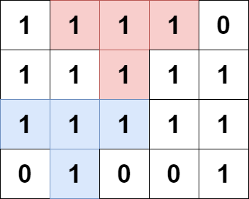
>
> ```
> 输入：grid = [[1,1,1,1,0],[1,1,1,1,1],[1,1,1,1,1],[0,1,0,0,1]]
> 输出：13
> 解释：
> 有 7 个金字塔区域。上图第二和第三张图中展示了它们中的 3 个。
> 有 6 个倒金字塔区域。上图中最后一张图展示了它们中的 2 个。
> 所以金字塔区域总数目为 7 + 6 = 13.
> ```
>
> **提示：**
>
> - `m == grid.length`
>
> - `n == grid[i].length`
>
> - `1 <= m, n <= 1000`
>
> - `1 <= m * n <= 10⁵`
>
> - `grid[i][j]` 要么是 `0` ，要么是 `1` 。

> **题解**
> 先求正金字塔。
>
> 定义 $\textit{dp}[i][j]$ 表示金字塔顶端位于 $(i,j)$ 时的最大层数（$1$ 层也算）。如果顶端在 $(i,j)$ 的金字塔最大能有 $x$ 层，那么顶端在 $(i,j)$ 的金字塔也可以有 $x-1,x-2,\cdots,1$ 层。由于要求区域内格子数目大于 $1$，统计答案的时候把 $1$ 层去掉，因此有 $x-1$ 个以 $(i,j)$ 为顶端的金字塔。
>
> 我们从 $\textit{grid}$ 的最后一行开始往上递推。转移的策略是在 $(i+1,j)$ 处的最大金字塔上套一层 **∧ 型的「外壳」**。具体来说，从 $(i,j)$ 出发向左下方向前进，求出能达到的最长连续 $1$ 的个数，根据 $\textit{dp}$ 的定义，这就是 $\textit{dp}[i+1][j-1]+1$；同理，向右下方向前进，能达到的最长连续 $1$ 的个数为 $\textit{dp}[i+1][j+1]+1$。取左右最长连续 $1$ 的个数的最小值即为「外壳」的高度。那么 $(i,j)$ 处的最大金字塔的高度为「外壳」的高度与 $(i+1,j)$ 处最大金字塔高度 $+1$ 的最小值。
>
> 即
>
> $$
> \textit{dp}[i][j] = \min(\textit{dp}[i+1][j-1]+1, \textit{dp}[i+1][j+1]+1, \textit{dp}[i+1][j]+1)
> $$
>
> 倒金字塔可以将 $\textit{grid}$ 上下颠倒后再求一遍正金字塔即可。
>
>
> 相似题目：
>
> - [CF1393D - Rarity and New Dress](https://codeforces.com/problemset/problem/1393/D)
