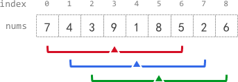

# 2090. 半径为 k 的子数组平均值

Medium · 难度分 1358 · [力扣原题](https://leetcode.cn/problems/k-radius-subarray-averages/)

所在刷题路径：灵神核心路线、灵神题单·滑动窗口与双指针

| 作者 | 题解 | 动画讲解 |
|---|---|---|
| 灵茶山艾府 | [📄 题解](灵茶山艾府.md) | [▶︎ 动画（GIF）](2090%20半径为%20k%20的子数组平均值%20·%20灵茶山艾府.gif) · [mp4 文件](2090%20半径为%20k%20的子数组平均值%20·%20灵茶山艾府.mp4) |
| yiduobo | [📄 题解](yiduobo.md) | [▶︎ 动画（GIF）](2090%20半径为%20k%20的子数组平均值%20·%20yiduobo.gif) · [mp4 文件](2090%20半径为%20k%20的子数组平均值%20·%20yiduobo.mp4) |

## 动画讲解

> 动图会循环播放；想暂停、拖进度条请下载上面表格里的 mp4 文件。

### 灵茶山艾府


### yiduobo


## 题目描述

给你一个下标从 **0** 开始的数组 `nums` ，数组中有 `n` 个整数，另给你一个整数 `k` 。

**半径为 k 的子数组平均值** 是指：`nums` 中一个以下标 `i` 为 **中心** 且 **半径** 为 `k` 的子数组中所有元素的平均值，即下标在 `i - k` 和 `i + k` 范围（**含** `i - k` 和 `i + k`）内所有元素的平均值。如果在下标 `i` 前或后不足 `k` 个元素，那么 **半径为 k 的子数组平均值** 是 `-1` 。

构建并返回一个长度为 `n` 的数组 `avgs` ，其中 `avgs[i]` 是以下标 `i` 为中心的子数组的 **半径为 k 的子数组平均值** 。

`x` 个元素的 **平均值** 是 `x` 个元素相加之和除以 `x` ，此时使用截断式 **整数除法** ，即需要去掉结果的小数部分。

- 例如，四个元素 `2`、`3`、`1` 和 `5` 的平均值是 `(2 + 3 + 1 + 5) / 4 = 11 / 4 = 2.75`，截断后得到 `2` 。

**示例 1：**



```

输入：nums = [7,4,3,9,1,8,5,2,6], k = 3
输出：[-1,-1,-1,5,4,4,-1,-1,-1]
解释：
- avg[0]、avg[1] 和 avg[2] 是 -1 ，因为在这几个下标前的元素数量都不足 k 个。
- 中心为下标 3 且半径为 3 的子数组的元素总和是：7 + 4 + 3 + 9 + 1 + 8 + 5 = 37 。
  使用截断式 整数除法，avg[3] = 37 / 7 = 5 。
- 中心为下标 4 的子数组，avg[4] = (4 + 3 + 9 + 1 + 8 + 5 + 2) / 7 = 4 。
- 中心为下标 5 的子数组，avg[5] = (3 + 9 + 1 + 8 + 5 + 2 + 6) / 7 = 4 。
- avg[6]、avg[7] 和 avg[8] 是 -1 ，因为在这几个下标后的元素数量都不足 k 个。
```

**示例 2：**

```

输入：nums = [100000], k = 0
输出：[100000]
解释：
- 中心为下标 0 且半径 0 的子数组的元素总和是：100000 。
  avg[0] = 100000 / 1 = 100000 。
```

**示例 3：**

```

输入：nums = [8], k = 100000
输出：[-1]
解释：
- avg[0] 是 -1 ，因为在下标 0 前后的元素数量均不足 k 。
```

**提示：**

- `n == nums.length`

- `1 <= n <= 10⁵`

- `0 <= nums[i], k <= 10⁵`

---
[↑ 返回 2000-2099](../README.md) · [总索引](../../../索引.md) · [仓库首页](../../../README.md)
