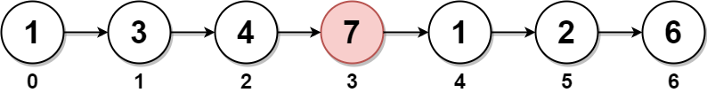

# 2095. 删除链表的中间节点

Medium · [力扣原题](https://leetcode.cn/problems/delete-the-middle-node-of-a-linked-list/)

所在刷题路径：灵神题单·链表树与回溯

| 作者 | 题解 | 动画讲解 |
|---|---|---|
| 灵茶山艾府 | [📄 题解](灵茶山艾府.md) | [▶︎ 动画（GIF）](2095%20删除链表的中间节点%20·%20灵茶山艾府.gif) · [mp4 文件](2095%20删除链表的中间节点%20·%20灵茶山艾府.mp4) |
| yiduobo | [📄 题解](yiduobo.md) | [▶︎ 动画（GIF）](2095%20删除链表的中间节点%20·%20yiduobo.gif) · [mp4 文件](2095%20删除链表的中间节点%20·%20yiduobo.mp4) |

## 动画讲解

> 动图会循环播放；想暂停、拖进度条请下载上面表格里的 mp4 文件。

### 灵茶山艾府


### yiduobo


## 题目描述

给你一个链表的头节点 `head` 。**删除** 链表的 **中间节点** ，并返回修改后的链表的头节点 `head` 。

长度为 `n` 链表的中间节点是从头数起第 `⌊n / 2⌋` 个节点（下标从 **0** 开始），其中 `⌊x⌋` 表示小于或等于 `x` 的最大整数。

- 对于 `n` = `1`、`2`、`3`、`4` 和 `5` 的情况，中间节点的下标分别是 `0`、`1`、`1`、`2` 和 `2` 。

**示例 1：**



```

输入：head = [1,3,4,7,1,2,6]
输出：[1,3,4,1,2,6]
解释：
上图表示给出的链表。节点的下标分别标注在每个节点的下方。
由于 n = 7 ，值为 7 的节点 3 是中间节点，用红色标注。
返回结果为移除节点后的新链表。
```

**示例 2：**


```

输入：head = [1,2,3,4]
输出：[1,2,4]
解释：
上图表示给出的链表。
对于 n = 4 ，值为 3 的节点 2 是中间节点，用红色标注。
```

**示例 3：**


```

输入：head = [2,1]
输出：[2]
解释：
上图表示给出的链表。
对于 n = 2 ，值为 1 的节点 1 是中间节点，用红色标注。
值为 2 的节点 0 是移除节点 1 后剩下的唯一一个节点。
```

**提示：**

- 链表中节点的数目在范围 `[1, 10⁵]` 内

- `1 <= Node.val <= 10⁵`

---
[↑ 返回 2000-2099](../README.md) · [总索引](../../../索引.md) · [仓库首页](../../../README.md)
