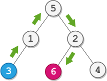

# DFS 求路径（Python/Java/C++/C/Go）

> **[2096. 从二叉树一个节点到另一个节点每一步的方向](https://leetcode.cn/problems/step-by-step-directions-from-a-binary-tree-node-to-another/solutions/1139430/bfs-zuo-fa-by-endlesscheng-dfcf/) · Medium · 难度分 1805**

> **所属题单**
> - [链表、二叉树与回溯 · 二、二叉树](../../../刷题路径/灵神原版题单/链表、二叉树与回溯/二、二叉树.md) · §2.8 最近公共祖先

> **题目描述**
> 给你一棵 **二叉树** 的根节点 `root` ，这棵二叉树总共有 `n` 个节点。每个节点的值为 `1` 到 `n` 中的一个整数，且互不相同。给你一个整数 `startValue` ，表示起点节点 `s` 的值，和另一个不同的整数 `destValue` ，表示终点节点 `t` 的值。
>
> 请找到从节点 `s` 到节点 `t` 的 **最短路径** ，并以字符串的形式返回每一步的方向。每一步用 **大写** 字母 `'L'` ，`'R'` 和 `'U'` 分别表示一种方向：
>
> - `'L'` 表示从一个节点前往它的 **左孩子** 节点。
>
> - `'R'` 表示从一个节点前往它的 **右孩子** 节点。
>
> - `'U'` 表示从一个节点前往它的 **父** 节点。
>
> 请你返回从 `s` 到 `t` **最短路径** 每一步的方向。
>
> **示例 1：**
>
> 
>
> ```
> 输入：root = [5,1,2,3,null,6,4], startValue = 3, destValue = 6
> 输出："UURL"
> 解释：最短路径为：3 → 1 → 5 → 2 → 6 。
> ```
>
> **示例 2：**
>
> 
>
> ```
> 输入：root = [2,1], startValue = 2, destValue = 1
> 输出："L"
> 解释：最短路径为：2 → 1 。
> ```
>
> **提示：**
>
> - 树中节点数目为 `n` 。
>
> - `2 <= n <= 10⁵`
>
> - `1 <= Node.val <= n`
>
> - 树中所有节点的值 **互不相同** 。
>
> - `1 <= startValue, destValue <= n`
>
> - `startValue != destValue`

> **题解**
> 首先，用 DFS 求出从根节点到 $\textit{startValue}$ 的移动路径，以及从根节点到 $\textit{destValue}$ 的移动路径。
>
> 例如：
>
> - 从根节点到 $\textit{startValue}$ 的移动路径为 $\texttt{RRLL}$。
> - 从根节点到 $\textit{destValue}$ 的移动路径为 $\texttt{RRRL}$。
>
> 两条路径的最长公共前缀为 $\texttt{RR}$，然后分道扬镳。根据最近公共祖先的定义，分道扬镳的位置就是最近公共祖先。
>
> - 从最近公共祖先到 $\textit{startValue}$ 的移动路径为 $\texttt{LL}$。
> - 从最近公共祖先到 $\textit{destValue}$ 的移动路径为 $\texttt{RL}$。
>
> 所以从 $\textit{startValue}$ 到 $\textit{destValue}$ 的移动路径为：
>
> 1. 从 $\textit{startValue}$ 往上走两步到最近公共祖先，即 $\texttt{UU}$。
> 2. 从最近公共祖先到 $\textit{destValue}$，即 $\texttt{RL}$。
> 3. 拼接得到 $\texttt{UURL}$。
>
> ## 写法一：两次 DFS
>
> ```python
> class Solution:
>     def getDirections(self, root: Optional[TreeNode], startValue: int, destValue: int) -> str:
>         path = []
>
>         # dfs 返回是否找到了 target
>         def dfs(node: Optional[TreeNode], target: int) -> bool:
>             if node is None:
>                 return False
>
>             # 找到 target
>             if node.val == target:
>                 return True
>
>             # 往左找 target
>             path.append('L')
>             if dfs(node.left, target):
>                 return True
>
>             # 往右找 target
>             path[-1] = 'R'  # 直接覆盖，无需恢复现场
>             if dfs(node.right, target):
>                 return True
>
>             path.pop()  # 恢复现场
>             return False
>
>         dfs(root, startValue)
>         path_to_start = path.copy()
>
>         path.clear()
>         dfs(root, destValue)
>         path_to_dest = path
>
>         i = 0
>         while i < min(len(path_to_start), len(path_to_dest)) and path_to_start[i] == path_to_dest[i]:
>             i += 1
>
>         return 'U' * (len(path_to_start) - i) + ''.join(path_to_dest[i:])
> ```
>
>
> ## 写法二：一次 DFS
>
> ```python
> class Solution:
>     def getDirections(self, root: Optional[TreeNode], startValue: int, destValue: int) -> str:
>         path_to_start = path_to_dest = None
>         path = []
>
>         def dfs(node: Optional[TreeNode]) -> None:
>             if node is None:
>                 return
>
>             nonlocal path_to_start, path_to_dest
>             if node.val == startValue:
>                 path_to_start = path.copy()
>             elif node.val == destValue:
>                 path_to_dest = path.copy()
>
>             # 往左找
>             path.append('L')
>             dfs(node.left)
>
>             # 往右找
>             path[-1] = 'R'  # 直接覆盖，无需恢复现场
>             dfs(node.right)
>             path.pop()  # 恢复现场
>
>         dfs(root)
>
>         i = 0
>         while i < min(len(path_to_start), len(path_to_dest)) and path_to_start[i] == path_to_dest[i]:
>             i += 1
>
>         return 'U' * (len(path_to_start) - i) + ''.join(path_to_dest[i:])
> ```
>
>
> #### 复杂度分析
>
> - 时间复杂度：$\mathcal{O}(n)$，其中 $n$ 是二叉树的节点个数。
> - 空间复杂度：$\mathcal{O}(n)$。
>
> ## 分类题单
>
> [如何科学刷题？](https://leetcode.cn/circle/discuss/RvFUtj/)
>
> 1. [滑动窗口与双指针（定长/不定长/单序列/双序列/三指针/分组循环）](https://leetcode.cn/circle/discuss/0viNMK/)
> 2. [二分算法（二分答案/最小化最大值/最大化最小值/第K小）](https://leetcode.cn/circle/discuss/SqopEo/)
> 3. [单调栈（基础/矩形面积/贡献法/最小字典序）](https://leetcode.cn/circle/discuss/9oZFK9/)
> 4. [网格图（DFS/BFS/综合应用）](https://leetcode.cn/circle/discuss/YiXPXW/)
> 5. [位运算（基础/性质/拆位/试填/恒等式/思维）](https://leetcode.cn/circle/discuss/dHn9Vk/)
> 6. [图论算法（DFS/BFS/拓扑排序/基环树/最短路/最小生成树/网络流）](https://leetcode.cn/circle/discuss/01LUak/)
> 7. [动态规划（入门/背包/划分/状态机/区间/状压/数位/数据结构优化/树形/博弈/概率期望）](https://leetcode.cn/circle/discuss/tXLS3i/)
> 8. [常用数据结构（前缀和/差分/栈/队列/堆/字典树/并查集/树状数组/线段树）](https://leetcode.cn/circle/discuss/mOr1u6/)
> 9. [数学算法（数论/组合/概率期望/博弈/计算几何/随机算法）](https://leetcode.cn/circle/discuss/IYT3ss/)
> 10. [贪心与思维（基本贪心策略/反悔/区间/字典序/数学/思维/脑筋急转弯/构造）](https://leetcode.cn/circle/discuss/g6KTKL/)
> 11. [链表、二叉树与回溯（前后指针/快慢指针/DFS/BFS/直径/LCA/一般树）](https://leetcode.cn/circle/discuss/K0n2gO/)
> 12. [字符串（KMP/Z函数/Manacher/字符串哈希/AC自动机/后缀数组/子序列自动机）](https://leetcode.cn/circle/discuss/SJFwQI/)
>
> [我的题解精选（已分类）](https://github.com/EndlessCheng/codeforces-go/blob/master/leetcode/SOLUTIONS.md)
>
> 欢迎关注 [B站@灵茶山艾府](https://space.bilibili.com/206214)
