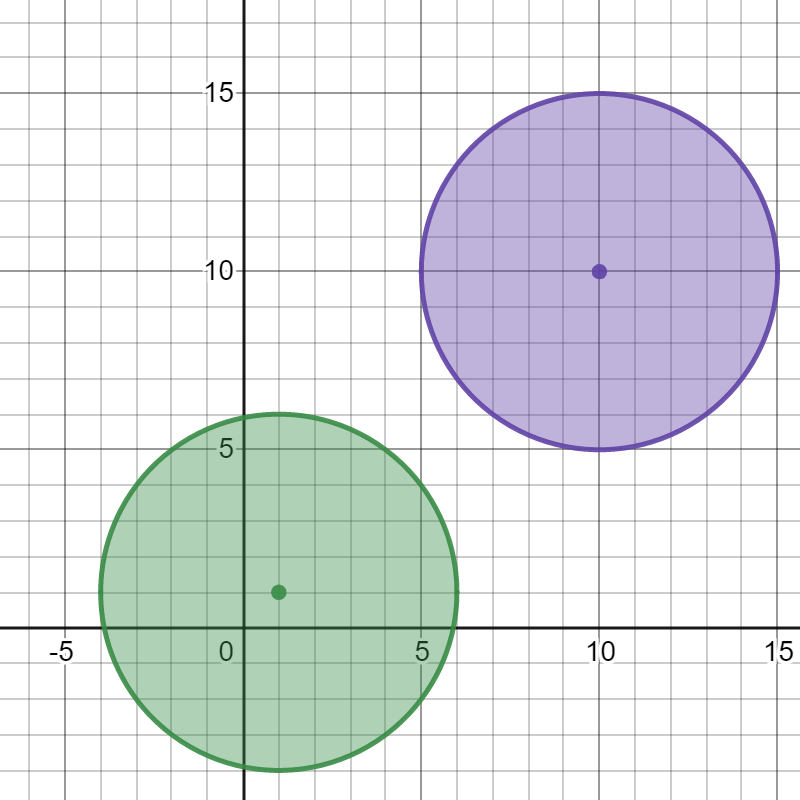
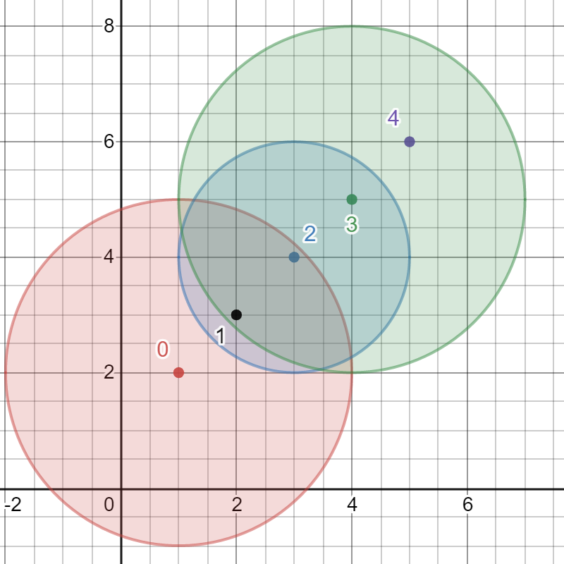

# 两种方法：DFS / Bitset+Floyd（Python/Java/C++/Go）

> **[2101. 引爆最多的炸弹](https://leetcode.cn/problems/detonate-the-maximum-bombs/solutions/1152450/jian-tu-bao-li-mei-ju-suo-you-qi-dian-by-h4mj/) · Medium · 难度分 1880**

> **所属题单**
> - [图论算法 · 一、图的遍历](../../../刷题路径/灵神原版题单/图论算法/一、图的遍历.md) · §1.1 深度优先搜索（DFS）
> - [图论算法 · 三、最短路](../../../刷题路径/灵神原版题单/图论算法/三、最短路.md) · §3.2 全源最短路：Floyd 算法

> **题目描述**
> 给你一个炸弹列表。一个炸弹的 **爆炸范围** 定义为以炸弹为圆心的一个圆。
>
> 炸弹用一个下标从 **0** 开始的二维整数数组 `bombs` 表示，其中 `bombs[i] = [x_i, y_i, r_i]` 。`x_i` 和 `y_i` 表示第 `i` 个炸弹的 X 和 Y 坐标，`r_i` 表示爆炸范围的 **半径** 。
>
> 你需要选择引爆 **一个** 炸弹。当这个炸弹被引爆时，**所有** 在它爆炸范围内的炸弹都会被引爆，这些炸弹会进一步将它们爆炸范围内的其他炸弹引爆。
>
> 给你数组 `bombs` ，请你返回在引爆 **一个** 炸弹的前提下，**最多** 能引爆的炸弹数目。
>
> **示例 1：**
>
> 
>
> ```
> 输入：bombs = [[2,1,3],[6,1,4]]
> 输出：2
> 解释：
> 上图展示了 2 个炸弹的位置和爆炸范围。
> 如果我们引爆左边的炸弹，右边的炸弹不会被影响。
> 但如果我们引爆右边的炸弹，两个炸弹都会爆炸。
> 所以最多能引爆的炸弹数目是 max(1, 2) = 2 。
> ```
>
> **示例 2：**
>
> 
>
> ```
> 输入：bombs = [[1,1,5],[10,10,5]]
> 输出：1
> 解释：
> 引爆任意一个炸弹都不会引爆另一个炸弹。所以最多能引爆的炸弹数目为 1 。
> ```
>
> **示例 3：**
>
> 
>
> ```
> 输入：bombs = [[1,2,3],[2,3,1],[3,4,2],[4,5,3],[5,6,4]]
> 输出：5
> 解释：
> 最佳引爆炸弹为炸弹 0 ，因为：
> - 炸弹 0 引爆炸弹 1 和 2 。红色圆表示炸弹 0 的爆炸范围。
> - 炸弹 2 引爆炸弹 3 。蓝色圆表示炸弹 2 的爆炸范围。
> - 炸弹 3 引爆炸弹 4 。绿色圆表示炸弹 3 的爆炸范围。
> 所以总共有 5 个炸弹被引爆。
> ```
>
> **提示：**
>
> - `1 <= bombs.length <= 100`
>
> - `bombs[i].length == 3`
>
> - `1 <= x_i, y_i, r_i <= 10⁵`

> **题解**
> ## 方法一：建图 + 枚举起点 DFS
>
> 建图：$n$ 个炸弹看成 $n$ 个节点，如果炸弹 $x$ 可以引爆炸弹 $y$，那么就连一条从节点 $x$ 到节点 $y$ 的**有向边**。
>
> 为什么不是无向边？看示例 1，右边的炸弹可以引爆左边的炸弹，但是左边的炸弹无法引爆右边的炸弹，所以是有向边。
>
> 建图后，枚举 $i$ 作为一开始引爆的炸弹，从 $i$ 开始 **DFS** 这张图，统计能访问到的节点个数，更新答案的最大值。
>
> **小优化**：如果某次 DFS 能访问到 $n$ 个点，说明我们可以引爆所有炸弹，答案就是 $n$，推出循环。
>
> #### 答疑
>
> **问**：为什么不能用并查集？
>
> **答**：注意本题是有向图。例如炸弹 $0$ 可以引爆炸弹 $2$，炸弹 $1$ 可以引爆炸弹 $2$，对应有向边 $0\rightarrow 2,\ 1\rightarrow 2$，那么正确答案是 $2$。如果用并查集做的话，会把 $0,1,2$ 三个点合并起来，计算出错误的答案 $3$。
>
> ```python
> class Solution:
>     def maximumDetonation(self, bombs: List[List[int]]) -> int:
>         n = len(bombs)
>         g = [[] for _ in range(n)]
>         for i, (x, y, r) in enumerate(bombs):
>             for j, (x2, y2, _) in enumerate(bombs):
>                 dx = x - x2
>                 dy = y - y2
>                 if j != i and dx * dx + dy * dy <= r * r:
>                     g[i].append(j)  # i 可以引爆 j
>
>         def dfs(x: int) -> int:
>             vis[x] = True
>             cnt = 1
>             for y in g[x]:
>                 if not vis[y]:
>                     cnt += dfs(y)
>             return cnt
>
>         ans = 0
>         for i in range(n):
>             vis = [False] * n
>             ans = max(ans, dfs(i))
>             if ans == n:
>                 break
>         return ans
> ```
>
>
> #### 复杂度分析
>
> - 时间复杂度：$\mathcal{O}(n^3)$，其中 $n$ 是 $\textit{bombs}$ 的长度。注意图中至多有 $\mathcal{O}(n^2)$ 条边，每次 DFS 的时间复杂度为 $\mathcal{O}(n^2)$。
> - 空间复杂度：$\mathcal{O}(n^2)$。
>
> ## 方法二：Bitset 优化 Floyd
>
> **前置知识**：[带你发明 Floyd 算法：从记忆化搜索到递推](../../1300-1399/1334%20阈值距离内邻居最少的城市/灵茶山艾府.md)
>
> > Floyd 算法可以计算任意两点间的最短路长度。但如果只要求计算任意两点间「能否」到达，则可以用 bool 数组代替 int 数组。进一步地，可以把 bool 数组压缩成 bitset。
>
> 定义 $f[i]$ 表示 $i$ 可以到达的节点集合。注意 $i$ 一定在 $f[i]$ 中。
>
> 如果 $i$ 可以到达 $k$，那么 $k$ 能到达的点，$i$ 也可以到达，于是 $i$ 能到达的点就是 $f[i]$ 和 $f[k]$ 的并集，即
>
> $$
> f[i] = f[i]\cup f[k]
> $$
>
> 代码循环顺序同 Floyd 算法。
>
> 初始值：集合 $f[i]$ 初始包含 $i$ 及其邻居节点。
>
> 答案：所有 $f[i]$ 集合大小的最大值。
>
> 代码中用到了一些位运算，原理见 [从集合论到位运算](https://leetcode.cn/circle/discuss/CaOJ45/)。
>
> ```python
> class Solution:
>     def maximumDetonation(self, bombs: List[List[int]]) -> int:
>         n = len(bombs)
>         f = [0] * n
>         for i, (x, y, r) in enumerate(bombs):
>             for j, (x2, y2, _) in enumerate(bombs):
>                 dx = x - x2
>                 dy = y - y2
>                 if dx * dx + dy * dy <= r * r:
>                     f[i] |= 1 << j  # i 可以到达 j
>
>         for k in range(n):
>             for i in range(n):
>                 if f[i] >> k & 1:  # i 可以到达 k
>                     f[i] |= f[k]  # i 也可以到 k 可以到达的点
>
>         return max(s.bit_count() for s in f)  # 集合大小的最大值
> ```
>
>
> #### 复杂度分析
>
> - 时间复杂度：$\mathcal{O}(n^3/w)$，其中 $n$ 是 $\textit{bombs}$ 的长度，$w=32$ 或 $64$。
> - 空间复杂度：$\mathcal{O}(n^2/w)$。
>
> ## 思考题
>
> 如果可以选择引爆 **两个** 炸弹呢？
>
> 欢迎在评论区分享你的思路/代码。
>
> ## 分类题单
>
> [如何科学刷题？](https://leetcode.cn/circle/discuss/RvFUtj/)
>
> 1. [滑动窗口（定长/不定长/多指针）](https://leetcode.cn/circle/discuss/0viNMK/)
> 2. [二分算法（二分答案/最小化最大值/最大化最小值/第K小）](https://leetcode.cn/circle/discuss/SqopEo/)
> 3. [单调栈（基础/矩形面积/贡献法/最小字典序）](https://leetcode.cn/circle/discuss/9oZFK9/)
> 4. [网格图（DFS/BFS/综合应用）](https://leetcode.cn/circle/discuss/YiXPXW/)
> 5. [位运算（基础/性质/拆位/试填/恒等式/思维）](https://leetcode.cn/circle/discuss/dHn9Vk/)
> 6. [图论算法（DFS/BFS/拓扑排序/最短路/最小生成树/二分图/基环树/欧拉路径）](https://leetcode.cn/circle/discuss/01LUak/)
> 7. [动态规划（入门/背包/状态机/划分/区间/状压/数位/数据结构优化/树形/博弈/概率期望）](https://leetcode.cn/circle/discuss/tXLS3i/)
> 8. [常用数据结构（前缀和/差分/栈/队列/堆/字典树/并查集/树状数组/线段树）](https://leetcode.cn/circle/discuss/mOr1u6/)
> 9. [数学算法（数论/组合/概率期望/博弈/计算几何/随机算法）](https://leetcode.cn/circle/discuss/IYT3ss/)
> 10. [贪心算法（基本贪心策略/反悔/区间/字典序/数学/思维/脑筋急转弯/构造）](https://leetcode.cn/circle/discuss/g6KTKL/)
>
> [我的题解精选（已分类）](https://github.com/EndlessCheng/codeforces-go/blob/master/leetcode/SOLUTIONS.md)
>
> 欢迎关注 [B站@灵茶山艾府](https://space.bilibili.com/206214)
