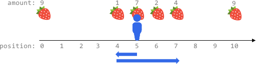
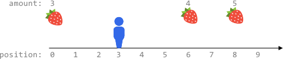

# 2106. 摘水果

Hard · 难度分 2062 · [力扣原题](https://leetcode.cn/problems/maximum-fruits-harvested-after-at-most-k-steps/)

所在刷题路径：灵神题单·滑动窗口与双指针

| 作者 | 题解 | 动画讲解 |
|---|---|---|
| 灵茶山艾府 | [📄 题解](灵茶山艾府.md) | [▶︎ 2106 摘水果 · 灵茶山艾府.mp4](2106%20摘水果%20·%20灵茶山艾府.mp4) |
| yiduobo | [📄 题解](yiduobo.md) | [▶︎ 2106 摘水果 · yiduobo.mp4](2106%20摘水果%20·%20yiduobo.mp4) |

## 题目描述

在一个无限的 x 坐标轴上，有许多水果分布在其中某些位置。给你一个二维整数数组 `fruits` ，其中 `fruits[i] = [position_i, amount_i]` 表示共有 `amount_i` 个水果放置在 `position_i` 上。`fruits` 已经按 `position_i` **升序排列** ，每个 `position_i` **互不相同** 。

另给你两个整数 `startPos` 和 `k` 。最初，你位于 `startPos` 。从任何位置，你可以选择 **向左或者向右** 走。在 x 轴上每移动 **一个单位** ，就记作 **一步** 。你总共可以走 **最多** `k` 步。你每达到一个位置，都会摘掉全部的水果，水果也将从该位置消失（不会再生）。

返回你可以摘到水果的 **最大总数** 。

**示例 1：**


```
输入：fruits = [[2,8],[6,3],[8,6]], startPos = 5, k = 4
输出：9
解释：
最佳路线为：
- 向右移动到位置 6 ，摘到 3 个水果
- 向右移动到位置 8 ，摘到 6 个水果
移动 3 步，共摘到 3 + 6 = 9 个水果
```

**示例 2：**



```
输入：fruits = [[0,9],[4,1],[5,7],[6,2],[7,4],[10,9]], startPos = 5, k = 4
输出：14
解释：
可以移动最多 k = 4 步，所以无法到达位置 0 和位置 10 。
最佳路线为：
- 在初始位置 5 ，摘到 7 个水果
- 向左移动到位置 4 ，摘到 1 个水果
- 向右移动到位置 6 ，摘到 2 个水果
- 向右移动到位置 7 ，摘到 4 个水果
移动 1 + 3 = 4 步，共摘到 7 + 1 + 2 + 4 = 14 个水果
```

**示例 3：**



```
输入：fruits = [[0,3],[6,4],[8,5]], startPos = 3, k = 2
输出：0
解释：
最多可以移动 k = 2 步，无法到达任一有水果的地方
```

**提示：**

- `1 <= fruits.length <= 10⁵`

- `fruits[i].length == 2`

- `0 <= startPos, position_i <= 2 * 10⁵`

- 对于任意 `i > 0` ，`position_(i-1) < position_i` 均成立（下标从 **0** 开始计数）

- `1 <= amount_i <= 10⁴`

- `0 <= k <= 2 * 10⁵`

---
[↑ 返回 2100-2199](../README.md) · [总索引](../../../索引.md) · [仓库首页](../../../README.md)
