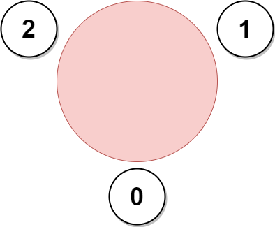
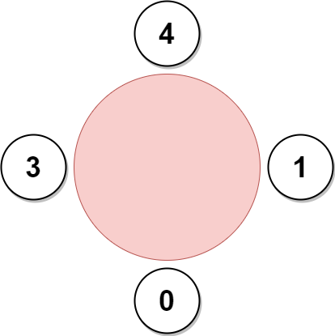
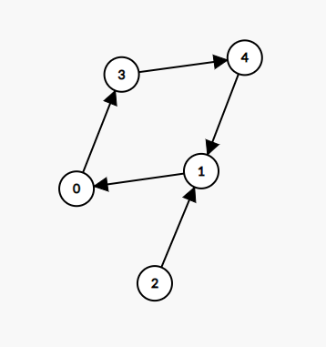
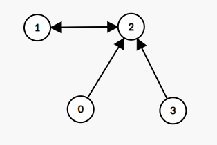
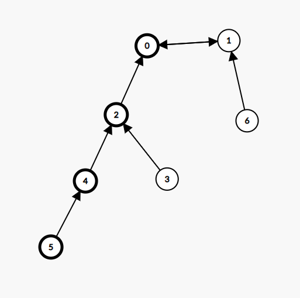

# 内向基环树：拓扑排序 + 分类讨论（Python/Java/C++/Go/JS/Rust）

> **[2127. 参加会议的最多员工数](https://leetcode.cn/problems/maximum-employees-to-be-invited-to-a-meeting/solutions/1187830/nei-xiang-ji-huan-shu-tuo-bu-pai-xu-fen-c1i1b/) · Hard · 难度分 2449**

> **所属题单**
> - [图论算法 · 二、拓扑排序](../../../刷题路径/灵神原版题单/图论算法/二、拓扑排序.md) · §2.3 基环树

> **题目描述**
> 一个公司准备组织一场会议，邀请名单上有 `n` 位员工。公司准备了一张 **圆形** 的桌子，可以坐下 **任意数目** 的员工。
>
> 员工编号为 `0` 到 `n - 1` 。每位员工都有一位 **喜欢** 的员工，每位员工 **当且仅当** 他被安排在喜欢员工的旁边，他才会参加会议。每位员工喜欢的员工 **不会** 是他自己。
>
> 给你一个下标从 **0** 开始的整数数组 `favorite` ，其中 `favorite[i]` 表示第 `i` 位员工喜欢的员工。请你返回参加会议的 **最多员工数目** 。
>
> **示例 1：**
>
> 
>
> ```
>
> 输入：favorite = [2,2,1,2]
> 输出：3
> 解释：
> 上图展示了公司邀请员工 0，1 和 2 参加会议以及他们在圆桌上的座位。
> 没办法邀请所有员工参与会议，因为员工 2 没办法同时坐在 0，1 和 3 员工的旁边。
> 注意，公司也可以邀请员工 1，2 和 3 参加会议。
> 所以最多参加会议的员工数目为 3 。
> ```
>
> **示例 2：**
>
> ```
>
> 输入：favorite = [1,2,0]
> 输出：3
> 解释：
> 每个员工都至少是另一个员工喜欢的员工。所以公司邀请他们所有人参加会议的前提是所有人都参加了会议。
> 座位安排同图 1 所示：
> - 员工 0 坐在员工 2 和 1 之间。
> - 员工 1 坐在员工 0 和 2 之间。
> - 员工 2 坐在员工 1 和 0 之间。
> 参与会议的最多员工数目为 3 。
> ```
>
> **示例 3：**
>
> 
>
> ```
>
> 输入：favorite = [3,0,1,4,1]
> 输出：4
> 解释：
> 上图展示了公司可以邀请员工 0，1，3 和 4 参加会议以及他们在圆桌上的座位。
> 员工 2 无法参加，因为他喜欢的员工 1 旁边的座位已经被占领了。
> 所以公司只能不邀请员工 2 。
> 参加会议的最多员工数目为 4 。
> ```
>
> **提示：**
>
> - `n == favorite.length`
>
> - `2 <= n <= 10⁵`
>
> - `0 <= favorite[i] <= n - 1`
>
> - `favorite[i] != i`

> **题解**
> ## 思路
>
> 从 $i$ 向 $\textit{favorite}[i]$ 连边，可以得到一张有向图。由于每个大小为 $k$ 的连通块都有 $k$ 个点和 $k$ 条边，所以每个连通块必定有且仅有一个环，且由于每个点的出度均为 $1$，这样的有向图又叫做内向**基环树 (pseudotree)**，由基环树组成的森林叫**基环树森林 (pseudoforest)**。
>
> 每一个内向基环树（连通块）都由一个**基环**和其余指向基环的**树枝**组成。例如示例 $3$ 可以得到如下内向基环树，其基环由节点 $0$、$1$、$3$ 和 $4$ 组成，节点 $2$ 为其树枝：
>
> 
>
> 特别地，基环可能只包含两个节点。例如示例 $1$ 可以得到如下内向基环树，其基环只包含节点 $1$ 和 $2$，而节点 $0$ 和 $3$ 组成其树枝：
>
> 
>
> 对于本题来说，这两类基环树在组成圆桌时会有明显区别，下文会说明这一点。
>
> 先来看看基环长度大于 $2$ 的情况。基环上的节点是可以组成一个圆桌的；而树枝上的点，若插入圆桌上 $x\rightarrow y$ 这两人中间，会导致节点 $x$ 无法和其喜欢的员工坐在一起，因此**树枝上的点是无法插入圆桌的**；此外，树枝上的点也不能单独组成圆桌，因为这样会存在一个出度为 $0$ 的节点，无法和其喜欢的员工坐在一起。对于其余内向基环树（连通块）上的节点，和树枝同理，也无法插入该基环组成的圆桌。
>
> 因此，对于基环长度大于 $2$ 的情况，圆桌的最大员工数目即为最大的基环长度，记作 $\textit{maxRingSize}$。
>
> 下面来分析基环长度等于 $2$ 的情况。
>
> 以如下基环树为例，$0$ 和 $1$ 组成基环，其余节点组成树枝：
>
> 
>
> 可以先让 $0$ 和 $1$ 坐在圆桌旁（假设 $0$ 坐在 $1$ 左侧），那么 $0$ 这一侧的树枝只能坐在 $0$ 的左侧，而 $1$ 这一侧的树枝只能坐在 $1$ 的右侧。
>
> $2$ 可以紧靠着坐在 $0$ 的左侧，而 $3$ 和 $4$ 只能选一个坐在 $2$ 的左侧（如果 $4$ 紧靠着坐在 $2$ 的左侧，那么 $3$ 是无法紧靠着坐在 $4$ 的左侧的，反之亦然）。
>
> 这意味着从 $0$ 出发倒着找树枝上的点（即沿着反图上的边），每个点只能在其反图上选择一个儿子，因此 $0$ 这一侧的节点必须组成一条链，那么可以找**最长的那条链**，即上图加粗的节点。
>
> 对于 $1$ 这一侧也同理。将这两条最长链拼起来，即为该基环树能组成的圆桌的最大员工数。
>
> 对于多个基环长度等于 $2$ 的基环树，每个基环树所对应的链，都可以拼在其余链的末尾，因此可以**将这些链全部拼成一个圆桌**，其大小记作 $\textit{sumChainSize}$。
>
> 答案即为 $\max(\textit{maxRingSize},\textit{sumChainSize})$。
>
> ## 实现细节
>
> 通过一次拓扑排序，可以「剪掉」所有树枝。因为拓扑排序后，树枝节点的入度均为 $0$，基环节点的入度均为 $1$。这样就可以将基环和树枝区分开，从而简化后续处理流程：
>
> - 如果要遍历基环，可以从入度为 $1$ 的节点出发，遍历其余入度为 $1$ 的节点。
> - 如果要遍历树枝，可以以基环与树枝的连接处为起点，顺着反图来遍历树枝，从而将问题转化成一个树形问题。
>
> 注意创建反图的过程可以在拓扑排序中完成，这样创建的反图是不包含基环的，遍历的时候更方便。
>
> 对于本题，可以遍历所有基环，并按基环长度分类计算：
>
> - 对于长度大于 $2$ 的基环，取基环长度的最大值；
> - 对于长度等于 $2$ 的基环，可以从基环上的点出发，在反图上找到最大的树枝节点深度。
>
> ```python
> class Solution:
>     def maximumInvitations(self, favorite: List[int]) -> int:
>         n = len(favorite)
>         deg = [0] * n
>         for f in favorite:
>             deg[f] += 1  # 统计基环树每个节点的入度
>
>         rg = [[] for _ in range(n)]  # 反图
>         q = deque(i for i, d in enumerate(deg) if d == 0)
>         while q:  # 拓扑排序，剪掉图上所有树枝
>             x = q.popleft()
>             y = favorite[x]  # x 只有一条出边
>             rg[y].append(x)
>             deg[y] -= 1
>             if deg[y] == 0:
>                 q.append(y)
>
>         # 通过反图 rg 寻找树枝上最深的链
>         def rdfs(x: int) -> int:
>             max_depth = 1
>             for son in rg[x]:
>                 max_depth = max(max_depth, rdfs(son) + 1)
>             return max_depth
>
>         max_ring_size = sum_chain_size = 0
>         for i, d in enumerate(deg):
>             if d == 0: continue
>
>             # 遍历基环上的点
>             deg[i] = 0  # 将基环上的点的入度标记为 0，避免重复访问
>             ring_size = 1  # 基环长度
>             x = favorite[i]
>             while x != i:
>                 deg[x] = 0  # 将基环上的点的入度标记为 0，避免重复访问
>                 ring_size += 1
>                 x = favorite[x]
>
>             if ring_size == 2:  # 基环长度为 2
>                 sum_chain_size += rdfs(i) + rdfs(favorite[i])  # 累加两条最长链的长度
>             else:
>                 max_ring_size = max(max_ring_size, ring_size)  # 取所有基环长度的最大值
>         return max(max_ring_size, sum_chain_size)
> ```
>
>
> 对于本题来说，还有更加简洁的写法（特化的写法）：在拓扑排序的同时，计算出最长链的长度，这样就不需要建反图，也不需要在反图上找最长链了。（参考 [@Class](https://leetcode.cn/u/class_/) 的评论）
>
> ```python
> class Solution:
>     def maximumInvitations(self, favorite: List[int]) -> int:
>         n = len(favorite)
>         deg = [0] * n
>         for f in favorite:
>             deg[f] += 1  # 统计基环树每个节点的入度
>
>         max_depth = [1] * n
>         q = deque(i for i, d in enumerate(deg) if d == 0)
>         while q:  # 拓扑排序，剪掉图上所有树枝
>             x = q.popleft()
>             y = favorite[x]  # x 只有一条出边
>             max_depth[y] = max_depth[x] + 1
>             deg[y] -= 1
>             if deg[y] == 0:
>                 q.append(y)
>
>         max_ring_size = sum_chain_size = 0
>         for i, d in enumerate(deg):
>             if d == 0: continue
>
>             # 遍历基环上的点
>             deg[i] = 0  # 将基环上的点的入度标记为 0，避免重复访问
>             ring_size = 1  # 基环长度
>             x = favorite[i]
>             while x != i:
>                 deg[x] = 0  # 将基环上的点的入度标记为 0，避免重复访问
>                 ring_size += 1
>                 x = favorite[x]
>
>             if ring_size == 2:  # 基环长度为 2
>                 sum_chain_size += max_depth[i] + max_depth[favorite[i]]  # 累加两条最长链的长度
>             else:
>                 max_ring_size = max(max_ring_size, ring_size)  # 取所有基环长度的最大值
>         return max(max_ring_size, sum_chain_size)
> ```
>
>
> #### 复杂度分析
>
> - 时间复杂度：$\mathcal{O}(n)$。其中 $n$ 为 $\textit{favorite}$ 的长度。拓扑排序和遍历基环均为 $\mathcal{O}(n)$。
> - 空间复杂度：$\mathcal{O}(n)$。
>
> 欢迎关注 [B站@灵茶山艾府](https://space.bilibili.com/206214)
>
> 更多精彩题解，请看 [往期题解精选（已分类）](https://github.com/EndlessCheng/codeforces-go/blob/master/leetcode/SOLUTIONS.md)
