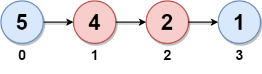
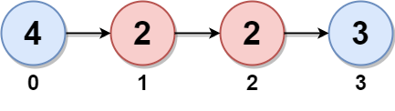
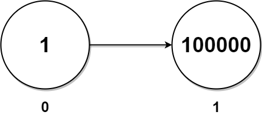

# 两种方法：递归 / 找中点+反转右半（Python/Java/C++/Go）

> **[2130. 链表最大孪生和](https://leetcode.cn/problems/maximum-twin-sum-of-a-linked-list/solutions/3974815/liang-chong-fang-fa-di-gui-zhao-zhong-di-czvg/) · Medium**

> **所属题单**
> - [链表、二叉树与回溯 · 一、链表](../../../刷题路径/灵神原版题单/链表、二叉树与回溯/一、链表.md) · §1.6 快慢指针

> **题目描述**
> 在一个大小为 `n` 且 `n` 为 **偶数** 的链表中，对于 `0 <= i <= (n / 2) - 1` 的 `i` ，第 `i` 个节点（下标从 **0** 开始）的孪生节点为第 `(n-1-i)` 个节点 。
>
> - 比方说，`n = 4` 那么节点 `0` 是节点 `3` 的孪生节点，节点 `1` 是节点 `2` 的孪生节点。这是长度为 `n = 4` 的链表中所有的孪生节点。
>
> **孪生和** 定义为一个节点和它孪生节点两者值之和。
>
> 给你一个长度为偶数的链表的头节点 `head` ，请你返回链表的 **最大孪生和** 。
>
> **示例 1：**
>
> 
>
> ```
> 输入：head = [5,4,2,1]
> 输出：6
> 解释：
> 节点 0 和节点 1 分别是节点 3 和 2 的孪生节点。孪生和都为 6 。
> 链表中没有其他孪生节点。
> 所以，链表的最大孪生和是 6 。
> ```
>
> **示例 2：**
>
> 
>
> ```
> 输入：head = [4,2,2,3]
> 输出：7
> 解释：
> 链表中的孪生节点为：
> - 节点 0 是节点 3 的孪生节点，孪生和为 4 + 3 = 7 。
> - 节点 1 是节点 2 的孪生节点，孪生和为 2 + 2 = 4 。
> 所以，最大孪生和为 max(7, 4) = 7 。
> ```
>
> **示例 3：**
>
> 
>
> ```
> 输入：head = [1,100000]
> 输出：100001
> 解释：
> 链表中只有一对孪生节点，孪生和为 1 + 100000 = 100001 。
> ```
>
> **提示：**
>
> - 链表的节点数目是 `[2, 10⁵]` 中的 **偶数** 。
>
> - `1 <= Node.val <= 10⁵`

> **题解**
> 本题思路与 [234. 回文链表](https://leetcode.cn/problems/palindrome-linked-list/) 是一样的，请看 [我的题解](../../0200-0299/0234%20回文链表/灵茶山艾府.md)。
>
> 注意题目保证链表长度是**偶数**。
>
> ## 方法一：递归
>
> ```python
> class Solution:
>     def pairSum(self, head: Optional[ListNode]) -> int:
>         ans = 0
>         left = head
>
>         def dfs(right: Optional[ListNode]) -> None:
>             # 「递」，先把 right 移到链表末尾
>             if right.next:
>                 dfs(right.next)
>             # 「归」的过程就是在从右到左遍历链表
>             nonlocal ans, left
>             ans = max(ans, left.val + right.val)
>             left = left.next  # left 往右走
>             # 归，right 会往左走
>
>         dfs(head)
>         return ans
> ```
>
>
> #### 复杂度分析
>
> - 时间复杂度：$\mathcal{O}(n)$，其中 $n$ 是链表的长度（节点个数）。
> - 空间复杂度：$\mathcal{O}(n)$。递归需要 $\mathcal{O}(n)$ 的栈空间。
>
> ## 方法二：迭代
>
> ```python
> class Solution:
>     # 876. 链表的中间结点
>     def middleNode(self, head: Optional[ListNode]) -> Optional[ListNode]:
>         slow = fast = head
>         while fast and fast.next:
>             slow = slow.next
>             fast = fast.next.next
>         return slow
>
>     # 206. 反转链表
>     def reverseList(self, head: Optional[ListNode]) -> Optional[ListNode]:
>         pre, cur = None, head
>         while cur:
>             nxt = cur.next
>             cur.next = pre
>             pre = cur
>             cur = nxt
>         return pre
>
>     def pairSum(self, head: Optional[ListNode]) -> int:
>         mid = self.middleNode(head)
>         head2 = self.reverseList(mid)
>
>         ans = 0
>         while head2:
>             ans = max(ans, head.val + head2.val)
>             head = head.next
>             head2 = head2.next
>         return ans
> ```
>
>
> #### 复杂度分析
>
> - 时间复杂度：$\mathcal{O}(n)$，其中 $n$ 是链表的长度（节点个数）。
> - 空间复杂度：$\mathcal{O}(1)$。
>
> ## 分类题单
>
> [如何科学刷题？](https://leetcode.cn/circle/discuss/RvFUtj/)
>
> 1. [滑动窗口与双指针（定长/不定长/单序列/双序列/三指针/分组循环）](https://leetcode.cn/circle/discuss/0viNMK/)
> 2. [二分算法（二分答案/最小化最大值/最大化最小值/第K小）](https://leetcode.cn/circle/discuss/SqopEo/)
> 3. [单调栈（基础/矩形面积/贡献法/最小字典序）](https://leetcode.cn/circle/discuss/9oZFK9/)
> 4. [网格图（DFS/BFS/综合应用）](https://leetcode.cn/circle/discuss/YiXPXW/)
> 5. [位运算（基础/性质/拆位/试填/恒等式/思维）](https://leetcode.cn/circle/discuss/dHn9Vk/)
> 6. [图论算法（DFS/BFS/拓扑排序/基环树/最短路/最小生成树/网络流）](https://leetcode.cn/circle/discuss/01LUak/)
> 7. [动态规划（入门/背包/划分/状态机/区间/状压/数位/数据结构优化/树形/博弈/概率期望）](https://leetcode.cn/circle/discuss/tXLS3i/)
> 8. [常用数据结构（前缀和/差分/栈/队列/堆/字典树/并查集/树状数组/线段树）](https://leetcode.cn/circle/discuss/mOr1u6/)
> 9. [数学算法（数论/组合/概率期望/博弈/计算几何/随机算法）](https://leetcode.cn/circle/discuss/IYT3ss/)
> 10. [贪心与思维（基本贪心策略/反悔/区间/字典序/数学/思维/脑筋急转弯/构造）](https://leetcode.cn/circle/discuss/g6KTKL/)
> 11. [链表、树与回溯（前后指针/快慢指针/DFS/BFS/直径/LCA）](https://leetcode.cn/circle/discuss/K0n2gO/)
> 12. [字符串（KMP/Z函数/Manacher/字符串哈希/AC自动机/后缀数组/子序列自动机）](https://leetcode.cn/circle/discuss/SJFwQI/)
>
> [我的题解精选（已分类）](https://github.com/EndlessCheng/codeforces-go/blob/master/leetcode/SOLUTIONS.md)
>
> 欢迎关注 [B站@灵茶山艾府](https://space.bilibili.com/206214)
