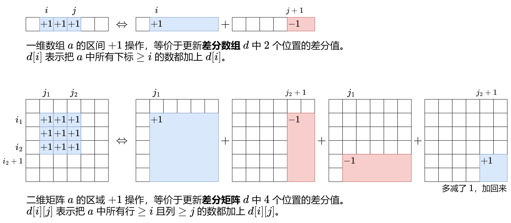

# 【图解】从一维差分到二维差分（Python/Java/C++/Go/JS/Rust）

> **[2132. 用邮票贴满网格图](https://leetcode.cn/problems/stamping-the-grid/solutions/1199642/wu-nao-zuo-fa-er-wei-qian-zhui-he-er-wei-zwiu/) · Hard · 难度分 2364**

> **所属题单**
> - [常用数据结构 · 二、差分](../../../刷题路径/灵神原版题单/常用数据结构/二、差分.md) · §2.2 二维差分

> **题目描述**
> 给你一个 `m x n` 的二进制矩阵 `grid` ，每个格子要么为 `0` （空）要么为 `1` （被占据）。
>
> 给你邮票的尺寸为 `stampHeight x stampWidth` 。我们想将邮票贴进二进制矩阵中，且满足以下 **限制** 和 **要求** ：
>
> 1. 覆盖所有 **空** 格子。
>
> 2. 不覆盖任何 **被占据** 的格子。
>
> 3. 我们可以放入任意数目的邮票。
>
> 4. 邮票可以相互有 **重叠** 部分。
>
> 5. 邮票不允许 **旋转** 。
>
> 6. 邮票必须完全在矩阵 **内** 。
>
> 如果在满足上述要求的前提下，可以放入邮票，请返回 `true` ，否则返回 `false` 。
>
> **示例 1：**
>
> 
>
> ```
> 输入：grid = [[1,0,0,0],[1,0,0,0],[1,0,0,0],[1,0,0,0],[1,0,0,0]], stampHeight = 4, stampWidth = 3
> 输出：true
> 解释：我们放入两个有重叠部分的邮票（图中标号为 1 和 2），它们能覆盖所有与空格子。
> ```
>
> **示例 2：**
>
> 
>
> ```
> 输入：grid = [[1,0,0,0],[0,1,0,0],[0,0,1,0],[0,0,0,1]], stampHeight = 2, stampWidth = 2
> 输出：false
> 解释：没办法放入邮票覆盖所有的空格子，且邮票不超出网格图以外。
> ```
>
> **提示：**
>
> - `m == grid.length`
>
> - `n == grid[r].length`
>
> - `1 <= m, n <= 10⁵`
>
> - `1 <= m * n <= 2 * 10⁵`
>
> - `grid[r][c]` 要么是 `0` ，要么是 `1` 。
>
> - `1 <= stampHeight, stampWidth <= 10⁵`

> **题解**
> ## 前置知识：差分数组
>
> 关于一维差分，请看[【算法小课堂】差分数组](../../1000-1099/1094%20拼车/灵茶山艾府.md)
>
> 一维差分的思想可以推广至二维，请点击图片放大查看：
>
> 
>
> ## 前置知识：二维前缀和
>
> 请看[【图解】二维前缀和](https://leetcode.cn/circle/discuss/UUuRex/)
>
> ## 思路
>
> 1. 由于邮票可以互相重叠，贪心地想，能放邮票就放邮票。
> 2. 遍历所有能放邮票的位置去放邮票。注意邮票不能覆盖被占据的格子，也不能出界。
> 3. 放邮票的同时，记录每个空格子被多少张邮票覆盖。如果存在一个空格子没被邮票覆盖，则返回 $\texttt{false}$，否则返回 $\texttt{true}$。
>
> ## 细节
>
> 1. 怎么快速判断一个矩形区域可以放邮票？求出 $\textit{grid}$ 的**二维前缀和**，从而 $\mathcal{O}(1)$ 地求出任意矩形区域的元素和。如果一个矩形区域的元素和等于 $0$，就表示该矩形区域的所有格子都是 $0$。
> 2. 假设用一个二维计数矩阵 $\textit{cnt}$ 记录每个空格子被多少张邮票覆盖，那么放邮票时，就需要把 $\textit{cnt}$ 的一个矩形区域都加一。怎么快速实现？可以用**二维差分矩阵** $d$ 来代替 $\textit{cnt}$。矩形区域都加一的操作，转变成 $\mathcal{O}(1)$ 地对 $d$ 中四个位置的更新操作。
> 3. 最后从二维差分矩阵 $d$ 还原出二维计数矩阵 $\textit{cnt}$。类似对一维差分数组求前缀和得到原数组，我们需要**对二维差分矩阵求二维前缀和**。遍历 $\textit{cnt}$，如果存在一个空格子的计数值为 $0$，就表明该空格子没有被邮票覆盖，返回 $\texttt{false}$，否则返回 $\texttt{true}$。代码实现时，可以直接在 $d$ 数组上**原地**计算出 $\textit{cnt}$。
>
> ```python
> class Solution:
>     def possibleToStamp(self, grid: List[List[int]], stampHeight: int, stampWidth: int) -> bool:
>         m, n = len(grid), len(grid[0])
>
>         # 1. 计算 grid 的二维前缀和
>         s = [[0] * (n + 1) for _ in range(m + 1)]
>         for i, row in enumerate(grid):
>             for j, v in enumerate(row):
>                 s[i + 1][j + 1] = s[i + 1][j] + s[i][j + 1] - s[i][j] + v
>
>         # 2. 计算二维差分
>         # 为方便第 3 步的计算，在 d 数组的最上面和最左边各加了一行（列），所以下标要 +1
>         d = [[0] * (n + 2) for _ in range(m + 2)]
>         for i2 in range(stampHeight, m + 1):
>             for j2 in range(stampWidth, n + 1):
>                 i1 = i2 - stampHeight + 1
>                 j1 = j2 - stampWidth + 1
>                 if s[i2][j2] - s[i2][j1 - 1] - s[i1 - 1][j2] + s[i1 - 1][j1 - 1] == 0:
>                     d[i1][j1] += 1
>                     d[i1][j2 + 1] -= 1
>                     d[i2 + 1][j1] -= 1
>                     d[i2 + 1][j2 + 1] += 1
>
>         # 3. 还原二维差分矩阵对应的计数矩阵（原地计算）
>         for i, row in enumerate(grid):
>             for j, v in enumerate(row):
>                 d[i + 1][j + 1] += d[i + 1][j] + d[i][j + 1] - d[i][j]
>                 if v == 0 and d[i + 1][j + 1] == 0:
>                     return False
>         return True
> ```
>
>
> #### 复杂度分析
>
> - 时间复杂度：$\mathcal{O}(mn)$，其中 $m$ 和 $n$ 分别为 $\textit{grid}$ 的行数和列数。
> - 空间复杂度：$\mathcal{O}(mn)$。
>
> 欢迎关注 [B站@灵茶山艾府](https://space.bilibili.com/206214)
>
> 更多精彩题解，请看 [往期题解精选（已分类）](https://github.com/EndlessCheng/codeforces-go/blob/master/leetcode/SOLUTIONS.md)
