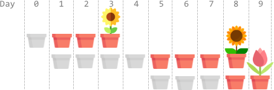
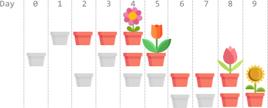

# 贪心及其证明（Python/Java/C++/Go/JS/Rust）

> **[2136. 全部开花的最早一天](https://leetcode.cn/problems/earliest-possible-day-of-full-bloom/solutions/1200254/tan-xin-ji-qi-zheng-ming-by-endlesscheng-hfwe/) · Hard · 难度分 2033**

> **所属题单**
> - [贪心算法 · 一、贪心策略](../../../刷题路径/灵神原版题单/贪心算法/一、贪心策略.md) · §1.7 交换论证法

> **题目描述**
> 你有 `n` 枚花的种子。每枚种子必须先种下，才能开始生长、开花。播种需要时间，种子的生长也是如此。给你两个下标从 **0** 开始的整数数组 `plantTime` 和 `growTime` ，每个数组的长度都是 `n` ：
>
> - `plantTime[i]` 是 **播种** 第 `i` 枚种子所需的 **完整天数** 。每天，你只能为播种某一枚种子而劳作。**无须** 连续几天都在种同一枚种子，但是种子播种必须在你工作的天数达到 `plantTime[i]` 之后才算完成。
>
> - `growTime[i]` 是第 `i` 枚种子完全种下后生长所需的 **完整天数** 。在它生长的最后一天 **之后** ，将会开花并且永远 **绽放** 。
>
> 从第 `0` 开始，你可以按 **任意** 顺序播种种子。
>
> 返回所有种子都开花的 **最早** 一天是第几天。
>
> **示例 1：**
>
> 
>
> ```
> 输入：plantTime = [1,4,3], growTime = [2,3,1]
> 输出：9
> 解释：灰色的花盆表示播种的日子，彩色的花盆表示生长的日子，花朵表示开花的日子。
> 一种最优方案是：
> 第 0 天，播种第 0 枚种子，种子生长 2 整天。并在第 3 天开花。
> 第 1、2、3、4 天，播种第 1 枚种子。种子生长 3 整天，并在第 8 天开花。
> 第 5、6、7 天，播种第 2 枚种子。种子生长 1 整天，并在第 9 天开花。
> 因此，在第 9 天，所有种子都开花。
> ```
>
> **示例 2：**
>
> 
>
> ```
> 输入：plantTime = [1,2,3,2], growTime = [2,1,2,1]
> 输出：9
> 解释：灰色的花盆表示播种的日子，彩色的花盆表示生长的日子，花朵表示开花的日子。
> 一种最优方案是：
> 第 1 天，播种第 0 枚种子，种子生长 2 整天。并在第 4 天开花。
> 第 0、3 天，播种第 1 枚种子。种子生长 1 整天，并在第 5 天开花。
> 第 2、4、5 天，播种第 2 枚种子。种子生长 2 整天，并在第 8 天开花。
> 第 6、7 天，播种第 3 枚种子。种子生长 1 整天，并在第 9 天开花。
> 因此，在第 9 天，所有种子都开花。
> ```
>
> **示例 3：**
>
> ```
> 输入：plantTime = [1], growTime = [1]
> 输出：2
> 解释：第 0 天，播种第 0 枚种子。种子需要生长 1 整天，然后在第 2 天开花。
> 因此，在第 2 天，所有种子都开花。
> ```
>
> **提示：**
>
> - `n == plantTime.length == growTime.length`
>
> - `1 <= n <= 10⁵`
>
> - `1 <= plantTime[i], growTime[i] <= 10⁴`

> **题解**
> ## 需要交替播种吗？
>
> 假设有两枚种子要播种，$1$ 号种子需要 $3$ 天，$2$ 号种子需要 $2$ 天。
>
> - 如果播种顺序为 $11122$，即先播种完 $1$ 号种子，再播种 $2$ 号种子，那么 $1$ 号种子在第 $3$ 天播种完毕，$2$ 号种子在第 $5$ 天播种完毕，完成播种共需 $5$ 天。
> - 如果交替播种，比如 $12112$，那么 $2$ 号种子完成播种的时间是不变的，但对于 $1$ 号种子来说，完成播种的时间却延后了一天。
>
> 这说明如果要交替播种，至少有一枚种子的完成时间要延后，并且所有种子完成播种的时间是不变的。也就是说，交替播种不仅没有得到任何好处，反而会拖慢其中一些种子的播种进度。
>
> 所以不应交替播种，应当种完一枚种子再开始另一枚。
>
> ## 谁先播种？
>
> 对于两枚种子，设其播种所需天数为 $p_1$ 和 $p_2$，生长所需天数为 $g_1$ 和 $g_2$。
>
> 不妨设 $g_1\ge g_2$。我们来比较哪种播种顺序更优：
>
> - 先 $1$ 后 $2$ 时的最晚开花时间：
>     $$
>     \max(p_1+g_1,p_1+p_2+g_2)
>     $$
> - 先 $2$ 后 $1$ 时的最晚开花时间：
>     $$
>     \max(p_1+p_2+g_1,p_2+g_2)
>     $$
>     由于 $g_1\ge g_2$ 且 $p_1>0$，所以 $p_1+p_2+g_1>p_2+g_2$，上式可化简为 
>     $$
>     p_1+p_2+g_1
>     $$
>
> 由于 $p_1+g_1 < p_1+p_2+g_1$ 且 $p_1+p_2+g_2 \le p_1+p_2+g_1$，因此
>
> $$
> \max(p_1+g_1,p_1+p_2+g_2) \le p_1+p_2+g_1 = \max(p_1+p_2+g_1,p_2+g_2)
> $$
>
> 上式表明，按照先 $1$ 后 $2$ 的顺序播种，最晚开花时间不会晚于按照先 $2$ 后 $1$ 播种时的最晚开花时间。
>
> 这意味着**按照生长天数从大到小排序**后，交换任意两枚种子的播种顺序，不会让最晚开花时间提前。
>
> 假设存在其它更优的种子排列，我们可以交换「生长天数小且排在前面的种子」与「生长天数大且排在后面的种子」，从而得到更早的最晚开花时间，因此假设不成立，按照生长天数从大到小的顺序播种是最优的。
>
> 对于两枚生长天数相同的种子，由于无论按照何种顺序播种，这两枚种子的最晚开花时间都是相同的，因此无需考虑生长天数相同的种子的播种顺序，在排序时，仅需按生长天数从大到小排序。
>
> ```python
> class Solution:
>     def earliestFullBloom(self, plantTime: List[int], growTime: List[int]) -> int:
>         ans = days = 0
>         for p, g in sorted(zip(plantTime, growTime), key=lambda z: -z[1]):
>             days += p  # 累加播种天数
>             ans = max(ans, days + g)  # 再加上生长天数，就是这个种子的开花时间
>         return ans
> ```
>
>
> #### 复杂度分析
>
> - 时间复杂度：$\mathcal{O}(n\log n)$，其中 $n$ 是 $\textit{plantTime}$ 的长度。
> - 空间复杂度：$\mathcal{O}(n)$。
>
> ## 相似题目
>
> - [1665. 完成所有任务的最少初始能量](https://leetcode.cn/problems/minimum-initial-energy-to-finish-tasks/)
>
> 欢迎关注 [B站@灵茶山艾府](https://space.bilibili.com/206214)
>
> 更多精彩题解，请看 [往期题解精选（已分类）](https://github.com/EndlessCheng/codeforces-go/blob/master/leetcode/SOLUTIONS.md)
