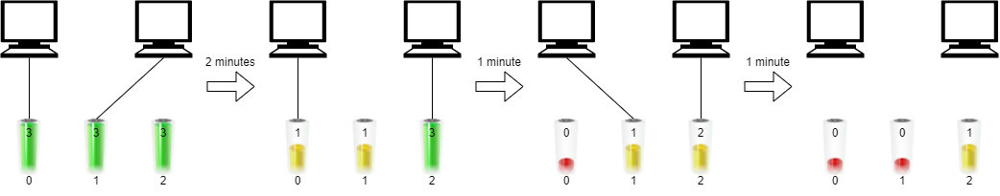
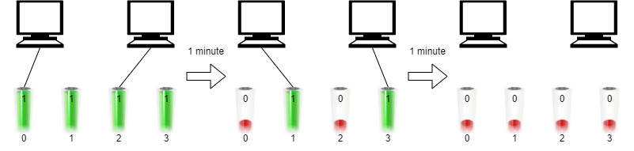

# 两种方法：二分答案 / 排序+贪心（Python/Java/C++/Go）

> **[2141. 同时运行 N 台电脑的最长时间](https://leetcode.cn/problems/maximum-running-time-of-n-computers/solutions/1214440/liang-chong-jie-fa-er-fen-da-an-pai-xu-t-grd8/) · Hard · 难度分 2265**

> **所属题单**
> - [二分算法 · 二、二分答案](../../../刷题路径/灵神原版题单/二分算法/二、二分答案.md) · §2.2 求最大
> - [贪心算法 · 一、贪心策略](../../../刷题路径/灵神原版题单/贪心算法/一、贪心策略.md) · §1.1 从最小/最大开始贪心

> **题目描述**
> 你有 `n` 台电脑。给你整数 `n` 和一个下标从 **0** 开始的整数数组 `batteries` ，其中第 `i` 个电池可以让一台电脑 **运行** `batteries[i]` 分钟。你想使用这些电池让 **全部** `n` 台电脑 **同时** 运行。
>
> 一开始，你可以给每台电脑连接 **至多一个电池** 。然后在任意整数时刻，你都可以将一台电脑与它的电池断开连接，并连接另一个电池，你可以进行这个操作 **任意次** 。新连接的电池可以是一个全新的电池，也可以是别的电脑用过的电池。断开连接和连接新的电池不会花费任何时间。
>
> 注意，你不能给电池充电。
>
> 请你返回你可以让 `n` 台电脑同时运行的 **最长** 分钟数。
>
> **示例 1：**
>
> 
>
> ```
> 输入：n = 2, batteries = [3,3,3]
> 输出：4
> 解释：
> 一开始，将第一台电脑与电池 0 连接，第二台电脑与电池 1 连接。
> 2 分钟后，将第二台电脑与电池 1 断开连接，并连接电池 2 。注意，电池 0 还可以供电 1 分钟。
> 在第 3 分钟结尾，你需要将第一台电脑与电池 0 断开连接，然后连接电池 1 。
> 在第 4 分钟结尾，电池 1 也被耗尽，第一台电脑无法继续运行。
> 我们最多能同时让两台电脑同时运行 4 分钟，所以我们返回 4 。
> ```
>
> **示例 2：**
>
> 
>
> ```
> 输入：n = 2, batteries = [1,1,1,1]
> 输出：2
> 解释：
> 一开始，将第一台电脑与电池 0 连接，第二台电脑与电池 2 连接。
> 一分钟后，电池 0 和电池 2 同时耗尽，所以你需要将它们断开连接，并将电池 1 和第一台电脑连接，电池 3 和第二台电脑连接。
> 1 分钟后，电池 1 和电池 3 也耗尽了，所以两台电脑都无法继续运行。
> 我们最多能让两台电脑同时运行 2 分钟，所以我们返回 2 。
> ```
>
> **提示：**
>
> - `1 <= n <= batteries.length <= 10⁵`
>
> - `1 <= batteries[i] <= 10⁹`

> **题解**
> ## 方法一：二分答案
>
> 如果可以让 $n$ 台电脑同时运行 $x$ 分钟，那么必然可以同时运行 $x-1,x-2,\ldots$ 分钟（要求更宽松）；如果无法让 $n$ 台电脑同时运行 $x$ 分钟，那么必然无法同时运行 $x+1,x+2,\ldots$ 分钟（要求更苛刻）。
>
> 据此，可以**二分猜答案**。关于二分算法的原理，请看 [二分查找 红蓝染色法【基础算法精讲 04】](https://www.bilibili.com/video/BV1AP41137w7/)。
>
> 假设可以让 $n$ 台电脑同时运行 $x$ 分钟，那么对于电量大于 $x$ 的电池，其只能被使用 $x$ 分钟，因此每个电池的使用时间至多为 $\min(\textit{batteries}[i], x)$。累加所有电池的使用时间，记作 $\textit{sum}$。那么要让 $n$ 台电脑同时运行 $x$ 分钟，**必要条件**是 $n\cdot x\le \textit{sum}$。
>
> 下面证明该条件也是**充分**的，即如果 $n\cdot x\le \textit{sum}$ 成立，那么一定存在一种安排电池的方式，可以让 $n$ 台电脑同时运行 $x$ 分钟。
>
> 构造方法如下：
>
> 对于电量 $\ge x$ 的电池，我们可以让其给一台电脑供电 $x$ 分钟。由于一个电池不能同时给多台电脑供电，因此该电池若给一台电脑供电 $x$ 分钟，那它就不能用于其他电脑了（我们只有 $x$ 分钟，无论电池有多少电，电池只能用 $x$ 分钟，剩余的电再多也没机会用）。我们可以将所有电量 $\ge x$ 的电池各给一台电脑供电。
>
> 对于其余电池，设其电量和为 $\textit{sum}'$，剩余 $n'$ 台电脑未被供电。我们可以随意选择剩下的电池，供给剩余的第一台电脑（用完一个电池就换下一个电池），多余的电池电量与剩下的电池一起供给剩余的第二台电脑，依此类推。注意由于这些电池的电量均小于 $x$，按照这种做法是不会出现同一个电池在同一时间供给多台电脑的（如果某个电池供给了两台电脑，可以将这个电池的供电时间**划分到第一台电脑的末尾和第二台电脑的开头**，因为电池电量小于 $x$，所以时间不会重叠）。注：想象我们把其余电池连成一条线，每隔 $x$ 切一刀，每段分给一台电脑。
>
> 由于 $\textit{sum}'=\textit{sum}-(n-n')\cdot x$，结合 $n\cdot x\le \textit{sum}$ 可以得到 $n'\cdot x\le \textit{sum}'$，按照上述供电方案（用完一个电池就换下一个电池），这 $n'$ 台电脑可以运行至少 $x$ 分钟。充分性得证。
>
> ### 细节
>
> 下面代码采用开区间二分，这仅仅是二分的一种写法，使用闭区间或者半闭半开区间都是可以的。
>
> - 开区间左端点初始值：$0$。不运行任何电脑，一定满足要求。
> - 开区间右端点初始值：平均值加一，即 $\left\lfloor\dfrac{\sum \textit{batteries}[i]}{n}\right\rfloor + 1$。一定无法满足要求。
>
> ```python
> class Solution:
>     def maxRunTime(self, n: int, batteries: List[int]) -> int:
>         l, r = 0, sum(batteries) // n + 1
>         while l + 1 < r:
>             x = (l + r) // 2
>             if n * x <= sum(min(b, x) for b in batteries):
>                 l = x
>             else:
>                 r = x
>         return l
> ```
>
> > [!example]- Python3 库函数
> > ```python
> > class Solution:
> >     def maxRunTime(self, n: int, batteries: List[int]) -> int:
> >         r = sum(batteries) // n
> >         # 二分找最小的不满足要求的 x+1，那么最大的满足要求的就是 x
> >         check = lambda x: n * (x + 1) > sum(min(b, x + 1) for b in batteries)
> >         return bisect_left(range(r), True, key=check)
> > ```
>
>
> #### 复杂度分析
>
> - 时间复杂度：$\mathcal{O}(m\log (S/n))$，其中 $m$ 是 $\textit{batteries}$ 的长度，$S$ 是 $\textit{batteries}$ 的元素和。
> - 空间复杂度：$\mathcal{O}(1)$。
>
> ## 方法二：排序 + 贪心
>
> 受解法一的启发，我们可以得出如下贪心策略：
>
> 记电池电量和为 $\textit{sum}$，则理论上至多可以供电 $x=\Big\lfloor\dfrac{\textit{sum}}{n}\Big\rfloor$ 分钟。我们对电池电量从大到小排序，然后从电量最大的电池开始遍历：
>
> - 若该电池电量超过 $x$，则将其供给一台电脑，问题缩减为 $n-1$ 台电脑的子问题。
> - 若该电池电量不超过 $x$，则其余电池的电量均不超过 $x$，此时有
>
>   $$
>   n\cdot x=n\cdot\Big\lfloor\dfrac{\textit{sum}}{n}\Big\rfloor \le \textit{sum}
>   $$
>
>   根据解法一的结论，这些电池可以给 $n$ 台电脑供电 $x$ 分钟。
>
> 由于随着问题规模减小，$x$ 不会增加，因此若遍历到一个电量不超过 $x$ 的电池时，可以直接返回 $x$ 作为答案。
>
> ```python
> class Solution:
>     def maxRunTime(self, n: int, batteries: List[int]) -> int:
>         batteries.sort(reverse=True)
>         s = sum(batteries)
>         for b in batteries:
>             if b <= s // n:
>                 return s // n
>             s -= b
>             n -= 1
> ```
>
>
> #### 复杂度分析
>
> - 时间复杂度：$\mathcal{O}(m\log m)$，其中 $m$ 是 $\textit{batteries}$ 的长度。瓶颈在排序上。
> - 空间复杂度：$\mathcal{O}(1)$。忽略排序的栈开销。
>
> ## 专题训练
>
> 1. 二分题单的「**§2.2 求最大**」。
> 2. 贪心题单的「**§1.1 从最小/最大开始贪心**」。
>
> ## 分类题单
>
> [如何科学刷题？](https://leetcode.cn/circle/discuss/RvFUtj/)
>
> 1. [滑动窗口与双指针（定长/不定长/单序列/双序列/三指针/分组循环）](https://leetcode.cn/circle/discuss/0viNMK/)
> 2. [二分算法（二分答案/最小化最大值/最大化最小值/第K小）](https://leetcode.cn/circle/discuss/SqopEo/)
> 3. [单调栈（基础/矩形面积/贡献法/最小字典序）](https://leetcode.cn/circle/discuss/9oZFK9/)
> 4. [网格图（DFS/BFS/综合应用）](https://leetcode.cn/circle/discuss/YiXPXW/)
> 5. [位运算（基础/性质/拆位/试填/恒等式/思维）](https://leetcode.cn/circle/discuss/dHn9Vk/)
> 6. [图论算法（DFS/BFS/拓扑排序/最短路/最小生成树/二分图/基环树/欧拉路径）](https://leetcode.cn/circle/discuss/01LUak/)
> 7. [动态规划（入门/背包/状态机/划分/区间/状压/数位/数据结构优化/树形/博弈/概率期望）](https://leetcode.cn/circle/discuss/tXLS3i/)
> 8. [常用数据结构（前缀和/差分/栈/队列/堆/字典树/并查集/树状数组/线段树）](https://leetcode.cn/circle/discuss/mOr1u6/)
> 9. [数学算法（数论/组合/概率期望/博弈/计算几何/随机算法）](https://leetcode.cn/circle/discuss/IYT3ss/)
> 10. [贪心与思维（基本贪心策略/反悔/区间/字典序/数学/思维/脑筋急转弯/构造）](https://leetcode.cn/circle/discuss/g6KTKL/)
> 11. [链表、二叉树与回溯（前后指针/快慢指针/DFS/BFS/直径/LCA/一般树）](https://leetcode.cn/circle/discuss/K0n2gO/)
> 12. [字符串（KMP/Z函数/Manacher/字符串哈希/AC自动机/后缀数组/子序列自动机）](https://leetcode.cn/circle/discuss/SJFwQI/)
>
> [我的题解精选（已分类）](https://github.com/EndlessCheng/codeforces-go/blob/master/leetcode/SOLUTIONS.md)
>
> 欢迎关注 [B站@灵茶山艾府](https://space.bilibili.com/206214)
