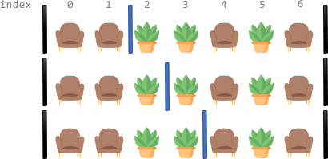

# 一次遍历，简洁写法（Python/Java/C++/C/Go/JS/Rust）

> **[2147. 分隔长廊的方案数](https://leetcode.cn/problems/number-of-ways-to-divide-a-long-corridor/solutions/1226675/an-zhao-ti-yi-mo-ni-o1-e-wai-kong-jian-b-5oqd/) · Hard · 难度分 1915**

> **所属题单**
> - [滑动窗口与双指针 · 六、分组循环](../../../刷题路径/灵神原版题单/滑动窗口与双指针/六、分组循环.md)
> - [数学算法 · 二、组合数学](../../../刷题路径/灵神原版题单/数学算法/二、组合数学.md) · §2.1 乘法原理

> **题目描述**
> 在一个图书馆的走廊里，有一些座位和装饰植物排成一列。给你一个下标从 **0** 开始，长度为 `n` 的字符串 `corridor` ，它包含字母 `'S'` 和 `'P'` ，其中每个 `'S'` 表示一个座位，每个 `'P'` 表示一株植物。
>
> 在下标 `0` 的左边和下标 `n - 1` 的右边 **已经** 分别各放了一个屏风。你还需要额外放置一些屏风。每一个位置 `i - 1` 和 `i` 之间（`1 <= i <= n - 1`），至多能放一个屏风。
>
> 请你将走廊用屏风划分为若干段，且每一段内都 **恰好有两个座位** ，而每一段内植物的数目没有要求。可能有多种划分方案，如果两个方案中有任何一个屏风的位置不同，那么它们被视为 **不同** 方案。
>
> 请你返回划分走廊的方案数。由于答案可能很大，请你返回它对 `10⁹ + 7` **取余** 的结果。如果没有任何方案，请返回 `0` 。
>
> **示例 1：**
>
> 
>
> ```
>
> 输入：corridor = "SSPPSPS"
> 输出：3
> 解释：总共有 3 种不同分隔走廊的方案。
> 上图中黑色的竖线表示已经放置好的屏风。
> 上图每种方案中，每一段都恰好有 两个 座位。
> ```
>
> **示例 2：**
>
> 
>
> ```
>
> 输入：corridor = "PPSPSP"
> 输出：1
> 解释：只有 1 种分隔走廊的方案，就是不放置任何屏风。
> 放置任何的屏风都会导致有一段无法恰好有 2 个座位。
> ```
>
> **示例 3：**
>
> 
>
> ```
>
> 输入：corridor = "S"
> 输出：0
> 解释：没有任何方案，因为总是有一段无法恰好有 2 个座位。
> ```
>
> **提示：**
>
> - `n == corridor.length`
>
> - `1 <= n <= 10⁵`
>
> - `corridor[i]` 要么是 `'S'` ，要么是 `'P'` 。

> **题解**
> 
>
> 在示例 1 中，我们可以在第 $2$ 个座位和第 $3$ 个座位之间的任意空隙放置一个屏风，空隙个数为两个座位的下标之差 $4-1=3$。
>
> 如果座位更多，例如 $\textit{corridor} = \texttt{SSPPSSPPPSS}$，我们可以：
>
> - 在第 $2$ 个座位和第 $3$ 个座位之间的任意空隙放置一个屏风，空隙个数为两个座位的下标之差 $4-1=3$。
> - 在第 $4$ 个座位和第 $5$ 个座位之间的任意空隙放置一个屏风，空隙个数为两个座位的下标之差 $9-5=4$。
> - 这两个屏风如何放置互相独立，根据**乘法原理**，划分走廊的方案数为 $3\cdot 4 = 12$。
>
> 一般地，对于第 $3,5,7,\ldots$ 个座位，可以在其到其左侧最近座位之间的任意空隙放置一个屏风，空隙个数为两个座位的下标之差。总的方案数为每个屏风的放法之积。
>
> 不合法的情况：
>
> 1. 没有座位。不满足题目「每一段内都恰好有两个座位」的要求。
> 2. 一共有奇数个座位。这会导致某一段只有一个座位，不满足要求。
>
> 代码实现时，注意取模。为什么可以在**中途取模**？原理见 [模运算的世界：当加减乘除遇上取模](https://leetcode.cn/circle/discuss/mDfnkW/)。
>
> ```python
> class Solution:
>     def numberOfWays(self, corridor: str) -> int:
>         MOD = 1_000_000_007
>         ans = 1
>         cnt_s = last_s = 0
>
>         for i, ch in enumerate(corridor):
>             if ch == 'S':
>                 cnt_s += 1
>                 # 对于第 3,5,7,... 个座位，可以在其到其左侧最近座位之间的任意空隙放置屏风
>                 if cnt_s >= 3 and cnt_s % 2:
>                     ans = ans * (i - last_s) % MOD
>                 last_s = i  # 记录上一个座位的位置
>  
>         if cnt_s == 0 or cnt_s % 2:  # 座位个数不能为 0 或奇数
>             return 0
>         return ans
> ```
>
>
> #### 复杂度分析
>
> - 时间复杂度：$\mathcal{O}(n)$，其中 $n$ 是 $\textit{corridor}$ 的长度。
> - 空间复杂度：$\mathcal{O}(1)$。
>
> ## 专题训练
>
> 见下面数学题单的「**§2.1 乘法原理**」。
>
> ## 分类题单
>
> [如何科学刷题？](https://leetcode.cn/circle/discuss/RvFUtj/)
>
> 1. [滑动窗口与双指针（定长/不定长/单序列/双序列/三指针/分组循环）](https://leetcode.cn/circle/discuss/0viNMK/)
> 2. [二分算法（二分答案/最小化最大值/最大化最小值/第K小）](https://leetcode.cn/circle/discuss/SqopEo/)
> 3. [单调栈（基础/矩形面积/贡献法/最小字典序）](https://leetcode.cn/circle/discuss/9oZFK9/)
> 4. [网格图（DFS/BFS/综合应用）](https://leetcode.cn/circle/discuss/YiXPXW/)
> 5. [位运算（基础/性质/拆位/试填/恒等式/思维）](https://leetcode.cn/circle/discuss/dHn9Vk/)
> 6. [图论算法（DFS/BFS/拓扑排序/基环树/最短路/最小生成树/网络流）](https://leetcode.cn/circle/discuss/01LUak/)
> 7. [动态规划（入门/背包/划分/状态机/区间/状压/数位/数据结构优化/树形/博弈/概率期望）](https://leetcode.cn/circle/discuss/tXLS3i/)
> 8. [常用数据结构（前缀和/差分/栈/队列/堆/字典树/并查集/树状数组/线段树）](https://leetcode.cn/circle/discuss/mOr1u6/)
> 9. [数学算法（数论/组合/概率期望/博弈/计算几何/随机算法）](https://leetcode.cn/circle/discuss/IYT3ss/)
> 10. [贪心与思维（基本贪心策略/反悔/区间/字典序/数学/思维/脑筋急转弯/构造）](https://leetcode.cn/circle/discuss/g6KTKL/)
> 11. [链表、树与回溯（前后指针/快慢指针/DFS/BFS/直径/LCA）](https://leetcode.cn/circle/discuss/K0n2gO/)
> 12. [字符串（KMP/Z函数/Manacher/字符串哈希/AC自动机/后缀数组/子序列自动机）](https://leetcode.cn/circle/discuss/SJFwQI/)
>
> [我的题解精选（已分类）](https://github.com/EndlessCheng/codeforces-go/blob/master/leetcode/SOLUTIONS.md)
>
> 欢迎关注 [B站@灵茶山艾府](https://space.bilibili.com/206214)
