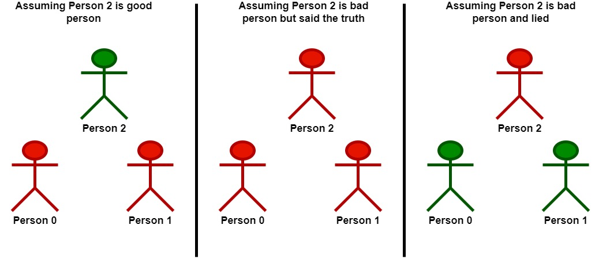
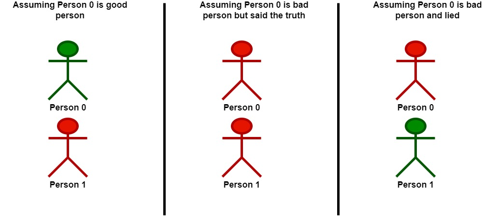

# 2151. 基于陈述统计最多好人数

Hard · 难度分 1980 · [力扣原题](https://leetcode.cn/problems/maximum-good-people-based-on-statements/)

所在刷题路径：灵神题单·链表树与回溯

| 作者 | 题解 | 动画讲解 |
|---|---|---|
| 灵茶山艾府 | [📄 题解](灵茶山艾府.md) | [▶︎ 2151 基于陈述统计最多好人数 · 灵茶山艾府.mp4](2151%20基于陈述统计最多好人数%20·%20灵茶山艾府.mp4) |
| yiduobo | [📄 题解](yiduobo.md) | [▶︎ 2151 基于陈述统计最多好人数 · yiduobo.mp4](2151%20基于陈述统计最多好人数%20·%20yiduobo.mp4) |

## 题目描述

游戏中存在两种角色：

- **好人**：该角色只说真话。

- **坏人**：该角色可能说真话，也可能说假话。

给你一个下标从 **0** 开始的二维整数数组 `statements` ，大小为 `n x n` ，表示 `n` 个玩家对彼此角色的陈述。具体来说，`statements[i][j]` 可以是下述值之一：

- `0` 表示 `i` 的陈述认为 `j` 是 **坏人** 。

- `1` 表示 `i` 的陈述认为 `j` 是 **好人** 。

- `2` 表示 `i` 没有对 `j` 作出陈述。

另外，玩家不会对自己进行陈述。形式上，对所有 `0 <= i < n` ，都有 `statements[i][i] = 2` 。

根据这 `n` 个玩家的陈述，返回可以认为是 **好人** 的 **最大** 数目。

**示例 1：**



```
输入：statements = [[2,1,2],[1,2,2],[2,0,2]]
输出：2
解释：每个人都做一条陈述。
- 0 认为 1 是好人。
- 1 认为 0 是好人。
- 2 认为 1 是坏人。
以 2 为突破点。
- 假设 2 是一个好人：
    - 基于 2 的陈述，1 是坏人。
    - 那么可以确认 1 是坏人，2 是好人。
    - 基于 1 的陈述，由于 1 是坏人，那么他在陈述时可能：
        - 说真话。在这种情况下会出现矛盾，所以假设无效。
        - 说假话。在这种情况下，0 也是坏人并且在陈述时说假话。
    - 在认为 2 是好人的情况下，这组玩家中只有一个好人。
- 假设 2 是一个坏人：
    - 基于 2 的陈述，由于 2 是坏人，那么他在陈述时可能：
        - 说真话。在这种情况下，0 和 1 都是坏人。
            - 在认为 2 是坏人但说真话的情况下，这组玩家中没有一个好人。
        - 说假话。在这种情况下，1 是好人。
            - 由于 1 是好人，0 也是好人。
            - 在认为 2 是坏人且说假话的情况下，这组玩家中有两个好人。
在最佳情况下，至多有两个好人，所以返回 2 。
注意，能得到此结论的方法不止一种。
```

**示例 2：**



```
输入：statements = [[2,0],[0,2]]
输出：1
解释：每个人都做一条陈述。
- 0 认为 1 是坏人。
- 1 认为 0 是坏人。
以 0 为突破点。
- 假设 0 是一个好人：
    - 基于与 0 的陈述，1 是坏人并说假话。
    - 在认为 0 是好人的情况下，这组玩家中只有一个好人。
- 假设 0 是一个坏人：
    - 基于 0 的陈述，由于 0 是坏人，那么他在陈述时可能：
        - 说真话。在这种情况下，0 和 1 都是坏人。
            - 在认为 0 是坏人但说真话的情况下，这组玩家中没有一个好人。
        - 说假话。在这种情况下，1 是好人。
            - 在认为 0 是坏人且说假话的情况下，这组玩家中只有一个好人。
在最佳情况下，至多有一个好人，所以返回 1 。
注意，能得到此结论的方法不止一种。
```

**提示：**

- `n == statements.length == statements[i].length`

- `2 <= n <= 15`

- `statements[i][j]` 的值为 `0`、`1` 或 `2`

- `statements[i][i] == 2`

---
[↑ 返回 2100-2199](../README.md) · [总索引](../../../索引.md) · [仓库首页](../../../README.md)
