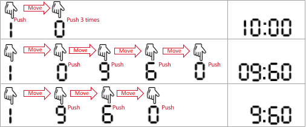

# 分类讨论

> **[2162. 设置时间的最少代价](https://leetcode.cn/problems/minimum-cost-to-set-cooking-time/solutions/1247077/fen-lei-tao-lun-by-endlesscheng-w66r/) · Medium · 难度分 1852**

> **所属题单**
> - [贪心算法 · 五、思维题](../../../刷题路径/灵神原版题单/贪心算法/五、思维题.md) · §5.8 分类讨论

> **题目描述**
> 常见的微波炉可以设置加热时间，且加热时间满足以下条件：
>
> - 至少为 `1` 秒钟。
>
> - 至多为 `99` 分 `99` 秒。
>
> 你可以 **最多** 输入 **4 个数字** 来设置加热时间。如果你输入的位数不足 4 位，微波炉会自动加 **前缀** **0** 来补足 4 位。微波炉会将设置好的四位数中，**前** 两位当作分钟数，**后** 两位当作秒数。它们所表示的总时间就是加热时间。比方说：
>
> - 你输入 `9` `5` `4` （三个数字），被自动补足为 `0954` ，并表示 `9` 分 `54` 秒。
>
> - 你输入 `0` `0` `0` `8` （四个数字），表示 `0` 分 `8` 秒。
>
> - 你输入 `8` `0` `9` `0` ，表示 `80` 分 `90` 秒。
>
> - 你输入 `8` `1` `3` `0` ，表示 `81` 分 `30` 秒。
>
> 给你整数 `startAt` ，`moveCost` ，`pushCost` 和 `targetSeconds` 。**一开始**，你的手指在数字 `startAt` 处。将手指移到 **任何其他数字** ，需要花费 `moveCost` 的单位代价。**每** 输入你手指所在位置的数字一次，需要花费 `pushCost` 的单位代价。
>
> 要设置 `targetSeconds` 秒的加热时间，可能会有多种设置方法。你想要知道这些方法中，总代价最小为多少。
>
> 请你能返回设置 `targetSeconds` 秒钟加热时间需要花费的最少代价。
>
> 请记住，虽然微波炉的秒数最多可以设置到 `99` 秒，但一分钟等于 `60` 秒。
>
> **示例 1：**
>
> 
>
> ```
> 输入：startAt = 1, moveCost = 2, pushCost = 1, targetSeconds = 600
> 输出：6
> 解释：以下为设置加热时间的所有方法。
> - 1 0 0 0 ，表示 10 分 0 秒。
>   手指一开始就在数字 1 处，输入 1 （代价为 1），移到 0 处（代价为 2），输入 0（代价为 1），输入 0（代价为 1），输入 0（代价为 1）。
>   总代价为：1 + 2 + 1 + 1 + 1 = 6 。这是所有方案中的最小代价。
> - 0 9 6 0，表示 9 分 60 秒。它也表示 600 秒。
>   手指移到 0 处（代价为 2），输入 0 （代价为 1），移到 9 处（代价为 2），输入 9（代价为 1），移到 6 处（代价为 2），输入 6（代价为 1），移到 0 处（代价为 2），输入 0（代价为 1）。
>   总代价为：2 + 1 + 2 + 1 + 2 + 1 + 2 + 1 = 12 。
> - 9 6 0，微波炉自动补全为 0960 ，表示 9 分 60 秒。
>   手指移到 9 处（代价为 2），输入 9 （代价为 1），移到 6 处（代价为 2），输入 6（代价为 1），移到 0 处（代价为 2），输入 0（代价为 1）。
>   总代价为：2 + 1 + 2 + 1 + 2 + 1 = 9 。
> ```
>
> **示例 2：**
>
> 
>
> ```
> 输入：startAt = 0, moveCost = 1, pushCost = 2, targetSeconds = 76
> 输出：6
> 解释：最优方案为输入两个数字 7 6，表示 76 秒。
> 手指移到 7 处（代价为 1），输入 7 （代价为 2），移到 6 处（代价为 1），输入 6（代价为 2）。总代价为：1 + 2 + 1 + 2 = 6
> 其他可行方案为 0076 ，076 ，0116 和 116 ，但是它们的代价都比 6 大。
> ```
>
> **提示：**
>
> - `0 <= startAt <= 9`
>
> - `1 <= moveCost, pushCost <= 10⁵`
>
> - `1 <= targetSeconds <= 6039`

> **题解**
> 下文用 $s$ 表示 $\textit{targetSeconds}$。
>
> - 如果 $s<100$，那么可以输入 $s$ 秒；
> - 如果 $60\le s<6000$，那么可以输入 $\dfrac{s}{60}$ 分 $s\bmod 60$ 秒，注意这里秒数需要补前导零；
> - 如果 $s\ge 100$ 且 $s\bmod 60<40$，那么我们可以借 $1$ 分钟给秒数，即输入 $\dfrac{s}{60}-1$ 分 $s\bmod 60+60$ 秒。
>  
> 对于每种情况按照题意模拟，取所有情况的最小值。
>  
> ```python
> class Solution:
>     def minCostSetTime(self, startAt: int, moveCost: int, pushCost: int, sec: int) -> int:
>         def calc(s: str) -> int:
>             cost = pushCost * len(s)
>             cur = startAt
>             for ch in s:
>                 if ord(ch) - ord('0') != cur:
>                     cost += moveCost
>                     cur = ord(ch) - ord('0')
>             return cost
>
>         ans = inf
>         if 60 <= sec < 6000: ans = calc(f"{sec // 60}{sec % 60 :02}")
>         if sec < 100: ans = min(ans, calc(str(sec)))  # 仅输入秒数
>         elif sec % 60 < 40: ans = min(ans, calc(f"{sec // 60 - 1}{sec % 60 + 60}"))  # 借一分钟给秒数
>         return ans
> ```
