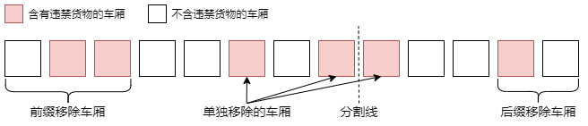
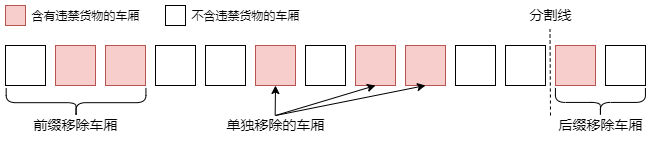

# 前后缀分解 + DP（Python/Java/C++/Go）

> **[2167. 移除所有载有违禁货物车厢所需的最少时间](https://leetcode.cn/problems/minimum-time-to-remove-all-cars-containing-illegal-goods/solutions/1247626/qian-hou-zhui-fen-jie-dp-by-endlesscheng-6u1b/) · Hard · 难度分 2219**

> **所属题单**
> - [动态规划 · 七、其他线性 DP](../../../刷题路径/灵神原版题单/动态规划/七、其他线性%20DP.md) · §7.1 一维 DP
> - [动态规划 · 专题：前后缀分解](../../../刷题路径/灵神原版题单/动态规划/专题：前后缀分解.md)

> **题目描述**
> 给你一个下标从 **0** 开始的二进制字符串 `s` ，表示一个列车车厢序列。`s[i] = '0'` 表示第 `i` 节车厢 **不** 含违禁货物，而 `s[i] = '1'` 表示第 `i` 节车厢含违禁货物。
>
> 作为列车长，你需要清理掉所有载有违禁货物的车厢。你可以不限次数执行下述三种操作中的任意一个：
>
> 1. 从列车 **左** 端移除一节车厢（即移除 `s[0]`），用去 1 单位时间。
>
> 2. 从列车 **右** 端移除一节车厢（即移除 `s[s.length - 1]`），用去 1 单位时间。
>
> 3. 从列车车厢序列的 **任意位置** 移除一节车厢，用去 2 单位时间。
>
> 返回移除所有载有违禁货物车厢所需要的 **最少** 单位时间数。
>
> 注意，空的列车车厢序列视为没有车厢含违禁货物。
>
> **示例 1：**
>
> ```
>
> 输入：s = "1100101"
> 输出：5
> 解释：
> 一种从序列中移除所有载有违禁货物的车厢的方法是：
> - 从左端移除一节车厢 2 次。所用时间是 2 * 1 = 2 。
> - 从右端移除一节车厢 1 次。所用时间是 1 。
> - 移除序列中间位置载有违禁货物的车厢。所用时间是 2 。
> 总时间是 2 + 1 + 2 = 5 。
>
> 一种替代方法是：
> - 从左端移除一节车厢 2 次。所用时间是 2 * 1 = 2 。
> - 从右端移除一节车厢 3 次。所用时间是 3 * 1 = 3 。
> 总时间也是 2 + 3 = 5 。
>
> 5 是移除所有载有违禁货物的车厢所需要的最少单位时间数。
> 没有其他方法能够用更少的时间移除这些车厢。
> ```
>
> **示例 2：**
>
> ```
>
> 输入：s = "0010"
> 输出：2
> 解释：
> 一种从序列中移除所有载有违禁货物的车厢的方法是：
> - 从左端移除一节车厢 3 次。所用时间是 3 * 1 = 3 。
> 总时间是 3.
>
> 另一种从序列中移除所有载有违禁货物的车厢的方法是：
> - 移除序列中间位置载有违禁货物的车厢。所用时间是 2 。
> 总时间是 2.
>
> 另一种从序列中移除所有载有违禁货物的车厢的方法是：
> - 从右端移除一节车厢 2 次。所用时间是 2 * 1 = 2 。
> 总时间是 2.
>
> 2 是移除所有载有违禁货物的车厢所需要的最少单位时间数。
> 没有其他方法能够用更少的时间移除这些车厢。
> ```
>
> **提示：**
>
> - `1 <= s.length <= 2 * 10⁵`
>
> - `s[i]` 为 `'0'` 或 `'1'`

> **题解**
> ## 解法一：前后缀分解
>
> #### 提示 1
>
> 考虑将列车分成左右两部分，枚举分割线，分别计算这两部分的最少时间。
>
> #### 提示 2
>
> 考虑 DP。
>
> 
>
> 考虑左半部分的最少时间。
>
> 定义 $\textit{pre}[i]$ 表示移除从 $s[0]$ 到 $s[i]$ 的所有违禁货物车厢所花费的最少时间。
>
> 讨论 $s[i]$：
>
> - 当 $s[i]=0$ 时，无需移除车厢，则有 $\textit{pre}[i]=\textit{pre}[i-1]$；
> - 当 $s[i]=1$ 时，可以单独移除第 $i$ 节车厢，也可以移除前 $i$ 个车厢，二者取最小值，即 $\textit{pre}[i]=\min(\textit{pre}[i-1]+2,i+1)$。
>
> 对于右半部分，同样定义 $\textit{suf}[i]$ 表示移除从 $s[i]$ 到 $s[n-1]$ 的所有违禁货物车厢所花费的最少时间，有
>
> $$
> \textit{suf}[i] =
> \begin{cases} 
> \textit{suf}[i+1],&s[i]=0\\
> \min(\textit{suf}[i+1]+2,n-i),&s[i]=1
> \end{cases}
> $$
>
> 然后枚举分割线，计算所有 $\textit{pre}[i]+\textit{suf}[i+1]$ 的最小值，即为答案。
>
> ---
>
> 代码实现时，有如下三处优化点：
>
> 优化 1：可以先计算 $\textit{suf}$，然后在枚举分割线的同时计算 $\textit{pre}$。
>
> 优化 2：由于计算 $\textit{pre}$ 的转移时当前状态只和上一个状态有关，因此可以使用滚动数组优化，即用一个变量来表示 $\textit{pre}$。
>
> 优化 3：由于 $s[i]=0$ 时，$\textit{pre}[i]$ 和 $\textit{suf}[i]$ 的值均不会变化，因此仅需要考虑 $s[i]=1$ 时的 $\textit{pre}[i]+\textit{suf}[i+1]$ 的最小值。
>
> ```python
> class Solution:
>     def minimumTime(self, s: str) -> int:
>         n = len(s)
>         suf = [0] * (n + 1)
>         for i in range(n - 1, -1, -1):
>             suf[i] = suf[i + 1] if s[i] == '0' else min(suf[i + 1] + 2, n - i)
>         ans = suf[0]
>         pre = 0
>         for i, ch in enumerate(s):
>             if ch == '1':
>                 pre = min(pre + 2, i + 1)
>                 ans = min(ans, pre + suf[i + 1])
>         return ans
> ```
>
>
> #### 复杂度分析
>
> - 时间复杂度：$\mathcal{O}(n)$，其中 $n$ 为 $s$ 的长度。
> - 空间复杂度：$\mathcal{O}(n)$。
>
> ### 解法二：进一步优化，一次遍历
>
> 由于我们计算的是「移除前缀 + 移除分割线左侧某些车厢 + (分割线) + 移除分割线右侧某些车厢 + 移除后缀」的最少花费，其中「移除分割线左侧某些车厢 + 移除分割线右侧某些车厢」都是在移除中间的某些车厢，因此这是可以合并的，不妨合并到分割线左侧，即计算「移除前缀 + 移除分割线左侧某些车厢 + (分割线) + 移除后缀」的最少花费。
>
> 
>
> 合并后，计算 $\textit{pre}$ 的过程不变，而 $\textit{suf}$ 就仅为移除后缀所有车厢的花费了，这可以直接用下标计算出来。因此我们可以省略 $\textit{suf}$ 的计算流程，直接一次遍历计算出答案。
>
> ```python
> class Solution:
>     def minimumTime(self, s: str) -> int:
>         ans = n = len(s)
>         pre = 0
>         for i, ch in enumerate(s):
>             if ch == '1':
>                 pre = min(pre + 2, i + 1)
>             ans = min(ans, pre + n - 1 - i)
>         return ans
> ```
>
>
> #### 复杂度分析
>
> - 时间复杂度：$\mathcal{O}(n)$，其中 $n$ 为 $s$ 的长度。
> - 空间复杂度：$\mathcal{O}(n)$。
