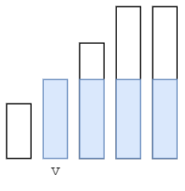

# 枚举最后袋子中魔法豆的数目（Python/Java/C++/C/Go/JS/Rust）

> **[2171. 拿出最少数目的魔法豆](https://leetcode.cn/problems/removing-minimum-number-of-magic-beans/solutions/1262419/pai-xu-hou-yi-ci-bian-li-by-endlesscheng-36g8/) · Medium · 难度分 1748**

> **所属题单**
> - [贪心算法 · 一、贪心策略](../../../刷题路径/灵神原版题单/贪心算法/一、贪心策略.md) · §1.6 先枚举，再贪心

> **题目描述**
> 给定一个 **正整数** 数组 `beans` ，其中每个整数表示一个袋子里装的魔法豆的数目。
>
> 请你从每个袋子中 **拿出** 一些豆子（也可以 **不拿出**），使得剩下的 **非空** 袋子中（即 **至少还有一颗** 魔法豆的袋子）魔法豆的数目 **相等**。一旦把魔法豆从袋子中取出，你不能再将它放到任何袋子中。
>
> 请返回你需要拿出魔法豆的 **最少数目**。
>
> **示例 1：**
>
> ```
>
> 输入：beans = [4,1,6,5]
> 输出：4
> 解释：
> - 我们从有 1 个魔法豆的袋子中拿出 1 颗魔法豆。
>   剩下袋子中魔法豆的数目为：[4,0,6,5]
> - 然后我们从有 6 个魔法豆的袋子中拿出 2 个魔法豆。
>   剩下袋子中魔法豆的数目为：[4,0,4,5]
> - 然后我们从有 5 个魔法豆的袋子中拿出 1 个魔法豆。
>   剩下袋子中魔法豆的数目为：[4,0,4,4]
> 总共拿出了 1 + 2 + 1 = 4 个魔法豆，剩下非空袋子中魔法豆的数目相等。
> 没有比取出 4 个魔法豆更少的方案。
> ```
>
> **示例 2：**
>
> ```
>
> 输入：beans = [2,10,3,2]
> 输出：7
> 解释：
> - 我们从有 2 个魔法豆的其中一个袋子中拿出 2 个魔法豆。
>   剩下袋子中魔法豆的数目为：[0,10,3,2]
> - 然后我们从另一个有 2 个魔法豆的袋子中拿出 2 个魔法豆。
>   剩下袋子中魔法豆的数目为：[0,10,3,0]
> - 然后我们从有 3 个魔法豆的袋子中拿出 3 个魔法豆。
>   剩下袋子中魔法豆的数目为：[0,10,0,0]
> 总共拿出了 2 + 2 + 3 = 7 个魔法豆，剩下非空袋子中魔法豆的数目相等。
> 没有比取出 7 个魔法豆更少的方案。
> ```
>
> **提示：**
>
> - `1 <= beans.length <= 10⁵`
>
> - `1 <= beans[i] <= 10⁵`

> **题解**
> 我们可以将 $\textit{beans}$ 从小到大排序后，枚举最终非空袋子中魔法豆的数目 $v$，将小于 $v$ 的魔法豆全部清空，大于 $v$ 的魔法豆减少至 $v$，这样所有非空袋子中的魔法豆就都相等了。
>
> 由于拿出魔法豆 + 剩余魔法豆 = 初始魔法豆之和，我们可以考虑最多能剩下多少个魔法豆，从而计算出最少能拿出多少个魔法豆。
>
> 
>
> 如上图所示，可以保留蓝色矩形区域内的魔法豆。设 $\textit{beans}$ 的长度为 $n$，以 $n-i$ 为矩形底边长，$v=\textit{beans}[i]$ 为矩形高，则矩形面积为
>
> $$
> (n-i) \cdot v
> $$
>
> 用 $\sum\textit{beans}[i]$ 减去矩形面积的最大值，即为拿出魔法豆的最小值。
>
> ```python
> class Solution:
>     def minimumRemoval(self, beans: List[int]) -> int:
>         beans.sort()
>         n = len(beans)
>         max_save = max((n - i) * v for i, v in enumerate(beans))
>         return sum(beans) - max_save
> ```
>
>
> #### 复杂度分析
>
> - 时间复杂度：$\mathcal{O}(n\log n)$，其中 $n$ 为 $\textit{beans}$ 的长度。瓶颈在排序上。
> - 空间复杂度：$\mathcal{O}(1)$。忽略排序的栈开销。
>
> ## 分类题单
>
> [如何科学刷题？](https://leetcode.cn/circle/discuss/RvFUtj/)
>
> 1. [滑动窗口与双指针（定长/不定长/单序列/双序列/三指针/分组循环）](https://leetcode.cn/circle/discuss/0viNMK/)
> 2. [二分算法（二分答案/最小化最大值/最大化最小值/第K小）](https://leetcode.cn/circle/discuss/SqopEo/)
> 3. [单调栈（基础/矩形面积/贡献法/最小字典序）](https://leetcode.cn/circle/discuss/9oZFK9/)
> 4. [网格图（DFS/BFS/综合应用）](https://leetcode.cn/circle/discuss/YiXPXW/)
> 5. [位运算（基础/性质/拆位/试填/恒等式/思维）](https://leetcode.cn/circle/discuss/dHn9Vk/)
> 6. [图论算法（DFS/BFS/拓扑排序/基环树/最短路/最小生成树/网络流）](https://leetcode.cn/circle/discuss/01LUak/)
> 7. [动态规划（入门/背包/划分/状态机/区间/状压/数位/数据结构优化/树形/博弈/概率期望）](https://leetcode.cn/circle/discuss/tXLS3i/)
> 8. [常用数据结构（前缀和/差分/栈/队列/堆/字典树/并查集/树状数组/线段树）](https://leetcode.cn/circle/discuss/mOr1u6/)
> 9. [数学算法（数论/组合/概率期望/博弈/计算几何/随机算法）](https://leetcode.cn/circle/discuss/IYT3ss/)
> 10. [贪心与思维（基本贪心策略/反悔/区间/字典序/数学/思维/脑筋急转弯/构造）](https://leetcode.cn/circle/discuss/g6KTKL/)
> 11. [链表、二叉树与回溯（前后指针/快慢指针/DFS/BFS/直径/LCA/一般树）](https://leetcode.cn/circle/discuss/K0n2gO/)
> 12. [字符串（KMP/Z函数/Manacher/字符串哈希/AC自动机/后缀数组/子序列自动机）](https://leetcode.cn/circle/discuss/SJFwQI/)
>
> [我的题解精选（已分类）](https://github.com/EndlessCheng/codeforces-go/blob/master/leetcode/SOLUTIONS.md)
>
> 欢迎关注 [B站@灵茶山艾府](https://space.bilibili.com/206214)
