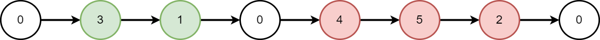
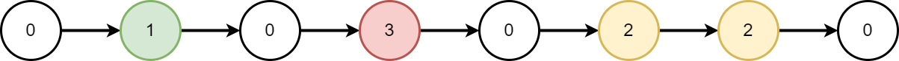

# 2181. 合并零之间的节点

Medium · [力扣原题](https://leetcode.cn/problems/merge-nodes-in-between-zeros/)

所在刷题路径：灵神题单·链表树与回溯

| 作者 | 题解 | 动画讲解 |
|---|---|---|
| 灵茶山艾府 | [📄 题解](灵茶山艾府.md) | [▶︎ 动画（GIF）](2181%20合并零之间的节点%20·%20灵茶山艾府.gif) · [mp4 文件](2181%20合并零之间的节点%20·%20灵茶山艾府.mp4) |
| yiduobo | [📄 题解](yiduobo.md) | [▶︎ 动画（GIF）](2181%20合并零之间的节点%20·%20yiduobo.gif) · [mp4 文件](2181%20合并零之间的节点%20·%20yiduobo.mp4) |

## 动画讲解

> 动图会循环播放；想暂停、拖进度条请下载上面表格里的 mp4 文件。

### 灵茶山艾府


### yiduobo


## 题目描述

给你一个链表的头节点 `head` ，该链表包含由 `0` 分隔开的一连串整数。链表的 **开端** 和 **末尾** 的节点都满足 `Node.val == 0` 。

对于每两个相邻的 `0` ，请你将它们之间的所有节点合并成一个节点，其值是所有已合并节点的值之和。然后将所有 `0` 移除，修改后的链表不应该含有任何 `0` 。

 返回修改后链表的头节点 `head` 。

示例 1：



```

输入：head = [0,3,1,0,4,5,2,0]
输出：[4,11]
解释：
上图表示输入的链表。修改后的链表包含：
- 标记为绿色的节点之和：3 + 1 = 4
- 标记为红色的节点之和：4 + 5 + 2 = 11
```

示例 2：



```

输入：head = [0,1,0,3,0,2,2,0]
输出：[1,3,4]
解释：
上图表示输入的链表。修改后的链表包含：
- 标记为绿色的节点之和：1 = 1
- 标记为红色的节点之和：3 = 3
- 标记为黄色的节点之和：2 + 2 = 4
```

**提示：**

- 列表中的节点数目在范围 `[3, 2 * 10⁵]` 内

- `0 <= Node.val <= 1000`

- **不** 存在连续两个 `Node.val == 0` 的节点

- 链表的 **开端** 和 **末尾** 节点都满足 `Node.val == 0`

---
[↑ 返回 2100-2199](../README.md) · [总索引](../../../索引.md) · [仓库首页](../../../README.md)
