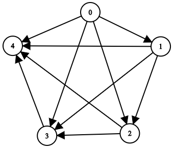

# 2192. 有向无环图中一个节点的所有祖先

Medium · 难度分 1788 · [力扣原题](https://leetcode.cn/problems/all-ancestors-of-a-node-in-a-directed-acyclic-graph/)

所在刷题路径：灵神题单·图论算法

| 作者 | 题解 | 动画讲解 |
|---|---|---|
| 灵茶山艾府 | [📄 题解](灵茶山艾府.md) | [▶︎ 动画（GIF）](2192%20有向无环图中一个节点的所有祖先%20·%20灵茶山艾府.gif) · [mp4 文件](2192%20有向无环图中一个节点的所有祖先%20·%20灵茶山艾府.mp4) |
| yiduobo | [📄 题解](yiduobo.md) | [▶︎ 动画（GIF）](2192%20有向无环图中一个节点的所有祖先%20·%20yiduobo.gif) · [mp4 文件](2192%20有向无环图中一个节点的所有祖先%20·%20yiduobo.mp4) |

## 动画讲解

> 动图会循环播放；想暂停、拖进度条请下载上面表格里的 mp4 文件。

### 灵茶山艾府


### yiduobo


## 题目描述

给你一个正整数 `n` ，它表示一个 **有向无环图** 中节点的数目，节点编号为 `0` 到 `n - 1` （包括两者）。

给你一个二维整数数组 `edges` ，其中 `edges[i] = [from_i, to_i]` 表示图中一条从 `from_i` 到 `to_i` 的单向边。

请你返回一个数组 `answer`，其中 `answer[i]`是第 `i` 个节点的所有 **祖先** ，这些祖先节点 **升序** 排序。

如果 `u` 通过一系列边，能够到达 `v` ，那么我们称节点 `u` 是节点 `v` 的 **祖先** 节点。

**示例 1：**


```
输入：n = 8, edgeList = [[0,3],[0,4],[1,3],[2,4],[2,7],[3,5],[3,6],[3,7],[4,6]]
输出：[[],[],[],[0,1],[0,2],[0,1,3],[0,1,2,3,4],[0,1,2,3]]
解释：
上图为输入所对应的图。
- 节点 0 ，1 和 2 没有任何祖先。
- 节点 3 有 2 个祖先 0 和 1 。
- 节点 4 有 2 个祖先 0 和 2 。
- 节点 5 有 3 个祖先 0 ，1 和 3 。
- 节点 6 有 5 个祖先 0 ，1 ，2 ，3 和 4 。
- 节点 7 有 4 个祖先 0 ，1 ，2 和 3 。
```

**示例 2：**



```
输入：n = 5, edgeList = [[0,1],[0,2],[0,3],[0,4],[1,2],[1,3],[1,4],[2,3],[2,4],[3,4]]
输出：[[],[0],[0,1],[0,1,2],[0,1,2,3]]
解释：
上图为输入所对应的图。
- 节点 0 没有任何祖先。
- 节点 1 有 1 个祖先 0 。
- 节点 2 有 2 个祖先 0 和 1 。
- 节点 3 有 3 个祖先 0 ，1 和 2 。
- 节点 4 有 4 个祖先 0 ，1 ，2 和 3 。
```

**提示：**

- `1 <= n <= 1000`

- `0 <= edges.length <= min(2000, n * (n - 1) / 2)`

- `edges[i].length == 2`

- `0 <= from_i, to_i <= n - 1`

- `from_i != to_i`

- 图中不会有重边。

- 图是 **有向** 且 **无环** 的。

---
[↑ 返回 2100-2199](../README.md) · [总索引](../../../索引.md) · [仓库首页](../../../README.md)
