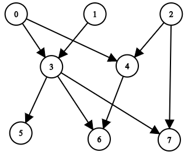

# 两种方法：逆向/正向（Python/Java/C++/Go/JS/Rust）

> **[2192. 有向无环图中一个节点的所有祖先](https://leetcode.cn/problems/all-ancestors-of-a-node-in-a-directed-acyclic-graph/solutions/2723203/liang-chong-fang-fa-ni-xiang-zheng-xiang-rwjs/) · Medium · 难度分 1788**

> **所属题单**
> - [图论算法 · 一、图的遍历](../../../刷题路径/灵神原版题单/图论算法/一、图的遍历.md) · §1.1 深度优先搜索（DFS）

> **题目描述**
> 给你一个正整数 `n` ，它表示一个 **有向无环图** 中节点的数目，节点编号为 `0` 到 `n - 1` （包括两者）。
>
> 给你一个二维整数数组 `edges` ，其中 `edges[i] = [from_i, to_i]` 表示图中一条从 `from_i` 到 `to_i` 的单向边。
>
> 请你返回一个数组 `answer`，其中 `answer[i]`是第 `i` 个节点的所有 **祖先** ，这些祖先节点 **升序** 排序。
>
> 如果 `u` 通过一系列边，能够到达 `v` ，那么我们称节点 `u` 是节点 `v` 的 **祖先** 节点。
>
> **示例 1：**
>
> 
>
> ```
> 输入：n = 8, edgeList = [[0,3],[0,4],[1,3],[2,4],[2,7],[3,5],[3,6],[3,7],[4,6]]
> 输出：[[],[],[],[0,1],[0,2],[0,1,3],[0,1,2,3,4],[0,1,2,3]]
> 解释：
> 上图为输入所对应的图。
> - 节点 0 ，1 和 2 没有任何祖先。
> - 节点 3 有 2 个祖先 0 和 1 。
> - 节点 4 有 2 个祖先 0 和 2 。
> - 节点 5 有 3 个祖先 0 ，1 和 3 。
> - 节点 6 有 5 个祖先 0 ，1 ，2 ，3 和 4 。
> - 节点 7 有 4 个祖先 0 ，1 ，2 和 3 。
> ```
>
> **示例 2：**
>
> 
>
> ```
> 输入：n = 5, edgeList = [[0,1],[0,2],[0,3],[0,4],[1,2],[1,3],[1,4],[2,3],[2,4],[3,4]]
> 输出：[[],[0],[0,1],[0,1,2],[0,1,2,3]]
> 解释：
> 上图为输入所对应的图。
> - 节点 0 没有任何祖先。
> - 节点 1 有 1 个祖先 0 。
> - 节点 2 有 2 个祖先 0 和 1 。
> - 节点 3 有 3 个祖先 0 ，1 和 2 。
> - 节点 4 有 4 个祖先 0 ，1 ，2 和 3 。
> ```
>
> **提示：**
>
> - `1 <= n <= 1000`
>
> - `0 <= edges.length <= min(2000, n * (n - 1) / 2)`
>
> - `edges[i].length == 2`
>
> - `0 <= from_i, to_i <= n - 1`
>
> - `from_i != to_i`
>
> - 图中不会有重边。
>
> - 图是 **有向** 且 **无环** 的。

> **题解**
> ## 方法一：逆向 DFS
>
> 把边**反向**，从点 $i$ 出发 DFS，能访问到的点就是 $\textit{answer}[i]$。
>
> 例如示例 1，把边反向后，从 $6$ 出发 DFS，可以访问到 $0,1,2,3,4$。
>
> 
>
> 从点 $i$ 出发 DFS，为避免重复访问节点，可以用 $\textit{vis}$ 数组标记访问过的节点，这样 DFS 结束后，有标记的节点就组成 $\textit{answer}[i]$ 了。
>
> 注：本题输入的是一个有向无环图，但该方法并不需要这个条件，即使图中有环，我们也可以找到所有能访问到 $i$ 的节点。
>
> ```python
> class Solution:
>     def getAncestors(self, n: int, edges: List[List[int]]) -> List[List[int]]:
>         g = [[] for _ in range(n)]
>         for x, y in edges:
>             g[y].append(x)  # 反向建图
>
>         def dfs(x: int) -> None:
>             vis[x] = True  # 避免重复访问
>             for y in g[x]:
>                 if not vis[y]:
>                     dfs(y)  # 只递归没有访问过的点
>
>         ans = [None] * n
>         for i in range(n):
>             vis = [False] * n
>             dfs(i)  # 从 i 开始 DFS
>             vis[i] = False  # ans[i] 不含 i
>             ans[i] = [j for j, b in enumerate(vis) if b]
>         return ans
> ```
>
>
> #### 复杂度分析
>
> - 时间复杂度：$\mathcal{O}(n(n+m))$。其中 $m$ 是 $\textit{edges}$ 的长度。对于每个起点 $i$，跑一次 DFS 的时间复杂度为 $\mathcal{O}(n+m)$。
> - 空间复杂度：$\mathcal{O}(n+m)$。返回值不计入。
>
> ## 方法二：正向 DFS
>
> 例如示例 1，从 $2$ 出发 DFS，可以访问到 $4,6,7$，那么把 $2$ 加到 $\textit{answer}[4], \textit{answer}[6], \textit{answer}[7]$ 中。
>
> 
>
> 依次从起点 $\textit{start}=0,1,2,\cdots,n-1$ 出发 DFS，途中把 $\textit{start}$ 加到能访问到的点的 $\textit{answer}$ 中。由于 $\textit{start}$ 从小到大枚举，所以 $\textit{answer}[i]$ 列表自然就是有序的了。
>
> 例如：
>
> - 从 $0$ 出发访问到 $5$，把 $0$ 加到 $\textit{answer}[5]$ 中，现在 $\textit{answer}[5]=[0]$。
> - 从 $1$ 出发访问到 $5$，把 $1$ 加到 $\textit{answer}[5]$ 中，现在 $\textit{answer}[5]=[0,1]$。
> - 从 $3$ 出发访问到 $5$，把 $3$ 加到 $\textit{answer}[5]$ 中，现在 $\textit{answer}[5]=[0,1,3]$。
>
> **小技巧**：无需每次 DFS 前都重新初始化 $\textit{vis}$ 数组。我们会跑 $n$ 个 DFS，每个 DFS 的 $\textit{start}$ 都是不同的。利用这一条件，当访问到节点 $x$ 时，标记 $\textit{vis}[x] = \textit{start}$，表示 $x$ 是本轮 DFS 中访问到的节点。当我们访问到某个节点 $y$ 时，如果发现 $\textit{vis}[y] = \textit{start}$，就表示 $y$ 访问过了，否则没有访问过。
>
> 注：本题输入的是一个有向无环图，但该方法并不需要这个条件，即使图中有环，我们也可以找到所有能访问到 $i$ 的节点。
>
> ```python
> class Solution:
>     def getAncestors(self, n: int, edges: List[List[int]]) -> List[List[int]]:
>         g = [[] for _ in range(n)]
>         for x, y in edges:
>             g[x].append(y)
>
>         def dfs(x: int) -> None:
>             vis[x] = start  # 避免重复访问
>             for y in g[x]:
>                 if vis[y] != start:
>                     ans[y].append(start)  # start 是访问到的点的祖先
>                     dfs(y)  # 只递归没有访问过的点
>
>         ans = [[] for _ in range(n)]
>         vis = [-1] * n
>         for start in range(n):
>             dfs(start)  # 从 start 开始 DFS
>         return ans
> ```
>
>
> #### 复杂度分析
>
> - 时间复杂度：$\mathcal{O}(n(n+m))$。其中 $m$ 是 $\textit{edges}$ 的长度。对于每个起点 $\textit{start}$，跑一次 DFS 的时间复杂度为 $\mathcal{O}(n+m)$。
> - 空间复杂度：$\mathcal{O}(n+m)$。返回值不计入。
>
> ## 分类题单
>
> 1. [滑动窗口（定长/不定长/多指针）](https://leetcode.cn/circle/discuss/0viNMK/)
> 2. [二分算法（二分答案/最小化最大值/最大化最小值/第K小）](https://leetcode.cn/circle/discuss/SqopEo/)
> 3. [单调栈（矩形系列/字典序最小/贡献法）](https://leetcode.cn/circle/discuss/9oZFK9/)
> 4. [网格图（DFS/BFS/综合应用）](https://leetcode.cn/circle/discuss/YiXPXW/)
> 5. [位运算（基础/性质/拆位/试填/恒等式/贪心/脑筋急转弯）](https://leetcode.cn/circle/discuss/dHn9Vk/)
> 6. [图论算法（DFS/BFS/拓扑排序/最短路/最小生成树/二分图/基环树/欧拉路径）](https://leetcode.cn/circle/discuss/01LUak/)
> 7. [动态规划（入门/背包/状态机/划分/区间/状压/数位/数据结构优化/树形/博弈/概率期望）](https://leetcode.cn/circle/discuss/tXLS3i/)
>
> 更多题单，点我个人主页 - 讨论发布。
>
> 欢迎关注 [B站@灵茶山艾府](https://space.bilibili.com/206214)
>
> [往期题解精选（已分类）](https://github.com/EndlessCheng/codeforces-go/blob/master/leetcode/SOLUTIONS.md)
