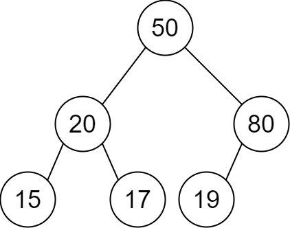
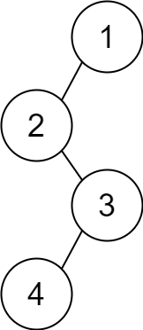

# 哈希表建树 + 位运算优化找根（Python/Java/C++/Go/JS/Rust）

> **[2196. 根据描述创建二叉树](https://leetcode.cn/problems/create-binary-tree-from-descriptions/solutions/1314483/jian-tu-dfs-by-endlesscheng-vl17/) · Medium · 难度分 1644**

> **所属题单**
> - [链表、二叉树与回溯 · 二、二叉树](../../../刷题路径/灵神原版题单/链表、二叉树与回溯/二、二叉树.md) · §2.10 创建二叉树

> **题目描述**
> 给你一个二维整数数组 `descriptions` ，其中 `descriptions[i] = [parent_i, child_i, isLeft_i]` 表示 `parent_i` 是 `child_i` 在 **二叉树** 中的 **父节点**，二叉树中各节点的值 **互不相同** 。此外：
>
> - 如果 `isLeft_i == 1` ，那么 `child_i` 就是 `parent_i` 的左子节点。
>
> - 如果 `isLeft_i == 0` ，那么 `child_i` 就是 `parent_i` 的右子节点。
>
> 请你根据 `descriptions` 的描述来构造二叉树并返回其 **根节点** 。
>
> 测试用例会保证可以构造出 **有效** 的二叉树。
>
> **示例 1：**
>
> 
>
> ```
>
> 输入：descriptions = [[20,15,1],[20,17,0],[50,20,1],[50,80,0],[80,19,1]]
> 输出：[50,20,80,15,17,19]
> 解释：根节点是值为 50 的节点，因为它没有父节点。
> 结果二叉树如上图所示。
> ```
>
> **示例 2：**
>
> 
>
> ```
>
> 输入：descriptions = [[1,2,1],[2,3,0],[3,4,1]]
> 输出：[1,2,null,null,3,4]
> 解释：根节点是值为 1 的节点，因为它没有父节点。
> 结果二叉树如上图所示。
> ```
>
> **提示：**
>
> - `1 <= descriptions.length <= 10⁴`
>
> - `descriptions[i].length == 3`
>
> - `1 <= parent_i, child_i <= 10⁵`
>
> - `0 <= isLeft_i <= 1`
>
> - `descriptions` 所描述的二叉树是一棵有效二叉树

> **题解**
> 题目输入的是节点整数值，不是节点。我们需要手动创建 $\texttt{TreeNode}$ 节点。
>
> 比如有两条边 $50\to 20$ 和 $20\to 15$。创建 $50$ 和 $20$ 的 $\texttt{TreeNode}$ 节点后，对于 $20\to 15$，由于 $20$ 的节点之前创建过，我们需要知道整数 $20$ 对应的 $\texttt{TreeNode}$ 节点是什么，所以需要一个从整数（节点值）映射到 $\texttt{TreeNode}$ 节点的哈希表 $\textit{nodes}$。
>
> 最后，我们需要返回二叉树的根节点。怎么判断谁是二叉树的根？
>
> 用一个哈希集合 $\textit{children}$ 记录哪些节点值有父节点。遍历哈希表 $\textit{nodes}$，不在 $\textit{children}$ 中的节点即为根节点。
>
> ## 优化前
>
> ```python
> class Solution:
>     def createBinaryTree(self, descriptions: List[List[int]]) -> Optional[TreeNode]:
>         nodes = {}  # val -> TreeNode
>         children = set()
>
>         # 建树
>         for x, y, is_left in descriptions:
>             if x not in nodes:
>                 nodes[x] = TreeNode(x)
>             if y not in nodes:
>                 nodes[y] = TreeNode(y)
>             if is_left:
>                 nodes[x].left = nodes[y]
>             else:
>                 nodes[x].right = nodes[y]
>             children.add(y)  # y 不是根节点
>
>         for x, node in nodes.items():
>             if x not in children:  # node 是根节点
>                 return node
>         # 测试用例保证可以构造出有效的二叉树
> ```
>
>
> ## 优化
>
> 把树上每个值异或一遍，再把所有儿子 $child_i$ 异或一遍。由于同一个值异或两次等于 $0$，所以最终异或和恰好等于根节点的值。
>
> 这个技巧来自 [136. 只出现一次的数字](https://leetcode.cn/problems/single-number/)，请看 [我的题解](../../0100-0199/0136%20只出现一次的数字/灵茶山艾府.md)。
>
> ```python
> class Solution:
>     def createBinaryTree(self, descriptions: List[List[int]]) -> Optional[TreeNode]:
>         nodes = {}  # val -> TreeNode
>         root = 0
>
>         for x, y, is_left in descriptions:
>             if x not in nodes:
>                 nodes[x] = TreeNode(x)
>                 root ^= x
>             if y not in nodes:
>                 nodes[y] = TreeNode(y)
>                 root ^= y
>             if is_left:
>                 nodes[x].left = nodes[y]
>             else:
>                 nodes[x].right = nodes[y]
>             root ^= y
>
>         return nodes[root]
> ```
>
>
> #### 复杂度分析
>
> - 时间复杂度：$\mathcal{O}(n)$，其中 $n$ 是 $\textit{descriptions}$ 的长度。
> - 空间复杂度：$\mathcal{O}(n)$。
>
> ## 专题训练
>
> 见下面树题单的「**§2.10 创建二叉树**」。
>
> ## 分类题单
>
> [如何科学刷题？](https://leetcode.cn/circle/discuss/RvFUtj/)
>
> 1. [滑动窗口与双指针（定长/不定长/单序列/双序列/三指针/分组循环）](https://leetcode.cn/circle/discuss/0viNMK/)
> 2. [二分算法（二分答案/最小化最大值/最大化最小值/第K小）](https://leetcode.cn/circle/discuss/SqopEo/)
> 3. [单调栈（基础/矩形面积/贡献法/最小字典序）](https://leetcode.cn/circle/discuss/9oZFK9/)
> 4. [网格图（DFS/BFS/综合应用）](https://leetcode.cn/circle/discuss/YiXPXW/)
> 5. [位运算（基础/性质/拆位/试填/恒等式/思维）](https://leetcode.cn/circle/discuss/dHn9Vk/)
> 6. [图论算法（DFS/BFS/拓扑排序/基环树/最短路/最小生成树/网络流）](https://leetcode.cn/circle/discuss/01LUak/)
> 7. [动态规划（入门/背包/划分/状态机/区间/状压/数位/数据结构优化/树形/博弈/概率期望）](https://leetcode.cn/circle/discuss/tXLS3i/)
> 8. [常用数据结构（前缀和/差分/栈/队列/堆/字典树/并查集/树状数组/线段树）](https://leetcode.cn/circle/discuss/mOr1u6/)
> 9. [数学算法（数论/组合/概率期望/博弈/计算几何/随机算法）](https://leetcode.cn/circle/discuss/IYT3ss/)
> 10. [贪心与思维（基本贪心策略/反悔/区间/字典序/数学/思维/脑筋急转弯/构造）](https://leetcode.cn/circle/discuss/g6KTKL/)
> 11. [链表、树与回溯（前后指针/快慢指针/DFS/BFS/直径/LCA）](https://leetcode.cn/circle/discuss/K0n2gO/)
> 12. [字符串（KMP/Z函数/Manacher/字符串哈希/AC自动机/后缀数组/子序列自动机）](https://leetcode.cn/circle/discuss/SJFwQI/)
>
> [我的题解精选（已分类）](https://github.com/EndlessCheng/codeforces-go/blob/master/leetcode/SOLUTIONS.md)
>
> 欢迎关注 [B站@灵茶山艾府](https://space.bilibili.com/206214)
