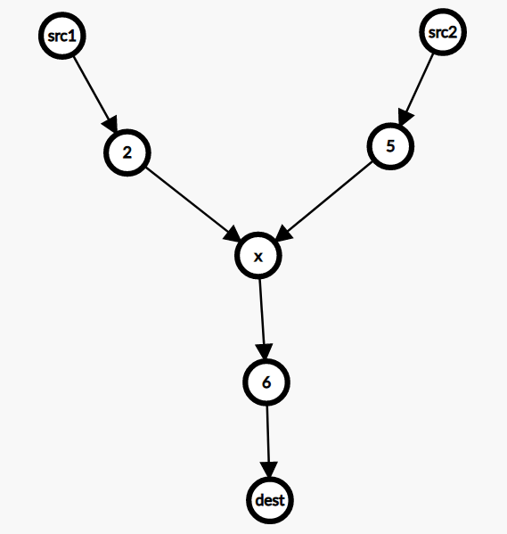

# 枚举三条最短路的交汇点（Python/Java/C++/Go）

> **[2203. 包含要求路径的最小带权子图](https://leetcode.cn/problems/minimum-weighted-subgraph-with-the-required-paths/solutions/1332967/by-endlesscheng-2mxm/) · Hard · 难度分 2364**

> **所属题单**
> - [图论算法 · 三、最短路](../../../刷题路径/灵神原版题单/图论算法/三、最短路.md) · §3.1 单源最短路：Dijkstra 算法

> **题目描述**
> 给你一个整数 `n` ，它表示一个 **带权有向** 图的节点数，节点编号为 `0` 到 `n - 1` 。
>
> 同时给你一个二维整数数组 `edges` ，其中 `edges[i] = [from_i, to_i, weight_i]` ，表示从 `from_i` 到 `to_i` 有一条边权为 `weight_i` 的 **有向** 边。
>
> 最后，给你三个 **互不相同** 的整数 `src1` ，`src2` 和 `dest` ，表示图中三个不同的点。
>
> 请你从图中选出一个 **边权和最小** 的子图，使得从 `src1` 和 `src2` 出发，在这个子图中，都 **可以** 到达 `dest` 。如果这样的子图不存在，请返回 `-1` 。
>
> **子图** 中的点和边都应该属于原图的一部分。子图的边权和定义为它所包含的所有边的权值之和。
>
> **示例 1：**
>
> 
>
> ```
>
> 输入：n = 6, edges = [[0,2,2],[0,5,6],[1,0,3],[1,4,5],[2,1,1],[2,3,3],[2,3,4],[3,4,2],[4,5,1]], src1 = 0, src2 = 1, dest = 5
> 输出：9
> 解释：
> 上图为输入的图。
> 蓝色边为最优子图之一。
> 注意，子图 [[1,0,3],[0,5,6]] 也能得到最优解，但无法在满足所有限制的前提下，得到更优解。
> ```
>
> **示例 2：**
>
> 
>
> ```
>
> 输入：n = 3, edges = [[0,1,1],[2,1,1]], src1 = 0, src2 = 1, dest = 2
> 输出：-1
> 解释：
> 上图为输入的图。
> 可以看到，不存在从节点 1 到节点 2 的路径，所以不存在任何子图满足所有限制。
> ```
>
> **提示：**
>
> - `3 <= n <= 10⁵`
>
> - `0 <= edges.length <= 10⁵`
>
> - `edges[i].length == 3`
>
> - `0 <= from_i, to_i, src1, src2, dest <= n - 1`
>
> - `from_i != to_i`
>
> - `src1` ，`src2` 和 `dest` 两两不同。
>
> - `1 <= weight[i] <= 10⁵`

> **题解**
> 想一想，答案（最小带权子图）会是什么形状呢？
>
> 画一条从 $\textit{src}_1$ 到 $\textit{dest}$ 的最短路，再画一条从 $\textit{src}_2$ 到 $\textit{dest}$ 的最短路，有两种情况：
>
> - 两条路径没有公共边。此时子图是一条链 $\textit{src}_1\to \textit{dest} \leftarrow \textit{src}_2$。
> - 两条路径有公共边。如下图，$\textit{src}_1$ 和 $\textit{src}_2$ 一开始各走各的，然后在某个点相遇，此时子图一定是 Y 形状的。**证明**：反证法，如果两人相遇后又分开，各走各的，分别到达 $\textit{dest}$，那么删除其中一条从相遇点到 $\textit{dest}$ 的路径，两人仍然可以到达 $\textit{dest}$，并且由于**公共边的边权只会被计入一次**，所以删边后的子图边权和更小，矛盾。因此两人**相遇后一定不会分开**。
>
> {:width=400px}
>
> 我们可以枚举相遇点 $x$，然后用 [Dijkstra 算法](../../0700-0799/0743%20网络延迟时间/灵茶山艾府.md) 求出从 $\textit{src}_1$ 到 $x$ 的最短路，从 $\textit{src}_2$ 到 $x$ 的最短路，以及从 $x$ 到 $\textit{dest}$ 的最短路，后者可以在反图（即所有边反向后的图）上求从 $\textit{dest}$ 出发的最短路得到。
>
> 这三条最短路的边权之和，即为相遇点在 $x$ 处的子图边权和。
>
> 枚举 $x=0,1,2,\ldots,n-1$，计算最小的子图的边权和，即为答案。
>
> 如果不存在这样的子图，返回 $-1$。
>
> > **注**：这种计算方式包含了子图是一条链（$\textit{src}_1\to \textit{dest} \leftarrow \textit{src}_2$）的情况，我们会在 $x = \textit{dest}$ 时枚举到这种情况。
>
> ```python
> class Solution:
>     def minimumWeight(self, n: int, edges: List[List[int]], src1: int, src2: int, dest: int) -> int:
>         def dijkstra(g: List[List[Tuple[int, int]]], start: int) -> List[int]:
>             dis = [inf] * n
>             dis[start] = 0
>             h = [(0, start)]
>
>             while h:
>                 dis_x, x = heappop(h)
>                 if dis_x > dis[x]:
>                     continue
>                 for y, wt in g[x]:
>                     new_dis_y = dis_x + wt
>                     if new_dis_y < dis[y]:
>                         dis[y] = new_dis_y
>                         heappush(h, (new_dis_y, y))
>             return dis
>
>         g = [[] for _ in range(n)]
>         rg = [[] for _ in range(n)]  # 反图，用于计算从 dest 出发的最短路
>         for x, y, wt in edges:
>             g[x].append((y, wt))
>             rg[y].append((x, wt))
>
>         d1 = dijkstra(g, src1)
>         d2 = dijkstra(g, src2)
>         d3 = dijkstra(rg, dest)
>
>         ans = min(map(sum, zip(d1, d2, d3)))  # 计算 d1[i]+d2[i]+d3[i] 的最小值
>         return ans if ans < inf else -1
> ```
>
>
> #### 复杂度分析
>
> - 时间复杂度：$\mathcal{O}(n + m\log m)$，其中 $m$ 是 $\textit{edges}$ 的长度。注意我们用的是**懒更新堆**，堆中有 $\mathcal{O}(m)$ 个元素（而不是 $\mathcal{O}(n)$ 个），每次操作堆需要 $\mathcal{O}(\log m)$ 的时间。
> - 空间复杂度：$\mathcal{O}(n + m)$。
>
> ## 专题训练
>
> 见下面图论题单的「**§3.1 单源最短路：Dijkstra 算法**」。
>
> ## 分类题单
>
> [如何科学刷题？](https://leetcode.cn/circle/discuss/RvFUtj/)
>
> 1. [滑动窗口与双指针（定长/不定长/单序列/双序列/三指针/分组循环）](https://leetcode.cn/circle/discuss/0viNMK/)
> 2. [二分算法（二分答案/最小化最大值/最大化最小值/第K小）](https://leetcode.cn/circle/discuss/SqopEo/)
> 3. [单调栈（基础/矩形面积/贡献法/最小字典序）](https://leetcode.cn/circle/discuss/9oZFK9/)
> 4. [网格图（DFS/BFS/综合应用）](https://leetcode.cn/circle/discuss/YiXPXW/)
> 5. [位运算（基础/性质/拆位/试填/恒等式/思维）](https://leetcode.cn/circle/discuss/dHn9Vk/)
> 6. [图论算法（DFS/BFS/拓扑排序/基环树/最短路/最小生成树/网络流）](https://leetcode.cn/circle/discuss/01LUak/)
> 7. [动态规划（入门/背包/划分/状态机/区间/状压/数位/数据结构优化/树形/博弈/概率期望）](https://leetcode.cn/circle/discuss/tXLS3i/)
> 8. [常用数据结构（前缀和/差分/栈/队列/堆/字典树/并查集/树状数组/线段树）](https://leetcode.cn/circle/discuss/mOr1u6/)
> 9. [数学算法（数论/组合/概率期望/博弈/计算几何/随机算法）](https://leetcode.cn/circle/discuss/IYT3ss/)
> 10. [贪心与思维（基本贪心策略/反悔/区间/字典序/数学/思维/脑筋急转弯/构造）](https://leetcode.cn/circle/discuss/g6KTKL/)
> 11. [链表、树与回溯（前后指针/快慢指针/DFS/BFS/直径/LCA）](https://leetcode.cn/circle/discuss/K0n2gO/)
> 12. [字符串（KMP/Z函数/Manacher/字符串哈希/AC自动机/后缀数组/子序列自动机）](https://leetcode.cn/circle/discuss/SJFwQI/)
>
> [我的题解精选（已分类）](https://github.com/EndlessCheng/codeforces-go/blob/master/leetcode/SOLUTIONS.md)
>
> 欢迎关注 [B站@灵茶山艾府](https://space.bilibili.com/206214)
