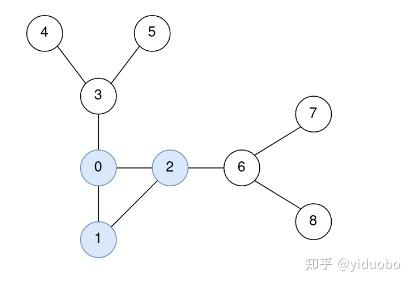
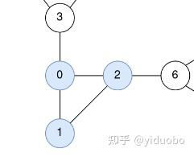

# 2204. 无向图中到环的距离

> **[yiduobo的每日leetcode 2204.无向图中到环的距离](https://zhuanlan.zhihu.com/p/627846189) · 知乎 · 2023-05-08 · 赞同 1**
> 力扣：[2204. 无向图中到环的距离](https://leetcode.cn/problems/distance-to-a-cycle-in-undirected-graph/) · Hard · 灵茶山艾府：[无向基环树](灵茶山艾府.md)

祖传的手艺不想丢了，所以按顺序写一个leetcode的题解。计划每日两题，争取不卡题吧

常规题号的题目已经写到头了，开始从头补vip题的题

2204.无向图中到环的距离

[力扣](https://leetcode.cn/problems/distance-to-a-cycle-in-undirected-graph/)

无向图中仅包含一个环，想要直接定位图中的节点并不容易，但是有一类节点是很好区分的，就是度为1的节点，这些度为1的节点必然不在环中。如果将这些节点以及与之相连的边从图中移除，就可能得到另一批新的度为1的节点，那么只需重复这个过程，直到图中仅剩那个环为止。另一方面， 对于每轮移除的节点而言，其与环的距离就是其唯一的那条边对面那个节点与环的距离再加上1，于是可以在移除的过程中记录每个被移除节点对面的节点，在移除所有非环上节点后，通过倒推法求解所有节点到环距离。

以样例2为例：



最开始度为1的点有4、5、7、8，其中4和5另一端的点为3，而7和8另一端的点为6

接下来，将4、5、7、8以及与之相连的变删除，图就变成了



此时度为1的点有3和6，其中3与0相连，6与2相连。

将二者删去后，图中就没有度为1的点了，也就是说剩下的就是图中的环，其中节点与环的距离都为0。

最后开始倒推。第一轮有dis[3] \= dis[0] + 1 \= 1，dis[6] \= dis[2] + 1 \= 1，第二轮有dis[4] \= dis[5] \= dis[3] + 1 \= 2，dis[7] \= dis[8] \= dis[6] + 1 \= 2，至此就计算出所有点与环的距离了。

最后附上python代码：

```python
class Solution(object):
    def distanceToCycle(self, n, edges):
        """
        :type n: int
        :type edges: List[List[int]]
        :rtype: List[int]
        """
        
        d = [0] * n
        g = [[] for _ in range(n)]
        for x, y in edges:
            d[x] += 1
            d[y] += 1
            g[x].append(y)
            g[y].append(x)
        
        q = []
        inq = [False] * n
        for index in range(n):
            if d[index] == 1:
                q.append(index)
                inq[index] = True
        
        linked = [None] * n
        head, tail = 0, len(q)
        while head < tail:
            now = q[head]
            head += 1
            for next in g[now]:
                if not inq[next]:
                    linked[now] = next
                    d[next] -= 1
                    if d[next] == 1:
                        q.append(next)
                        inq[next] = True
                        tail += 1

        res = [0] * n
        for now in q[::-1]:
            res[now] = res[linked[now]] + 1
        
        return res
```
