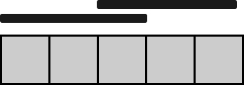

# 教你一步步思考 DP：从记忆化搜索到递推到空间优化！（Python/Java/C++/Go）

> **[2209. 用地毯覆盖后的最少白色砖块](https://leetcode.cn/problems/minimum-white-tiles-after-covering-with-carpets/solutions/1352146/by-endlesscheng-pa3v/) · Hard · 难度分 2106**

> **所属题单**
> - [动态规划 · 五、划分型 DP](../../../刷题路径/灵神原版题单/动态规划/五、划分型%20DP.md) · §5.3 约束划分个数
> - [动态规划 · 十一、优化 DP](../../../刷题路径/灵神原版题单/动态规划/十一、优化%20DP.md) · §11.8 WQS 二分优化 DP

> **题目描述**
> 给你一个下标从 **0** 开始的 **二进制** 字符串 `floor` ，它表示地板上砖块的颜色。
>
> - `floor[i] = '0'` 表示地板上第 `i` 块砖块的颜色是 **黑色** 。
>
> - `floor[i] = '1'` 表示地板上第 `i` 块砖块的颜色是 **白色** 。
>
> 同时给你 `numCarpets` 和 `carpetLen` 。你有 `numCarpets` 条 **黑色** 的地毯，每一条 **黑色** 的地毯长度都为 `carpetLen` 块砖块。请你使用这些地毯去覆盖砖块，使得未被覆盖的剩余 **白色** 砖块的数目 **最小** 。地毯相互之间可以覆盖。
>
> 请你返回没被覆盖的白色砖块的 **最少** 数目。
>
> **示例 1：**
>
> 
>
> ```
> 输入：floor = "10110101", numCarpets = 2, carpetLen = 2
> 输出：2
> 解释：
> 上图展示了剩余 2 块白色砖块的方案。
> 没有其他方案可以使未被覆盖的白色砖块少于 2 块。
> ```
>
> **示例 2：**
>
> 
>
> ```
> 输入：floor = "11111", numCarpets = 2, carpetLen = 3
> 输出：0
> 解释：
> 上图展示了所有白色砖块都被覆盖的一种方案。
> 注意，地毯相互之间可以覆盖。
> ```
>
> **提示：**
>
> - `1 <= carpetLen <= floor.length <= 1000`
>
> - `floor[i]` 要么是 `'0'` ，要么是 `'1'` 。
>
> - `1 <= numCarpets <= 1000`

> **题解**
> ## 一、寻找子问题
>
> 在示例 1 中，我们要解决的问题（原问题）是：
>
> - 有 $2$ 条地毯和 $8$ 块砖，计算没被覆盖的白色砖块的最少数目。
>
> 考虑从右往左覆盖砖。讨论最后一块砖是否覆盖（选或不选）：
>
> - 如果不覆盖（不选）最后一块砖，那么需要解决的子问题为：有 $2$ 条地毯和 $8-1=7$ 块砖，计算没被覆盖的白色砖块的最少数目。
> - 如果覆盖（选）最后一块砖，那么末尾连续的 $\textit{carpetLen}=2$ 块砖都会被覆盖，需要解决的子问题为：有 $1$ 条地毯和 $8-\textit{carpetLen}=6$ 块砖，计算没被覆盖的白色砖块的最少数目。
>
> 由于选或不选都会把原问题变成一个**和原问题相似的、规模更小的子问题**，所以可以用**递归**解决。
>
> > 注：从右往左思考，主要是为了方便把递归翻译成递推。从左往右思考也是可以的。
>
> ## 二、状态定义与状态转移方程
>
> 根据上面的讨论，我们需要在递归过程中跟踪以下信息：
>
> - $i$：还剩下 $i$ 条地毯。
> - $j$：剩余砖块为 $\textit{floor}[0]$ 到 $\textit{floor}[j]$，即 $j+1$ 块砖。
>
> 因此，定义状态为 $\textit{dfs}(i,j)$，表示用 $i$ 条地毯覆盖下标在 $[0,j]$ 中的砖，没被覆盖的白色砖块的最少数目。
>
> 接下来，思考如何从一个状态转移到另一个状态。
>
> 考虑 $\textit{floor}[j]$ 是否覆盖（选或不选）：
>
> - 不覆盖（不选）：接下来要解决的问题是，用 $i$ 条地毯覆盖下标在 $[0,j-1]$ 中的砖，没被覆盖的白色砖块的最少数目，再加上 $\texttt{int}(\textit{floor}[j])$（刚好白色是 $1$），得 $\textit{dfs}(i,j) = \textit{dfs}(i,j-1) + \texttt{int}(\textit{floor}[j])$。
> - 覆盖（选）：如果 $i>0$，接下来要解决的问题是，用 $i-1$ 条地毯覆盖下标在 $[0,j-\textit{carpetLen}]$ 中的砖，没被覆盖的白色砖块的最少数目，即 $\textit{dfs}(i,j) = \textit{dfs}(i-1,j-\textit{carpetLen})$。
>
> 这两种情况取最小值，就得到了 $\textit{dfs}(i,j)$，即
>
> $$
> \textit{dfs}(i,j) =
> \begin{cases}
> \min(\textit{dfs}(i,j-1) + \texttt{int}(\textit{floor}[j]),  \textit{dfs}(i-1,j-\textit{carpetLen})), & i>0     \\
> \textit{dfs}(i,j-1) + \texttt{int}(\textit{floor}[j]), & i=0     \\
> \end{cases}
> $$
>
> **递归边界**：如果 $j<\textit{carpetLen}\cdot i$，那么 $\textit{dfs}(i,j)=0$，因为剩余砖块可以全部覆盖。
>
> **递归入口**：$\textit{dfs}(\textit{numCarpets},m-1)$，其中 $m$ 是 $\textit{floor}$ 的长度。这是原问题，也是答案。
>
> ## 三、递归搜索 + 保存递归返回值 = 记忆化搜索
>
> 考虑到整个递归过程中有大量重复递归调用（递归入参相同）。由于递归函数没有副作用，同样的入参无论计算多少次，算出来的结果都是一样的，因此可以用**记忆化搜索**来优化：
>
> - 如果一个状态（递归入参）是第一次遇到，那么可以在返回前，把状态及其结果记到一个 $\textit{memo}$ 数组中。
> - 如果一个状态不是第一次遇到（$\textit{memo}$ 中保存的结果不等于 $\textit{memo}$ 的初始值），那么可以直接返回 $\textit{memo}$ 中保存的结果。
>
> **注意**：$\textit{memo}$ 数组的**初始值**一定不能等于要记忆化的值！例如初始值设置为 $0$，并且要记忆化的 $\textit{dfs}(i,j)$ 也等于 $0$，那就没法判断 $0$ 到底表示第一次遇到这个状态，还是表示之前遇到过了，从而导致记忆化失效。一般把初始值设置为 $-1$。
>
> > Python 用户可以无视上面这段，直接用 `@cache` 装饰器。
>
> 具体请看视频讲解 [动态规划入门：从记忆化搜索到递推](https://www.bilibili.com/video/BV1Xj411K7oF/)，其中包含把记忆化搜索 1:1 翻译成递推的技巧。
>
> ```python
> class Solution:
>     def minimumWhiteTiles(self, floor: str, numCarpets: int, carpetLen: int) -> int:
>         floor = list(map(int, floor))  # 避免在 dfs 中频繁调用 int()
>         @cache  # 缓存装饰器，避免重复计算 dfs 的结果（一行代码实现记忆化）
>         def dfs(i: int, j: int) -> int:
>             if j < carpetLen * i:  # 剩余砖块可以全部覆盖
>                 return 0
>             if i == 0:
>                 return dfs(i, j - 1) + floor[j]
>             return min(dfs(i, j - 1) + floor[j], dfs(i - 1, j - carpetLen))
>         return dfs(numCarpets, len(floor) - 1)
> ```
>
>
> #### 复杂度分析
>
> - 时间复杂度：$\mathcal{O}(\textit{numCarpets}\cdot m)$，其中 $m$ 是 $\textit{floor}$ 的长度。由于每个状态只会计算一次，动态规划的时间复杂度 $=$ 状态个数 $\times$ 单个状态的计算时间。本题状态个数等于 $\mathcal{O}(\textit{numCarpets}\cdot m)$，单个状态的计算时间为 $\mathcal{O}(1)$，所以总的时间复杂度为 $\mathcal{O}(\textit{numCarpets}\cdot m)$。
> - 空间复杂度：$\mathcal{O}(\textit{numCarpets}\cdot m)$。保存多少状态，就需要多少空间。
>
> ## 四、1:1 翻译成递推
>
> 我们可以去掉递归中的「递」，只保留「归」的部分，即自底向上计算。
>
> 具体来说，$f[i][j]$ 的定义和 $\textit{dfs}(i,j)$ 的定义是完全一样的，都表示用 $i$ 条地毯覆盖下标在 $[0,j]$ 中的砖，没被覆盖的白色砖块的最少数目。
>
> 相应的递推式（状态转移方程）也和 $\textit{dfs}$ 一样：
>
> $$
> f[i][j] =
> \begin{cases}
> \min(f[i][j-1] + \texttt{int}(\textit{floor}[j]),  f[i-1][j-\textit{carpetLen}]), & i>0     \\
> f[i][j-1] + \texttt{int}(\textit{floor}[j]), & i=0     \\
> \end{cases}
> $$
>
> 初始值 $f[i][j]=0$，翻译自递归边界 $\textit{dfs}(i,j)=0$。
>
> 答案为 $f[\textit{numCarpets}][m-1]$，翻译自递归入口 $\textit{dfs}(\textit{numCarpets},m-1)$。
>
> ```python
> class Solution:
>     def minimumWhiteTiles(self, floor: str, numCarpets: int, carpetLen: int) -> int:
>         floor = list(map(int, floor))
>         m = len(floor)
>         f = [[0] * m for _ in range(numCarpets + 1)]
>         f[0] = list(accumulate(floor))  # 单独计算 i=0 的情况，本质是 floor 的前缀和
>         for i in range(1, numCarpets + 1):
>             for j in range(carpetLen * i, m):
>                 f[i][j] = min(f[i][j - 1] + floor[j], f[i - 1][j - carpetLen])
>         return f[-1][-1]
> ```
>
>
> #### 复杂度分析
>
> - 时间复杂度：$\mathcal{O}(\textit{numCarpets}\cdot m)$，其中 $m$ 是 $\textit{floor}$ 的长度。
> - 空间复杂度：$\mathcal{O}(\textit{numCarpets}\cdot m)$。
>
> ## 五、空间优化
>
> 由于计算 $f[i]$ 只需要知道 $f[i-1]$ 中的数据，我们可以改用两个长为 $m$ 的数组滚动计算。
>
> 此外，可以在计算 DP 之前，特判 $\textit{numCarpets}\cdot \textit{carpetLen}\ge m$ 的情况，此时所有砖块都能被覆盖，直接返回 $0$。
>
> ```python
> class Solution:
>     def minimumWhiteTiles(self, floor: str, numCarpets: int, carpetLen: int) -> int:
>         m = len(floor)
>         if numCarpets * carpetLen >= m:
>             return 0
>
>         floor = list(map(int, floor))
>         f = list(accumulate(floor))
>         for i in range(1, numCarpets + 1):
>             nf = [0] * m
>             for j in range(carpetLen * i, m):
>                 nf[j] = min(nf[j - 1] + floor[j], f[j - carpetLen])
>             f = nf
>         return f[-1]
> ```
>
> > [!example]- Python3 手写 min
> > ```python
> > class Solution:
> >     def minimumWhiteTiles(self, floor: str, numCarpets: int, carpetLen: int) -> int:
> >         m = len(floor)
> >         if numCarpets * carpetLen >= m:
> >             return 0
> >
> >         floor = list(map(int, floor))
> >         f = list(accumulate(floor))
> >         for i in range(1, numCarpets + 1):
> >             nf = [0] * m
> >             for j in range(carpetLen * i, m):
> >                 x = nf[j - 1] + floor[j]
> >                 y = f[j - carpetLen]
> >                 nf[j] = x if x < y else y
> >             f = nf
> >         return f[-1]
> > ```
>
>
> #### 复杂度分析
>
> - 时间复杂度：$\mathcal{O}(\textit{numCarpets}\cdot m)$，其中 $m$ 是 $\textit{floor}$ 的长度。
> - 空间复杂度：$\mathcal{O}(m)$。
>
> 更多相似题目，见 [动态规划题单](https://leetcode.cn/circle/discuss/tXLS3i/) 中的「**§6.3 约束划分个数**」。
>
> ## 分类题单
>
> [如何科学刷题？](https://leetcode.cn/circle/discuss/RvFUtj/)
>
> 1. [滑动窗口与双指针（定长/不定长/单序列/双序列/三指针/分组循环）](https://leetcode.cn/circle/discuss/0viNMK/)
> 2. [二分算法（二分答案/最小化最大值/最大化最小值/第K小）](https://leetcode.cn/circle/discuss/SqopEo/)
> 3. [单调栈（基础/矩形面积/贡献法/最小字典序）](https://leetcode.cn/circle/discuss/9oZFK9/)
> 4. [网格图（DFS/BFS/综合应用）](https://leetcode.cn/circle/discuss/YiXPXW/)
> 5. [位运算（基础/性质/拆位/试填/恒等式/思维）](https://leetcode.cn/circle/discuss/dHn9Vk/)
> 6. [图论算法（DFS/BFS/拓扑排序/最短路/最小生成树/二分图/基环树/欧拉路径）](https://leetcode.cn/circle/discuss/01LUak/)
> 7. 【本题相关】[动态规划（入门/背包/状态机/划分/区间/状压/数位/数据结构优化/树形/博弈/概率期望）](https://leetcode.cn/circle/discuss/tXLS3i/)
> 8. [常用数据结构（前缀和/差分/栈/队列/堆/字典树/并查集/树状数组/线段树）](https://leetcode.cn/circle/discuss/mOr1u6/)
> 9. [数学算法（数论/组合/概率期望/博弈/计算几何/随机算法）](https://leetcode.cn/circle/discuss/IYT3ss/)
> 10. [贪心与思维（基本贪心策略/反悔/区间/字典序/数学/思维/脑筋急转弯/构造）](https://leetcode.cn/circle/discuss/g6KTKL/)
> 11. [链表、二叉树与回溯（前后指针/快慢指针/DFS/BFS/直径/LCA/一般树）](https://leetcode.cn/circle/discuss/K0n2gO/)
> 12. [字符串（KMP/Z函数/Manacher/字符串哈希/AC自动机/后缀数组/子序列自动机）](https://leetcode.cn/circle/discuss/SJFwQI/)
>
> [我的题解精选（已分类）](https://github.com/EndlessCheng/codeforces-go/blob/master/leetcode/SOLUTIONS.md)
>
> 欢迎关注 [B站@灵茶山艾府](https://space.bilibili.com/206214)
