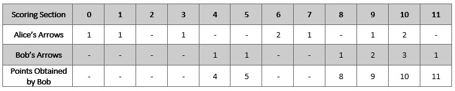
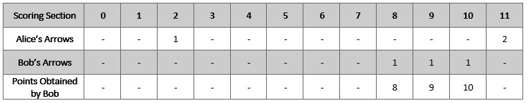

# 2212. 射箭比赛中的最大得分

Medium · 难度分 1869 · [力扣原题](https://leetcode.cn/problems/maximum-points-in-an-archery-competition/)

所在刷题路径：灵神题单·链表树与回溯

| 作者 | 题解 | 动画讲解 |
|---|---|---|
| 灵茶山艾府 | [📄 题解](灵茶山艾府.md) | [▶︎ 动画（GIF）](2212%20射箭比赛中的最大得分%20·%20灵茶山艾府.gif) · [mp4 文件](2212%20射箭比赛中的最大得分%20·%20灵茶山艾府.mp4) |
| yiduobo | [📄 题解](yiduobo.md) | [▶︎ 动画（GIF）](2212%20射箭比赛中的最大得分%20·%20yiduobo.gif) · [mp4 文件](2212%20射箭比赛中的最大得分%20·%20yiduobo.mp4) |

## 动画讲解

> 动图会循环播放；想暂停、拖进度条请下载上面表格里的 mp4 文件。

### 灵茶山艾府


### yiduobo


## 题目描述

Alice 和 Bob 是一场射箭比赛中的对手。比赛规则如下：

1. Alice 先射 `numArrows` 支箭，然后 Bob 也射 `numArrows` 支箭。

2. 分数按下述规则计算：

    1. 箭靶有若干整数计分区域，范围从 `0` 到 `11` （含 `0` 和 `11`）。

    2. 箭靶上每个区域都对应一个得分 `k`（范围是 `0` 到 `11`），Alice 和 Bob 分别在得分 `k` 区域射中 `a_k` 和 `b_k` 支箭。如果 `a_k >= b_k` ，那么 Alice 得 `k` 分。如果 `a_k < b_k` ，则 Bob 得 `k` 分

    3. 如果 `a_k == b_k == 0` ，那么无人得到 `k` 分。

-

例如，Alice 和 Bob 都向计分为 `11` 的区域射 `2` 支箭，那么 Alice 得 `11` 分。如果 Alice 向计分为 `11` 的区域射 `0` 支箭，但 Bob 向同一个区域射 `2` 支箭，那么 Bob 得 `11` 分。

给你整数 `numArrows` 和一个长度为 `12` 的整数数组 `aliceArrows` ，该数组表示 Alice 射中 `0` 到 `11` 每个计分区域的箭数量。现在，Bob 想要尽可能 **最大化** 他所能获得的总分。

返回数组 `bobArrows` ，该数组表示 Bob 射中 `0` 到 `11` **每个** 计分区域的箭数量。且 `bobArrows` 的总和应当等于 `numArrows` 。

如果存在多种方法都可以使 Bob 获得最大总分，返回其中 **任意一种** 即可。

**示例 1：**



```

输入：numArrows = 9, aliceArrows = [1,1,0,1,0,0,2,1,0,1,2,0]
输出：[0,0,0,0,1,1,0,0,1,2,3,1]
解释：上表显示了比赛得分情况。
Bob 获得总分 4 + 5 + 8 + 9 + 10 + 11 = 47 。
可以证明 Bob 无法获得比 47 更高的分数。
```

**示例 2：**



```

输入：numArrows = 3, aliceArrows = [0,0,1,0,0,0,0,0,0,0,0,2]
输出：[0,0,0,0,0,0,0,0,1,1,1,0]
解释：上表显示了比赛得分情况。
Bob 获得总分 8 + 9 + 10 = 27 。
可以证明 Bob 无法获得比 27 更高的分数。
```

**提示：**

- `1 <= numArrows <= 10⁵`

- `aliceArrows.length == bobArrows.length == 12`

- `0 <= aliceArrows[i], bobArrows[i] <= numArrows`

- `sum(aliceArrows[i]) == numArrows`

---
[↑ 返回 2200-2299](../README.md) · [总索引](../../../索引.md) · [仓库首页](../../../README.md)
