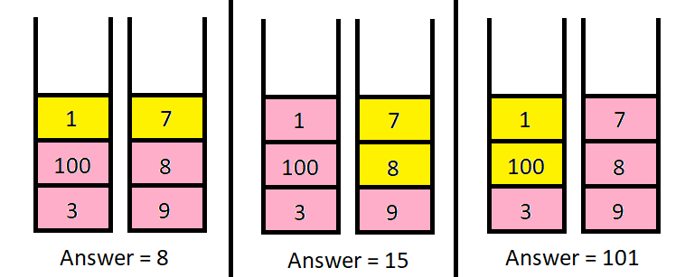

# 2218. 从栈中取出 K 个硬币的最大面值和

Hard · 难度分 2158 · [力扣原题](https://leetcode.cn/problems/maximum-value-of-k-coins-from-piles/)

所在刷题路径：灵神题单·动态规划

| 作者 | 题解 | 动画讲解 |
|---|---|---|
| 灵茶山艾府 | [📄 题解](灵茶山艾府.md) | [▶︎ 2218 从栈中取出 K 个硬币的最大面值和 · 灵茶山艾府.mp4](2218%20从栈中取出%20K%20个硬币的最大面值和%20·%20灵茶山艾府.mp4) |
| yiduobo | [📄 题解](yiduobo.md) | [▶︎ 2218 从栈中取出 K 个硬币的最大面值和 · yiduobo.mp4](2218%20从栈中取出%20K%20个硬币的最大面值和%20·%20yiduobo.mp4) |

## 题目描述

一张桌子上总共有 `n` 个硬币 **栈** 。每个栈有 **正整数** 个带面值的硬币。

每一次操作中，你可以从任意一个栈的 **顶部** 取出 1 个硬币，从栈中移除它，并放入你的钱包里。

给你一个列表 `piles` ，其中 `piles[i]` 是一个整数数组，分别表示第 `i` 个栈里 **从顶到底** 的硬币面值。同时给你一个正整数 `k` ，请你返回在 **恰好** 进行 `k` 次操作的前提下，你钱包里硬币面值之和 **最大为多少** 。

**示例 1：**



```

输入：piles = [[1,100,3],[7,8,9]], k = 2
输出：101
解释：
上图展示了几种选择 k 个硬币的不同方法。
我们可以得到的最大面值为 101 。
```

**示例 2：**

```

输入：piles = [[100],[100],[100],[100],[100],[100],[1,1,1,1,1,1,700]], k = 7
输出：706
解释：
如果我们所有硬币都从最后一个栈中取，可以得到最大面值和。
```

**提示：**

- `n == piles.length`

- `1 <= n <= 1000`

- `1 <= piles[i][j] <= 10⁵`

- `1 <= k <= sum(piles[i].length) <= 2000`

---
[↑ 返回 2200-2299](../README.md) · [总索引](../../../索引.md) · [仓库首页](../../../README.md)
