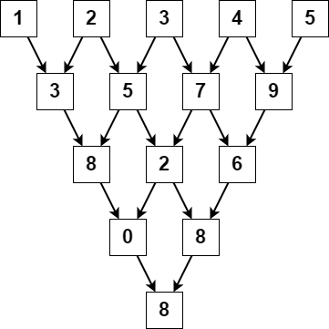

# 2221. 数组的三角和

Medium · [力扣原题](https://leetcode.cn/problems/find-triangular-sum-of-an-array/)

所在刷题路径：灵神题单·数学算法

| 作者 | 题解 | 动画讲解 |
|---|---|---|
| 灵茶山艾府 | [📄 题解](灵茶山艾府.md) | [▶︎ 动画（GIF）](2221%20数组的三角和%20·%20灵茶山艾府.gif) · [mp4 文件](2221%20数组的三角和%20·%20灵茶山艾府.mp4) |
| yiduobo | [📄 题解](yiduobo.md) | [▶︎ 动画（GIF）](2221%20数组的三角和%20·%20yiduobo.gif) · [mp4 文件](2221%20数组的三角和%20·%20yiduobo.mp4) |

## 动画讲解

> 动图会循环播放；想暂停、拖进度条请下载上面表格里的 mp4 文件。

### 灵茶山艾府


### yiduobo


## 题目描述

给你一个下标从 **0** 开始的整数数组 `nums` ，其中 `nums[i]` 是 `0` 到 `9` 之间（两者都包含）的一个数字。

`nums` 的 **三角和** 是执行以下操作以后最后剩下元素的值：

1. `nums` 初始包含 `n` 个元素。如果 `n == 1` ，**终止** 操作。否则，**创建** 一个新的下标从 **0** 开始的长度为 `n - 1` 的整数数组 `newNums` 。

2. 对于满足 `0 <= i < n - 1` 的下标 `i` ，`newNums[i]` **赋值** 为 `(nums[i] + nums[i+1]) % 10` ，`%` 表示取余运算。

3. 将 `newNums` **替换** 数组 `nums` 。

4. 从步骤 1 开始 **重复** 整个过程。

请你返回 `nums` 的三角和。

**示例 1：**



```

输入：nums = [1,2,3,4,5]
输出：8
解释：
上图展示了得到数组三角和的过程。
```

**示例 2：**

```

输入：nums = [5]
输出：5
解释：
由于 nums 中只有一个元素，数组的三角和为这个元素自己。
```

**提示：**

- `1 <= nums.length <= 1000`

- `0 <= nums[i] <= 9`

---
[↑ 返回 2200-2299](../README.md) · [总索引](../../../索引.md) · [仓库首页](../../../README.md)
