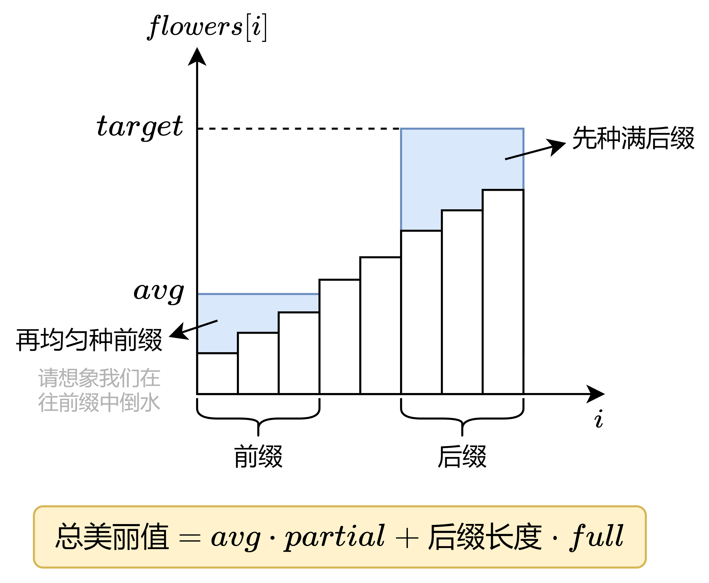

# 贪心+排序+双指针（Python/Java/C++/C/Go/JS/Rust）

> **[2234. 花园的最大总美丽值](https://leetcode.cn/problems/maximum-total-beauty-of-the-gardens/solutions/1408882/by-endlesscheng-10i7/) · Hard · 难度分 2562**

> **所属题单**
> - [滑动窗口与双指针 · 三、单序列双指针](../../../刷题路径/灵神原版题单/滑动窗口与双指针/三、单序列双指针.md) · §3.3 同向双指针
> - [贪心算法 · 一、贪心策略](../../../刷题路径/灵神原版题单/贪心算法/一、贪心策略.md) · §1.6 先枚举，再贪心

> **题目描述**
> Alice 是 `n` 个花园的园丁，她想通过种花，最大化她所有花园的总美丽值。
>
> 给你一个下标从 **0** 开始大小为 `n` 的整数数组 `flowers` ，其中 `flowers[i]` 是第 `i` 个花园里已经种的花的数目。已经种了的花 **不能** 移走。同时给你 `newFlowers` ，表示 Alice 额外可以种花的 **最大数目** 。同时给你的还有整数 `target` ，`full` 和 `partial` 。
>
> 如果一个花园有 **至少** `target` 朵花，那么这个花园称为 **完善的** ，花园的 **总美丽值** 为以下分数之 **和** ：
>
> - **完善** 花园数目乘以 `full`.
>
> - 剩余 **不完善** 花园里，花的 **最少数目** 乘以 `partial` 。如果没有不完善花园，那么这一部分的值为 `0` 。
>
> 请你返回 Alice 种最多 `newFlowers` 朵花以后，能得到的 **最大** 总美丽值。
>
> **示例 1：**
>
> ```
> 输入：flowers = [1,3,1,1], newFlowers = 7, target = 6, full = 12, partial = 1
> 输出：14
> 解释：Alice 可以按以下方案种花
> - 在第 0 个花园种 2 朵花
> - 在第 1 个花园种 3 朵花
> - 在第 2 个花园种 1 朵花
> - 在第 3 个花园种 1 朵花
> 花园里花的数目为 [3,6,2,2] 。总共种了 2 + 3 + 1 + 1 = 7 朵花。
> 只有 1 个花园是完善的。
> 不完善花园里花的最少数目是 2 。
> 所以总美丽值为 1 * 12 + 2 * 1 = 12 + 2 = 14 。
> 没有其他方案可以让花园总美丽值超过 14 。
> ```
>
> **示例 2：**
>
> ```
> 输入：flowers = [2,4,5,3], newFlowers = 10, target = 5, full = 2, partial = 6
> 输出：30
> 解释：Alice 可以按以下方案种花
> - 在第 0 个花园种 3 朵花
> - 在第 1 个花园种 0 朵花
> - 在第 2 个花园种 0 朵花
> - 在第 3 个花园种 2 朵花
> 花园里花的数目为 [5,4,5,5] 。总共种了 3 + 0 + 0 + 2 = 5 朵花。
> 有 3 个花园是完善的。
> 不完善花园里花的最少数目为 4 。
> 所以总美丽值为 3 * 2 + 4 * 6 = 6 + 24 = 30 。
> 没有其他方案可以让花园总美丽值超过 30 。
> 注意，Alice可以让所有花园都变成完善的，但这样她的总美丽值反而更小。
> ```
>
> **提示：**
>
> - `1 <= flowers.length <= 10⁵`
>
> - `1 <= flowers[i], target <= 10⁵`
>
> - `1 <= newFlowers <= 10¹⁰`
>
> - `1 <= full, partial <= 10⁵`

> **题解**
> **核心思路**：枚举把多少个花园种满（至少有 $\textit{target}$ 朵花），剩余的花种其他花园，让最小花朵数最大。
>
> 
>
> 贪心地想，那些要种满的花园，原有的花朵数越多越好，这样我们能有更多的花，去增大花的最少数目。
>
> 将 $\textit{flowers}$ 从小到大排序，这样 $\textit{flowers}$ 的**后缀**就是要种满的花园。
>
> 枚举 $i$，把 $\textit{flowers}[i]$ 到 $\textit{flowers}[n-1]$ 都种满花。那么剩下要解决的问题就是，怎么最大化花的最少数目。
>
> 例如 $\textit{flowers}=[1,3,5,7,10,10]$，还剩下 $9$ 朵花。
>
> - 为了增大最小值，我们先把 $\textit{flowers}[0]=1$ 增大，种下 $2$ 朵花，增大到 $\textit{flowers}[1]=3$，还剩下 $9-2=7$ 朵花。你可以**把这个过程想象成我们在往前缀中倒水**。
> - 继续种花（倒水），必须把 $\textit{flowers}[0]$ 和 $\textit{flowers}[1]$ 同时增大，那么各自种下 $2$ 朵花，增大到 $\textit{flowers}[2]=5$，还剩下 $7-4=3$ 朵花。
> - 继续种花（倒水），必须把 $\textit{flowers}[0]$，$\textit{flowers}[1]$ 和 $\textit{flowers}[2]$ 同时增大，由于剩余的花朵数无法让这三个花园都有 $\textit{flowers}[3]=7$ 朵花，所以只能平均每个花园都种 $1$ 朵花。
> - 最终，$\textit{flowers}=[6,6,6,7,10,10]$，最小的花园有 $6$ 朵花。换句话说，我们把 $\textit{flowers}$ 的一个长为 $3$ 的**前缀**都变成了 $6$ 朵花。
>
> 如果每次枚举 $i$，都模拟一遍上述流程的话，时间复杂度是 $\mathcal{O}(n^2)$，太慢了。
>
> 注意到，随着 $i$ 的变大（后缀变短），剩余能填充到前缀中的花也越多，那么前缀也就越长。有单调性，我们可以用**双指针**，枚举 $i$（后缀长度），同时维护前缀的最长长度。
>
> 设在填充后缀之后，还剩下 $\textit{leftFlowers}$ 朵花可以分配。我们把这些花种到长为 $j$ 的前缀 $[0,j-1]$ 中。设最终最小值为 $\textit{avg}$，那么这 $j$ 个花园一共有 $\textit{avg}\cdot j$ 朵花，这个总数不能超过 $\textit{leftFlowers}$ 加上原有的花，即
>
> $$
> \textit{avg}\cdot j \le  \textit{leftFlowers} + \sum_{k=0}^{k=j-1} \textit{flowers}[k]
> $$
>
> 解得 $\textit{avg}$ 的最大值为
>
> $$
> \left\lfloor\dfrac{\textit{leftFlowers}+\sum_{k=0}^{k=j-1} \textit{flowers}[k]}{j}\right\rfloor
> $$
>
> 由于 $j$ 是单调增加的，上式中的前缀和 $\sum_{k=0}^{k=j-1} \textit{flowers}[k]$ 可以（在双指针的过程中）用一个变量 $\textit{preSum}$ 维护。
>
> 最后，根据题目给出的计算公式
>
> $$
> \textit{avg} \cdot \textit{partial} + (n-i) \cdot \textit{full}
> $$
>
> 计算总美丽值，更新答案的最大值。（其中 $n-i$ 是后缀 $[i,n-1]$ 的长度）
>
> ### 优化
>
> 由于双指针是 $\mathcal{O}(n)$ 的，时间复杂度的瓶颈在排序上。如果能在排序之前，特判某些情况，从而提前返回，就能减少运行时间。
>
> 1. 如果所有花园都至少有 $\textit{target}$ 朵花，那么总美丽值只能是 $n\cdot \textit{full}$。（注意不能减少花的数量）
> 2. 否则，如果 $\textit{newFlowers}$ 足以让所有花园都至少有 $\textit{target}$ 朵花，那么我们有两种策略，取其中最大值作为答案：
>    1. 留一个花园种 $\textit{target}-1$ 朵花，其余种满，总美丽值为 $(\textit{target}-1) \cdot \textit{partial} + (n-1) \cdot \textit{full}$。
>    2. 全部种满，总美丽值为 $n\cdot \textit{full}$。
>
> ### 细节
>
> 把超过 $\textit{target}$ 的 $\textit{flowers}[i]$ 改成 $\textit{target}$。这一来可以简化双指针的计算，二来可以加快排序的效率，尤其是当很多 $\textit{flowers}[i]$ 都超过 $\textit{target}$ 的情况。
>
> > 注：也可以用计数排序。
>
> ```python
> class Solution:
>     def maximumBeauty(self, flowers: List[int], newFlowers: int, target: int, full: int, partial: int) -> int:
>         n = len(flowers)
>         for i in range(n):
>             flowers[i] = min(flowers[i], target)
>
>         # 如果全部种满，还剩下多少朵花？
>         left_flowers = newFlowers - (target * n - sum(flowers))
>
>         # 没有种花，所有花园都已种满
>         if left_flowers == newFlowers:
>             return n * full  # 答案只能是 n*full（注意不能减少花的数量）
>
>         # 可以全部种满
>         if left_flowers >= 0:
>             # 两种策略取最大值：留一个花园种 target-1 朵花，其余种满；或者，全部种满
>             return max((target - 1) * partial + (n - 1) * full, n * full)
>
>         flowers.sort()  # 时间复杂度的瓶颈在这，尽量写在后面
>
>         ans = pre_sum = j = 0
>         # 枚举 i，表示后缀 [i, n-1] 种满（i=0 的情况上面已讨论）
>         for i in range(1, n + 1):
>             # 撤销，flowers[i-1] 不变成 target
>             left_flowers += target - flowers[i - 1]
>             if left_flowers < 0:  # 花不能为负数，需要继续撤销
>                 continue
>
>             # 满足以下条件说明 [0, j] 都可以种 flowers[j] 朵花
>             while j < i and flowers[j] * j <= pre_sum + left_flowers:
>                 pre_sum += flowers[j]
>                 j += 1
>
>             # 计算总美丽值
>             # 在前缀 [0, j-1] 中均匀种花，这样最小值最大
>             avg = (left_flowers + pre_sum) // j  # 由于上面特判了，这里 avg 一定小于 target
>             total_beauty = avg * partial + (n - i) * full
>             ans = max(ans, total_beauty)
>
>         return ans
> ```
>
>
> #### 复杂度分析
>
> - 时间复杂度：$\mathcal{O}(n\log n)$，其中 $n$ 是 $\textit{flowers}$ 的长度。瓶颈在排序上。
> - 空间复杂度：$\mathcal{O}(1)$。忽略排序的栈开销。
>
> ## 分类题单
>
> [如何科学刷题？](https://leetcode.cn/circle/discuss/RvFUtj/)
>
> 1. [滑动窗口与双指针（定长/不定长/单序列/双序列/三指针/分组循环）](https://leetcode.cn/circle/discuss/0viNMK/)
> 2. [二分算法（二分答案/最小化最大值/最大化最小值/第K小）](https://leetcode.cn/circle/discuss/SqopEo/)
> 3. [单调栈（基础/矩形面积/贡献法/最小字典序）](https://leetcode.cn/circle/discuss/9oZFK9/)
> 4. [网格图（DFS/BFS/综合应用）](https://leetcode.cn/circle/discuss/YiXPXW/)
> 5. [位运算（基础/性质/拆位/试填/恒等式/思维）](https://leetcode.cn/circle/discuss/dHn9Vk/)
> 6. [图论算法（DFS/BFS/拓扑排序/最短路/最小生成树/二分图/基环树/欧拉路径）](https://leetcode.cn/circle/discuss/01LUak/)
> 7. [动态规划（入门/背包/状态机/划分/区间/状压/数位/数据结构优化/树形/博弈/概率期望）](https://leetcode.cn/circle/discuss/tXLS3i/)
> 8. [常用数据结构（前缀和/差分/栈/队列/堆/字典树/并查集/树状数组/线段树）](https://leetcode.cn/circle/discuss/mOr1u6/)
> 9. [数学算法（数论/组合/概率期望/博弈/计算几何/随机算法）](https://leetcode.cn/circle/discuss/IYT3ss/)
> 10. [贪心与思维（基本贪心策略/反悔/区间/字典序/数学/思维/脑筋急转弯/构造）](https://leetcode.cn/circle/discuss/g6KTKL/)
> 11. [链表、二叉树与回溯（前后指针/快慢指针/DFS/BFS/直径/LCA/一般树）](https://leetcode.cn/circle/discuss/K0n2gO/)
> 12. [字符串（KMP/Z函数/Manacher/字符串哈希/AC自动机/后缀数组/子序列自动机）](https://leetcode.cn/circle/discuss/SJFwQI/)
>
> [我的题解精选（已分类）](https://github.com/EndlessCheng/codeforces-go/blob/master/leetcode/SOLUTIONS.md)
>
> 欢迎关注 [B站@灵茶山艾府](https://space.bilibili.com/206214)
